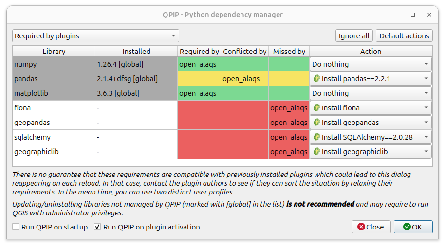
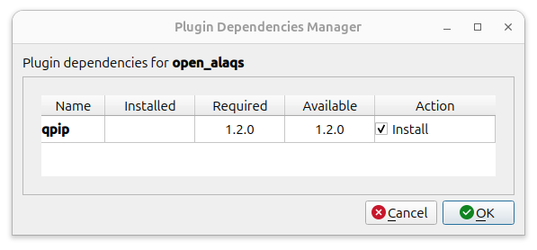

# Open-ALAQS

Open-ALAQS is a QGIS plugin for airport local air quality studies. It builds an emission inventory from the aircraft movements (runways, taxiways, gates, flight profiles, helicopters), the stationary sources (parkings, roadways, point and area sources, engine test sites) of an airport study, and prepares the inputs of the AUSTAL dispersion model.


The [User Guide](documents/USER_GUIDE.md) describes how to build and run a study. What changed in each version is in the [CHANGELOG](CHANGELOG.md).

## Table of contents

- [Installation](#installation)
  - [Install QGIS](#install-qgis)
  - [Install Open-ALAQS](#install-open-alaqs)
  - [Install the dependencies](#install-the-dependencies)
- [Upgrading from an earlier version](#upgrading-from-an-earlier-version)
- [Quick start with the training example](#quick-start-with-the-training-example)
- [What the plugin calculates](#what-the-plugin-calculates)
  - [Aircraft](#aircraft)
  - [Other sources](#other-sources)
  - [Meteorological data](#meteorological-data)
  - [Dispersion with AUSTAL](#dispersion-with-austal)
- [Running without the QGIS interface](#running-without-the-qgis-interface)
- [Documentation](#documentation)
- [Validation](#validation)
- [GSE application](#gse-application)
- [Development](#development)
  - [Code style](#code-style)
  - [Tests](#tests)
  - [Updating the Open-ALAQS database templates](#updating-the-open-alaqs-database-templates)
  - [Debugging](#debugging)
- [Contribute](#contribute)
- [License](#license)
- [Contact](#contact)

## Installation

[(Back to top)](#table-of-contents)

### Install QGIS

Open-ALAQS needs QGIS 3.34 or later (`qgisMinimumVersion` in `open_alaqs/metadata.txt`). Download QGIS from the [QGIS download page](https://qgis.org/download/). On Windows, use the [OSGeo4W installer](https://qgis.org/resources/installation-guide/#osgeo4w-installer) with the *Advanced Install* route; if QGIS was installed otherwise, uninstall it first. During the installation, accept the unmet dependencies and the license agreements.

### Install Open-ALAQS

The plugin is the `open_alaqs/` folder of the repository (the folder with `metadata.txt`), not the repository root.

**From the plugin zip** (`open_alaqs.v<version>.zip` on the [Releases](https://github.com/eurocontrol-asu/open_alaqs/releases) page, not the "Source code" archives): in QGIS, *Plugins → Manage and Install Plugins → Install from ZIP*, select the zip and click *Install Plugin*.

**From a clone of the repository**: copy (or link) the `open_alaqs/` folder into the QGIS plugin directory, so that `metadata.txt` ends up directly in:

- **Windows**: `%APPDATA%\QGIS\QGIS3\profiles\default\python\plugins\open_alaqs\`
- **macOS**: `~/Library/Application Support/QGIS/QGIS3/profiles/default/python/plugins/open_alaqs/`
- **Linux**: `~/.local/share/QGIS/QGIS3/profiles/default/python/plugins/open_alaqs/`

Then enable it in *Plugins → Manage and Install Plugins → Installed* (tick "open_alaqs").

### Install the dependencies

The plugin needs a few Python libraries that QGIS does not ship (`requirements.txt`). The plugin declares the QPIP plugin as a dependency: the first time Open-ALAQS loads, QPIP lists the missing libraries and offers to install them in the QGIS Python environment.





Restart QGIS once after the installation. Open-ALAQS is then in the menu and the toolbar:


Without QPIP, install the libraries with `pip install -r requirements.txt` in the Python environment of QGIS.

<details>
<summary>OSGeo4W manual installation</summary>

Find and install these packages from the OSGeo4W shell:

- `qgis-ltr-full` (3.34.x or newer)
- `python3-fiona`
- `python3-geopandas` (2.x.x)

</details>

## Upgrading from an earlier version

[(Back to top)](#table-of-contents)

Results change between versions, and a study file keeps the schema and the reference tables (engines, aircraft, profiles) of the version that created it. Before recalculating an existing study, read the User Guide:

- [Upgrading from 5.4.0](documents/USER_GUIDE.md#upgrading-from-540): BFFM2 results change; studies need no migration.
- [Upgrading from 5.3.x](documents/USER_GUIDE.md#upgrading-from-53x) (also for 5.0.x to 5.2.x studies): which results change and how to update a study with [`scripts/migrate_alaqs.py`](scripts/README.md#migrate_alaqspy) (or its GUI, `scripts/migrate_alaqs_gui.py`). The script is not in the plugin zip; run it from a checkout of the repository at the version you install.

## Quick start with the training example

[(Back to top)](#table-of-contents)

`example/training/` holds a complete study at Rotterdam The Hague Airport (13 movements over 3 days in December 2025):

| File | Content |
|---|---|
| `training.alaqs` | the study (geometry, sources, study setup), opened with *Load an Open ALAQS project* |
| `training_movements.csv` | aircraft movements |
| `training_meteo.csv` | hourly meteorological data |
| `training_ads_b_data.csv` | ADS-B tracks, imported into the inventory when it is generated |
| `training_engine_test_events.csv` | engine test events for the area source used as a run-up pad (see its `.README.md`) |
| `training_out.alaqs` | the inventory, as produced by *Calculate Emissions Inventory* from the files above |
| `training_validation_reference.xlsx` | reference results, per movement and method, to check an installation |
| `recipe_config.*.json` | example configurations of the standalone pipeline |

The steps of a study:

1. **Build the study** in QGIS: runways, taxiways, taxi routes, gates and the stationary sources ([User Guide, Define emission sources](documents/USER_GUIDE.md#define-emission-sources)).
2. **Generate the inventory** with *Calculate Emissions Inventory*: it combines the study with a movements CSV, a meteorological CSV and, optionally, an ADS-B CSV into an inventory file (`<name>_out.alaqs`).
3. **Calculate emissions** with *Visualize Emission Calculation* on the inventory: choose the method and the period; the emissions are calculated when a table, a time series or a map is requested ([User Guide](documents/USER_GUIDE.md#calculate-emissions-and-query-results)).
4. **Run the dispersion** with *Calculate Dispersion* (AUSTAL), see [Dispersion with AUSTAL](#dispersion-with-austal).

To check an installation, calculate `training_out.alaqs` and compare with `training_validation_reference.xlsx`.

## What the plugin calculates

[(Back to top)](#table-of-contents)

### Aircraft

| Method (GUI) | Standalone name | Fuel flow and emission indices |
|---|---|---|
| ByMode | `bymode` | ICAO EEDB fuel flow and emission indices of each LTO mode (taxi, approach, climb-out, take-off), times the time in mode. Optional ICCAIA NOx correction for ambient conditions on take-off and climb-out (*Apply NOx Corrections*, `bymode_nox_corr`). |
| BFFM2, fuel-flow source *trajectory* | `bffm2_traj` | Fuel flow of each profile segment from its thrust share, scaled to ambient conditions; BFFM2 (SAE AIR5715) emission indices of NOx, CO and HC at that fuel flow, with the ambient corrections. |
| BFFM2, fuel-flow source *mode_anchor* | `bffm2_anchor` | As above, with the EEDB fuel flow of the segment's mode. |

- **Ambient conditions aloft** (*Atmosphere Aloft*, 5.4.1): each flight segment uses the temperature, pressure and humidity at its height, derived from the hourly meteorological row (`standard_lapse` by default, `surface_layer` or `ground_held`), see [`ATMOSPHERE_ALOFT.md`](documents/ATMOSPHERE_ALOFT.md).
- **Particulate matter**: nvPM from the certified EEDB values in the LTO cycle and MEEM V1 above 3,000 ft; volatile PM (sulphate and organic) and brake wear after FOA3 (see the [PM10 output columns](documents/USER_GUIDE.md#pm10-output-columns)). Aircraft SOx comes from the fuel sulphur content.
- **Helicopters**: a movement whose aircraft type is in the helicopter catalog follows the FOCA 2015 method with its own trajectories, whatever the method chosen; no APU, engine start or gate emissions are computed for it, and its ground idle is counted ([User Guide, Helicopters](documents/USER_GUIDE.md#helicopters-foca-2015)).
- **Taxiing, gate (GSE, GPU), APU and engine start** emissions of fixed-wing movements come from the taxi route, the gate and the movement's APU and gate settings.

Details: [`BFFM2.md`](documents/BFFM2_validation/BFFM2.md), [`FUEL_FLOW_OPTIONS.md`](documents/FUEL_FLOW_OPTIONS.md).

### Other sources

Parkings and roadways (COPERT 5 emission factors), point and area sources (emission factors with activity profiles) and engine test sites: an area source marked as a test site takes its emissions from a list of test events instead of its emission factors ([User Guide, Engine test sites](documents/USER_GUIDE.md#engine-test-sites)). The buildings layer is not used in the calculation yet.

### Meteorological data

*Calculate Emissions Inventory* reads an hourly meteorological CSV (temperature, pressure, humidity, wind, stability, mixing height; format in the [User Guide](documents/USER_GUIDE.md#meteorology)). [`scripts/metar_to_alaqs_meteo.py`](scripts/README_metar_to_alaqs_meteo.md) builds that file from METAR observations (raw METAR, IEM CSV or Ogimet); fetching the observations is left to the user.

### Dispersion with AUSTAL

*Calculate Dispersion* writes the AUSTAL input files from an inventory (sources, hourly emissions, meteorology, grid, receptors), runs AUSTAL and plots the results as a layer. AUSTAL itself is installed separately ([`AUSTAL.md`](documents/AUSTAL/AUSTAL.md)); the dialog is described in [`AUSTAL_OPERATION.md`](documents/AUSTAL/AUSTAL_OPERATION.md). The default site parameters are z0 = 0.1 m (the TA Luft value for airports), d0 = 6 z0 and ha = 10 m + d0; how to choose them is in the [User Guide](documents/USER_GUIDE.md#roughness-length-displacement-height-and-anemometer-height).

## Running without the QGIS interface

[(Back to top)](#table-of-contents)

- **QGIS-free pipeline** ([`openalaqs_standalone/`](openalaqs_standalone/README.md)): computes the aircraft emissions of an inventory file, spreads the stationary emissions over the year, and builds the AUSTAL inputs without QGIS, PyQt or SpatiaLite (pyproj, shapely, numpy, pandas). It gives the plugin's results and runs from the repository root, for batch, server or cluster runs. Commands and options: [`USAGE.md`](openalaqs_standalone/USAGE.md); the AUSTAL writer is in [`austal_prep/`](austal_prep/).
- **Scripts using the plugin's code** (run with the QGIS Python), listed in [`scripts/README.md`](scripts/README.md):
  - [`scripts/emissions_austal/`](scripts/emissions_austal/README.md): emissions of an inventory and, optionally, the AUSTAL inputs, in one run;
  - [`scripts/austal_from_csv/`](scripts/austal_from_csv/README.md): AUSTAL inputs from emission and meteorological CSVs, without a `.alaqs` file;
  - [`scripts/import_engine_test_events.py`](scripts/README.md#import_engine_test_eventspy): engine test events from a CSV, for several sources at once;
  - [`scripts/migrate_alaqs.py`](scripts/README.md#migrate_alaqspy): update a study made with an earlier version.

## Documentation

[(Back to top)](#table-of-contents)

| Document | Content |
|---|---|
| [`USER_GUIDE.md`](documents/USER_GUIDE.md) | building and running a study, input formats, upgrading |
| [`AUSTAL/AUSTAL.md`](documents/AUSTAL/AUSTAL.md), [`AUSTAL/AUSTAL_OPERATION.md`](documents/AUSTAL/AUSTAL_OPERATION.md) | AUSTAL installation and the *Calculate Dispersion* dialog |
| [`ATMOSPHERE_ALOFT.md`](documents/ATMOSPHERE_ALOFT.md) | ambient conditions at the height of each flight segment |
| [`BFFM2_validation/BFFM2.md`](documents/BFFM2_validation/BFFM2.md), [`FUEL_FLOW_OPTIONS.md`](documents/FUEL_FLOW_OPTIONS.md) | the BFFM2 method and the fuel flow of the trajectory method |
| [`HELICOPTER_TRAJECTORIES.md`](documents/HELICOPTER_TRAJECTORIES.md) | FOCA 2015 helicopter trajectories and their sources |
| [`VALIDATION_GUIDE.md`](documents/VALIDATION_GUIDE.md) | how the results are validated and how to reproduce it |
| [`AIRCRAFT_PROFILES_PROVENANCE.md`](documents/AIRCRAFT_PROFILES_PROVENANCE.md), [`DATASET_PROVENANCE.md`](documents/DATASET_PROVENANCE.md) | origin of the reference data |
| [`AUXILIARY_MATERIAL.md`](documents/AUXILIARY_MATERIAL.md) | background of the User Guide: database, ANP, BFFM2, AUSTAL, COPERT, smooth and shift |
| [`TEST_CASE_STUDY.md`](documents/TEST_CASE_STUDY.md) | a worked test case study |
| [Training course (PDF)](documents/Airport%20Local%20Air%20Quality%20Studies%20with%20OpenALAQS%20-%20Training%20Course.pdf) | the training course material |

## Validation

[(Back to top)](#table-of-contents)

- The BFFM2 emission-index step is checked against two cases of the CAEP validation (EUROCONTROL's CAEP/14 engine-emissions calculation, `tests/test_caep14_sheet_reference_case.py`), and MEEM V1 against the MEEM_V1 tab of the CAEP14 calculation sheet v14 (`tests/test_meem_v1.py`).
- The CAEP validation does not cover how the fuel flow is derived from the profile. For the whole calculation (every method, the NOx correction and the helicopters), the plugin, the QGIS-free pipeline and the project's CAEP14 reference implementation (`compute_caep14_reference.py`) agree movement by movement on the training studies.

See [`VALIDATION_GUIDE.md`](documents/VALIDATION_GUIDE.md) and [`CAEP14_VALIDATION.md`](openalaqs_standalone/validation/tools/CAEP14_VALIDATION.md).

## GSE application

[(Back to top)](#table-of-contents)

A separate utility for ground support equipment (GSE) emissions is in `gse_application/` (`python3 gse_application/gse.py`), see [`gse_application/README.md`](gse_application/README.md).

## Development

[(Back to top)](#table-of-contents)

### Code style

`pre-commit` runs autoflake, isort, black and flake8 on each commit:

```bash
pip install pre-commit
pre-commit install
pre-commit run --all-files
```

### Tests

From the repository root, with QGIS on the Python path (the QGIS-free pipeline's tests need only its own dependencies):

```bash
QT_QPA_PLATFORM=offscreen PYTHONPATH=$PWD python3 -m pytest              # plugin and standalone suites
QT_QPA_PLATFORM=offscreen PYTHONPATH=$PWD python3 -m pytest --run-slow   # including the slow tests
```

CI runs the suites in the QGIS Docker images 3.40 and 3.44 (`.github/workflows/test.yaml`). `tests/data/` holds the test studies: `AIRPORT_A/` is an earlier version of the training study (11 taxiways, its own movements) with pre-computed outputs; its two comparison spreadsheets date from 5.0.0 and do not reflect the current results.

### Updating the Open-ALAQS database templates

New studies are copies of `open_alaqs/core/templates/project.alaqs`, new inventories of `inventory.alaqs`. Both are built by `tools/template_build/generate_templates.py` from the SpatiaLite scaffold, the SQL scripts in `tools/template_build/sql/` and the reference data in `open_alaqs/database/data/*.csv`; see [`tools/template_build/README.md`](tools/template_build/README.md). A change to the schema needs a matching change to `scripts/migrate_alaqs.py` users can run on their studies.

### Debugging

Use the QGIS Python console (*Plugins → Python Console*), or the QGIS Dev Tools plugin (debugpy) to attach VS Code or PyCharm.

## Contribute

[(Back to top)](#table-of-contents)

Contributions are welcome. Please open an issue to discuss substantive changes before submitting a pull request; small fixes (typos, documentation, missing tests) can go directly to a pull request. In a pull request:

- run the test suite and `pre-commit run --all-files`;
- add a regression test for any change of behaviour;
- reference the issue number.

## License

[(Back to top)](#table-of-contents)

This software is published under the European Union Public Licence v. 1.2 ([`LICENCE.md`](LICENCE.md)) with the amendments described in [`AMENDMENT_TO_EUPL_license.md`](AMENDMENT_TO_EUPL_license.md), reflecting EUROCONTROL's status as an international organisation.

## Contact

[(Back to top)](#table-of-contents)

For questions, bug reports or feature requests, write to [open-alaqs@eurocontrol.int](mailto:open-alaqs@eurocontrol.int) or open an [issue](https://github.com/eurocontrol-asu/open_alaqs/issues).
