# OpenALAQS User Guide

## Table of Contents
- [OpenALAQS User Guide](#openalaqs-user-guide)
  - [Table of contents](#table-of-contents)
  - [Introduction](#introduction)
    - [General Information](#general-information)
    - [Installation](#installation)
  - [Upgrading from 5.3.x](#upgrading-from-53x)
  - [The OpenALAQS Toolbar](#the-openalaqs-toolbar)
  - [Starting a Study](#starting-a-study)
    - [Setup a new study](#setup-a-new-study)
    - [Open an existing study](#open-an-existing-study)
    - [Import OpenStreetMap data](#import-openstreetmap-data)
  - [Define emission sources](#define-emission-sources)
    - [Add Features](#add-features)
    - [Edit Features](#edit-features)
    - [Delete Features](#delete-features)
    - [Visualize and Edit Attribute Values](#visualize-and-edit-attribute-values)
    - [Aircraft related Sources](#aircraft-related-sources)
      - [Gates](#gates)
      - [Runways](#runways)
      - [Taxiways](#taxiways)
      - [Tracks](#tracks)
    - [Stationary Sources](#stationary-sources)
      - [Parking Lots](#parking-lots)
      - [Roadways](#roadways)
      - [Point sources](#point-sources)
      - [Area sources](#area-sources)
      - [Engine test sites](#engine-test-sites)
      - [Buildings](#buildings)
  - [Activity Profiles](#activity-profiles)
    - [Worked example — defining and using named profiles](#worked-example--defining-and-using-named-profiles)
  - [Generate Emissions Inventory](#generate-emissions-inventory)
    - [Taxi routes](#taxi-routes)
    - [Create output file](#create-output-file)
    - [Movements table](#movements-table)
    - [Helicopters (FOCA 2015)](#helicopters-foca-2015)
    - [Meteorology](#meteorology)
  - [Calculate emissions and query results](#calculate-emissions-and-query-results)
  - [Dispersion modeling with AUSTAL](#dispersion-modeling-with-austal)
    - [Input data](#input-data)
    - [Running AUSTAL](#running-austal)
    - [Output data](#output-data)
    - [Visualize results](#visualize-results)
<!-- [FAQs](#faqs) -->
<!-- [Contact](#contact) -->

## [Introduction](#introduction)
[(Back to top)](#table-of-contents)

Welcome to the `OpenALAQS` user guide. This document will help you navigate the key features of the software, including setting up a study, emissions & dispersion calculations and exporting results in various formats.

### [General Information](#general-information)

OpenALAQS is a [`EUROCONTROL`](https://www.eurocontrol.int/) open-source tool designed to model and analyze emissions from aircraft operations and various airport sources. It can calculate emission inventories, visualize data, and perform dispersion modeling with the help of [`AUSTAL`](https://www.umweltbundesamt.de/en/topics/air/air-quality-control-in-europe/overview).

It is developed as a plugin for the open-source geographic information system [`QGIS`](https://qgis.org/), simplifying the definition of various airport elements (such as runways, taxiways, and buildings) and enabling the visualization of the spatial distribution of emissions and concentrations. It is fully based on an open architecture, making it easily adaptable to other GIS platforms and databases.

### [Installation](#installation)

For installation instructions, check the [`Installation Instructions`](../README.md#installation).

## [Upgrading from 5.3.x](#upgrading-from-53x)
[(Back to top)](#table-of-contents)

This section is for users who open a study made with OpenALAQS 5.3.x in this version. The full list of changes is in the [`CHANGELOG`](../CHANGELOG.md).

### Results that change

Recalculate a study after the upgrade if any of these applies to it:

| Change | Studies affected |
|---|---|
| Runway placement of ANP profiles: arrivals touch down at the landing threshold plus the runway's **Touchdown Offset** (else the profile's own 50 ft crossing), departures start their take-off roll where the taxi route last meets the runway (see [Runways](#runways)) | every study with ANP arrivals or departures |
| The **Touchdown Offset** of the first-named runway end (`touchdown`) was stored but not used; it is now used, and the second end has its own offset (`touchdown_2`) | studies with a non-zero `touchdown` |
| Arrival `runway_time` is the touchdown (A-CDM ALDT); the landing roll of the profile is taken out of the arrival taxi time (block time minus runway time) | every study with arrivals; check how `runway_time` was filled in |
| A movement whose taxi time comes out at 0 s (block time equal to runway time, or an arrival whose block to runway time is no longer than its landing roll) keeps its APU, stop-and-go and brake-wear emissions; only the route and queuing get no time. It lost all its taxi emissions before | studies with such movements |
| Aircraft SOx comes from the fuel sulphur: 0.758 g/kg for jet fuel, 0.2 g/kg for AvGas (it was 0) | every study with aircraft |
| BFFM2 segment Mach is TAS / a, with a = √(γ R T) | `BFFM2` studies with meteo away from ISA |
| MEEM V1 nvPM above 3000 ft above the aerodrome follows the CAEP14 calculation sheet v14 (OPR from `press_ratio`, ISA + ΔT) | hours whose `MixingHeight` is above 914.4 m |
| The NOx ambient correction (**Apply NOx Corrections**, bymode) applies to take-off and climb-out segments only; it was applied to every flight segment | bymode with the correction on: arrival NOx goes up |
| **In Study** (parkings, roadways, point and area sources) is saved from the form; a source drawn through the form in 5.3.x got an empty flag and was left out of the calculation, and unticking the box saved nothing | studies with sources created or edited through the form |
| **Engine Test Site** (area sources) is saved from the form; ticking or unticking it had no effect | studies with engine test sites |
| The airport altitude of aircraft movements (NOx correction, MEEM V1) comes from the study's airport elevation (`user_study_setup`), not from the grid reference altitude | studies where the two differ |
| A taxi route is oriented by its own gate, not by the gate of the first movement that uses it | studies where movements use a route defined for another gate |
| Engine data (`default_aircraft_engine_ei`): FOCA engines from ACT_PRF 2.6.3 (B601 to B603 PM10; turboprops T601, T602, T603, T717 and T790 now jet fuel, SOx 0.758 g/kg), 1ZM001 taxi values (were 0), OPR and 5th nvPM point for MEEM V1 | studies with these engines, once the engine table is refreshed (see below) |
| Standalone `austal`: receptors are clipped to the study grid (they were clipped to a 75 x 250 m square, which dropped receptors inside a larger grid); the UTM zone is the plugin's; the AUSTAL reference point is the grid reference, not the airport | standalone runs with receptors outside that square, in the southern hemisphere or on a zone boundary, or with the grid reference away from the airport |
| `scripts/emissions_austal`: `smooth & shift` and `should_apply_nox_corrections` are read as documented (they could be ignored before) | runs of that script with these settings |

### A study keeps its own engine, aircraft and profile tables

A project `.alaqs` carries its own copies of the reference tables, among them `default_aircraft`, `default_aircraft_engine_ei` and `default_aircraft_profiles`. **Calculate Emissions Inventory** copies them from the open project into every new inventory (`create_output.inventory_copy_aircraft`, `inventory_copy_aircraft_engine_ei`, `inventory_copy_aircraft_profiles`); the inventory template has none. A study made with 5.3.6 therefore keeps the 5.3.6 engine data after the upgrade:

+ `press_ratio` and the 5th nvPM point are empty, so MEEM V1 uses OPR 30 above 3000 ft;
+ the old FOCA rows (B601 to B603 PM10, turboprops as AvGas) and 1ZM001 with fuel flow and EIs 0 in taxi;
+ `nvpm_number_ei` in #/s instead of #/kg (no output column carries nvPM number).

Only a 0 or empty `sox_ei` is replaced at run time (by 0.758 g/kg for jet fuel, 0.2 g/kg for AvGas, from the row's `fuel_type`).

### How to update a study

1. For a new study, create a new project (**Create an Open ALAQS project**): it is made from the template of this version and has the current tables.
2. For an existing study, update the `.alaqs` with `scripts/migrate_alaqs.py`. The script is not in the plugin zip: run it with Python 3 from a checkout of the repository at this version (it reads the templates and CSVs of that checkout). Close the study in QGIS first. The script writes a backup (`<name>.bak-<timestamp>.alaqs`) unless `--no-backup` is given.
   + Schema only (adds `touchdown_2`, `engine_test_events`, `is_test_site` and the other missing tables and columns, empty, and the three named point-source profiles `heating_season`, `cooling_season` and `business_hours`; converts the numeric columns of the layers to `REAL`, see below):
     ```bash
     python scripts/migrate_alaqs.py study.alaqs
     ```
     The numeric columns of the layers (height, speed, distance, idle time, temperature, diameter, velocity, the fleet percentages, the emission factors, ...) were declared `DECIMAL` in 5.3.x. QGIS types such a column from the values it holds: whole numbers made it an integer field, so a decimal typed in a form was rounded (2.5 saved as 3, or 25 under a German locale), and an empty layer made it a text field, so the typed text was stored as it was ("30,3"). The script rebuilds these tables with `REAL` columns (the values are kept; a text value that reads as a number becomes that number) and reports, as `WARNING: <table> rowid <n>, column <c>: '...' is not a number; left as text`, any text it cannot read as a number, for you to correct in QGIS. A study that still has the old columns is reported in the log when it is opened ("Upgrade the study with scripts/migrate_alaqs.py"); it opens and calculates as before, and the forms check a number as QGIS saves it in that study (2.5 is checked, and saved, as 3 in an integer column).
   + Schema and the engine table (replaces every row of `default_aircraft_engine_ei`, including rows you added or edited):
     ```bash
     python scripts/migrate_alaqs.py study.alaqs --refresh-reference-data --refresh-tables default_aircraft_engine_ei
     ```
   + Schema and all reference tables, including the user-extensible ones (`default_aircraft`, `default_aircraft_engine_ei`, `default_aircraft_profiles`, `default_aircraft_apu_ef`, `default_aircraft_start_ef`, `default_gate_profiles`, `default_helicopter`, `default_helicopter_engines`):
     ```bash
     python scripts/migrate_alaqs.py study.alaqs --refresh-reference-data --refresh-include-user-extensible
     ```
     This overwrites every row you added or edited in those tables, CUSTOM (ADS-B) profiles stored in the project's `default_aircraft_profiles` included (see [`scripts/README.md`](../scripts/README.md#migrate_alaqspy)). Add `--dry-run` to see the plan first.
3. Check **Touchdown Offset, Runway 1 [m]** and **Touchdown Offset, Runway 2 [m]** of each runway (`touchdown_2` is empty after the migration: each arrival profile's own distance), **In Study** of the stationary sources and **Engine Test Site** of the area sources.
4. Generate the inventory again (**Calculate Emissions Inventory**) with the ADS-B file, if any: the ADS-B tracks are imported into the new inventory, and at an airport with a non-zero elevation the points of the take-off roll and of the landing are now set to the ground (height 0).
5. Recalculate (**Visualize Emission Calculation**).

## [The OpenALAQS Toolbar](#the-openalaqs-toolbar)
[(Back to top)](#table-of-contents)


The toolbar consists of the following functions (the names are the button tooltips):

+ **About Open ALAQS**: General information about the current OpenALAQS version.
+ **Create an Open ALAQS project**: Create a new OpenALAQS project.
+ **Load an Open ALAQS project**: Open an existing OpenALAQS project.
+ **Close all Open ALAQS projects**: Close the current project.
+ **Airport Study Setup**: Contains general information about the study (window `ALAQS Project Properties`).
+ **Import OSM data**: Download and import data from OpenStreetMap (OSM).
+ **Edit profiles**: Create activity profiles (hourly, daily, monthly; window `Open ALAQS - Activity Profiles`).
+ **Define taxi routes**: Create taxi routes based on user-defined airport elements (gates, runways, taxiways; window `Taxiway Routes Editor`).
+ **Calculate Emissions Inventory**: Prepares the OpenALAQS output file containing all study data (window `Generate Emission Inventory`).
+ **Visualize Emission Calculation**: Manages the emissions calculation, visualization, and export modules (window `Emission Inventory Analysis`).
+ **Calculate Dispersion**: Handles the dispersion calculation module (window `AUSTAL Dispersion Analysis`).
+ **Review Open ALAQS logs**: Opens the log file containing useful information about code execution. A warning is written when an ADS-B fuel flow per engine exceeds 1.5 times the EEDB take-off fuel flow (the mode-anchor fuel flow is then used for those segments), at ADS-B import for each flight with `fuel_flow` points below the ICAO idle fuel flow of its engine (the values are kept), and when an arrival's taxi route leaves the runway above 50 kt or meets the runway only before the touchdown. An OSM import logs the number of buildings added and where their heights come from, and warns about imported gate names that are already in the Gates layer or repeated in the import.

The order of the toolbar buttons generally follows the sequence of steps needed to conduct a study using OpenALAQS.

## [Starting a Study](#starting-a-study)
[(Back to top)](#table-of-contents)

This section describes the initial steps required to create an OpenALAQS study.

### [Setup a new study](#setup-a-new-study)
To create a new project, click on the **Create an Open ALAQS project** button in the OpenALAQS toolbar. This action opens a pop-up window named `Create an Open ALAQS project file`, where the user is required to select a `File name` for saving the new study (`.alaqs`).

After creating a project, the `ALAQS Project Properties` window opens automatically. In this window (tab `Airport`), the user must provide a project name and at least the ICAO code of the airport. The remaining fields (airport name, country, latitude, longitude, etc.) will be automatically filled based on the information in the internal database (see `default_airports.csv`). However, the user can manually edit this default information if needed.

<p align="center">
  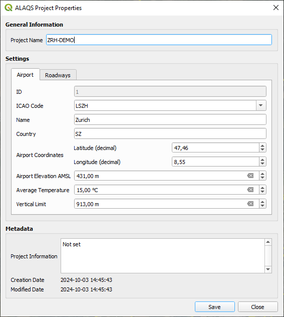
  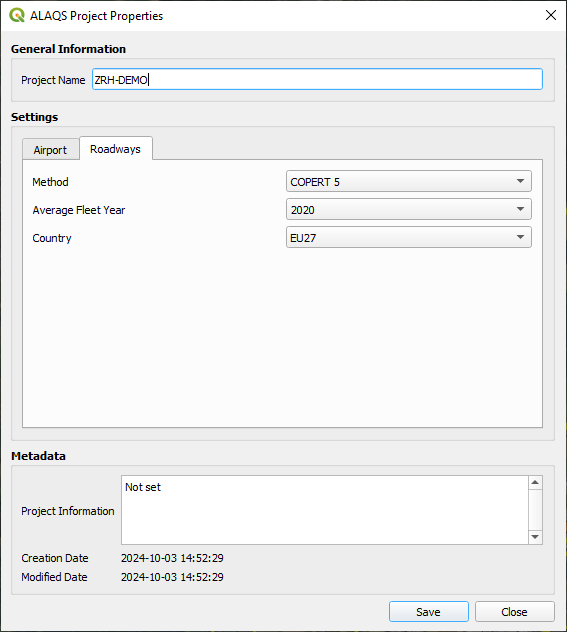
</p>

The second tab (`Roadways`) contains the settings for calculating road traffic emissions with [`COPERT`](https://copert.emisia.com/). Users are required to specify the average fleet year (values range from 1990 to 2030 in steps of 5) and select a country for country-specific emissions factors (or alternatively EU27). It should be noted that the average fleet year should be viewed as a proxy between the average fleet age and the Euro 1, Euro 2, Euro 3, Euro 4, Euro 5, and Euro 6 vehicle emission standards.

The `ALAQS Project Properties` window can also be accessed by clicking on the **Airport Study Setup** button in the OpenALAQS toolbar.

### [Open an existing study](#open-an-existing-study)
To open a previously created project, click on the **Load an Open ALAQS project** button in the OpenALAQS toolbar. This action opens a pop-up window (`Open an ALAQS database file`), allowing you to select an existing OpenALAQS database (`.alaqs`) file.

### [Import OpenStreetMap data](#import-openstreetmap-data)
An additional functionality is added to OpenALAQS to facilitate the creation of emission sources based on the geographic data (roads, buildings, points of interest, and more) provided by OpenStreetMap.

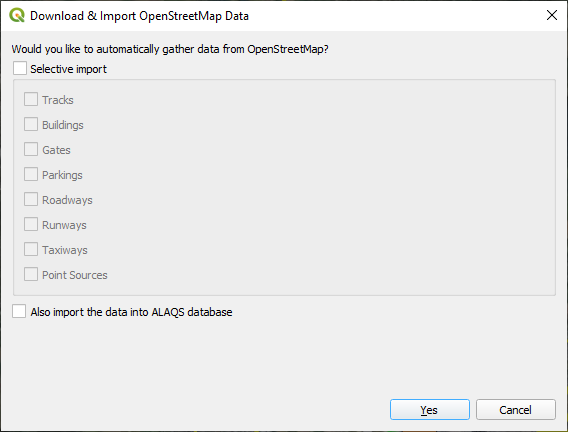

Using Nominatim, a search engine that uses the data from OpenStreetMap to provide geocoding (address to coordinates), directly from the OpenALAQS toolbar the user can select and import airport related geographical data to the study. The image below illustrates the information that can be collected from OpenStreetMap.

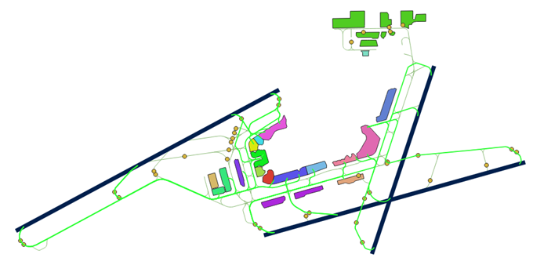

The log reports the number of buildings imported and where their heights come from: the OSM `height` column when the feature has one, else the layer default (0 m). With the bundled OSM reader configuration the `height` tag is not exposed as a column, so imported buildings get 0 m; enter the heights by hand.

Gate names come from the OSM `ref` tag of the aprons. When an imported name is already in the Gates layer, or occurs twice in the import, the log warns with the names, for example `OSM import: gate name(s) already in layer "Gates": G7; check and rename before calculating.` The features are imported as they are. Rename or delete the duplicates before calculating: movements refer to gates by name, and with two gates of the same name the calculation uses only one of them.

## [Define emission sources](#define-emission-sources)
[(Back to top)](#table-of-contents)

### [Add Features](#add-features)
New objects can be added using the `Digitizing` toolbar.


More information on how to use this toolbar is provided in the [`QGIS User Manual`](https://docs.qgis.org/3.34/en/docs/user_manual/working_with_vector/editing_geometry_attributes.html#digitizing-an-existing-layer).

To create a new emission source, select the desired layer (e.g., taxiway or runway) to activate it and click `Toggle Editing` in the `Digitizing` toolbar. Then click `Add Feature` to start designing the new feature. Once finished, right click and fill the attribute fields in the pop-up window.

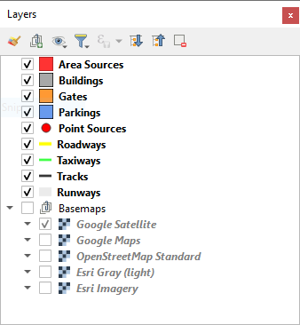

### [Edit Features](#edit-features)
Using the `Digitizing` toolbar in editing mode (`Toggle Editing`), it is possible to employ the `Vertex Tool` to edit objects.

### [Delete Features](#delete-features)
To delete one or more features, first select the geometry using the `Selection` toolbar (_Select Features by area or single click_) and use the `Delete Selected` tool to delete the feature(s). Multiple selected features can be deleted at once. Selection can also be done from the Attributes table.

### [Visualize and Edit Attribute Values](#visualize-and-edit-attribute-values)
Attribute values can also be modified after an object's creation via the `Attributes` toolbar.


The `Open Attribute Table` functionality can be accessed through the `Attributes` toolbar or via the `Layers` panel (by right-clicking on the appropriate layer).

The attribute table uses the same field names as the forms and this guide (for example **Touchdown Offset, Runway 1 [m]** or **Vehicles per Year**); the database column names are unchanged. The internal **OID** column is hidden. **In Study** is the last column, shown as true / false: on parkings, roadways, point sources and area sources it is also a check box in the form, right under the name (unticked sources are left out of the emission calculation); it is hidden on the other layers, which do not use it. New features start with the defaults of the forms: heights and offsets 0, profiles `default`, **Gate Type** PIER and **In Study** ticked.

### [Aircraft related Sources](#aircraft-related-sources)
Calculating aircraft emissions requires the definition of three distinct layers: runways, taxiways, gates. For each of these features, the user must provide the required attributes. Defining Tracks (i.e., aircraft trajectories) is also possible; however, this functionality is `not yet fully implemented`.

#### [Gates](#gates)
An airport gate refers to a designated location at an airport where aircraft park for boarding and disembarking passengers, loading/unloading cargo, and receiving services like refuelling, catering, and maintenance.

In OpenALAQS, gates are represented as polygons. Each gate can encompass several aircraft stands. The more stands grouped together within a single gate area, the less data preparation is needed (e.g., fewer taxi routes to define). However, if the gate area is too large, it might no longer accurately represent the location of the emissions.

Calculating gate emissions requires establishing the sum of four emission sources: GSE (Ground Support Equipment), GPU (Ground Power Unit), APU (Auxiliary Power Unit) and MES (Main Engine Start).

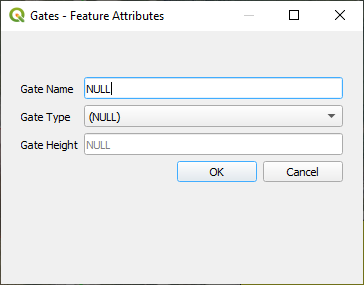

When adding a gate, the following information is required:
+ **Gate Name**
+ **Gate Type** (PIER, REMOTE or CARGO)
+ **Height [m]** `not yet fully implemented`

Gate names should be unique: movements refer to gates by name, and with two gates of the same name the calculation uses only one of them. When another gate already has the name, the form colours the **Gate Name** box yellow and its tooltip says so; the gate can still be saved.

In OpenALAQS, GSE and GPU emission factors, expressed in terms of grams of pollutant per hour, are assigned to each gate as a function of:
+ The gate type (PIER, REMOTE or CARGO)
+ The aircraft category (JET BUSINESS/REGIONAL/SMALL/MEDIUM/LARGE, TURBOPROPS, PISTON)
+ The operation type (Arrival or Departure)

More information on the corresponding GSE/GPU, APU and MES emission factors and activity time is available in [`OpenALAQS database`](AUXILIARY_MATERIAL.md#openalaqs-database).

#### [Runways](#runways)

Runways are linear features that define the vertical plane where approach, landing, take-off, and climb-out operations occur. Each end of the runway is designated as a specific runway, depending on the direction of movement.

When adding a runway, the following information can be given:
+ **Runway Name**: built from the runway ends chosen in the form (Runway 1 and the opposite Runway 2, for example 06/24).
+ **Touchdown Offset, Runway 1 [m]**: distance from the Runway 1 end (its landing threshold) to the touchdown of arrivals landing on Runway 1. Empty or 0: each arrival profile's own distance, i.e. where the profile descends through 50 ft (15.24 m, the ILS reference datum height), about 290 m before touchdown on a 3° approach.
+ **Touchdown Offset, Runway 2 [m]**: the same for Runway 2, independently of Runway 1. Empty or 0: each arrival profile's own distance.

Both offsets are whole metres (the form accepts integers only).

Draw the runway along the full pavement, from one end to the other (the drawing direction does not matter). The touchdown offset is measured from the drawn end: where the landing threshold is displaced, enter the displacement plus about 290 m; otherwise leave it empty (the profile's own 50 ft crossing, about 290 m). A profile that never descends through 50 ft touches down at the drawn end. Departures line up where their taxi route last meets the runway (see below), not at the drawn end.

Each offset is measured from its own landing threshold, along the landing direction, and applies to that direction only: for the same touchdown on both ends, enter the value in both fields.

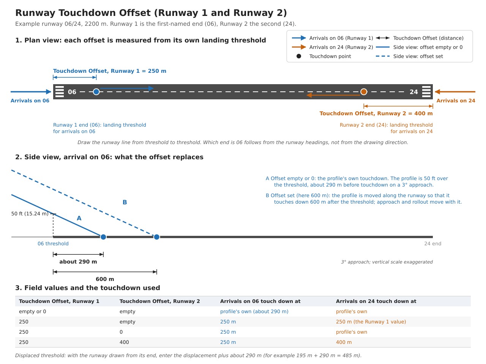

**Placement of the flight profiles on the runway.** The taxi route does not move the flight profile; it is checked against it.
+ Arrivals (ANP profiles) touch down at the landing threshold plus the Touchdown Offset. The aircraft leaves the runway at the first point where its taxi route meets the runway past the touchdown at 50 kt or less (ICAO Doc 9157 Part 2: rapid-exit reference speed); if no crossing is that slow, at the first one past the touchdown. When that exit comes before the end of the profile's rollout, the rollout ends there. When it comes after, the aircraft rolls on along the runway to the exit; that stretch is taxiing (from the rollout-end speed down to at most 18 kt).
+ Departures (ANP profiles) start their take-off roll where the taxi route last meets the runway (the line-up point); a route that runs along the runway (backtracking) lines up where it leaves it.
+ ADS-B (CUSTOM) profiles keep their own positions.
+ Taxi routes are read in the direction of travel, whichever way round their taxiways are listed (stand to runway or runway to stand); the taxiways must still be listed in sequence: from the stand for a departure, to the stand for an arrival.

Nothing blocks the calculation. An exit above 50 kt, or a route that meets the runway only before the touchdown, is reported in the log. The standalone tool also writes a check report (`runway_checks.csv`), one line per route and profile with what to change.

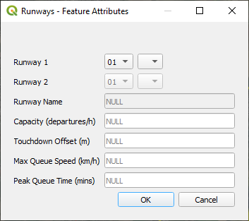

Airport runways are named based on their compass heading, rounded to the nearest 10 degrees. Since runways can be used in both directions, each end has a different number, differing by 18 (180 degrees). Parallel runways may be further differentiated by letters L (Left), C (Center), or R (Right).

The runway emissions are calculated based on the aircraft trajectories (profiles) provided in the [`Aircraft Noise and Performance`](https://www.easa.europa.eu/en/domains/environment/policy-support-and-research/aircraft-noise-and-performance-anp-data) (ANP) database. For more information, see the [`ANP`](AUXILIARY_MATERIAL.md#anp) section.

#### [Taxiways](#taxiways)

An airport taxiway is a designated path that connects runways with terminals, gates, or other parts of the airport. When adding a taxiway in an OpenALAQS study, the following information is mandatory:
+ **Taxiway Name**
+ **Speed [km/h]**

The time spent on a taxiway is not entered: it is calculated from the taxiway length and **Speed [km/h]**.

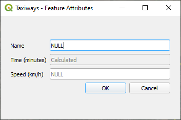

The length of each taxiway is calculated automatically from its geometry and the time spent on it is calculated from the indicated speed and length. Recommended taxiing speeds vary in relation to ambient conditions, traffic, and aircraft position on the taxi route. Typical taxiing speeds lie between 10 and 40 km/h (~5 and ~25 kts).

It is important to distinguish between taxiways and taxi-routes. Taxi-routes describe the operational path that will be followed by an aircraft for a runway / stand / movement type (arrival or departure) combination. Taxi-routes are defined as a series of taxiway segments in OpenALAQS. The process of defining taxi routes is detailed in the [`Test Case Study`](TEST_CASE_STUDY.md#taxi-routes).

#### [Tracks](#tracks)

Aircraft tracks define custom aircraft trajectories. When adding aircraft tracks, the following information is mandatory:
+ **Track Name**
+ **Runway Direction** (from the list of previously defined runways)
+ **Operation Type** (Arrival or Departure)

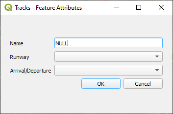

Standard departure and approach trajectories are taken from ANP fixed-point profiles (see `profile_id` in the Movements table). Alternatively, ADS-B-derived profiles can be used by setting `profile_id` to a profile with `course = CUSTOM` in `default_aircraft_profiles`. In CUSTOM profiles, the `x_m` and `y_m` coordinates are East/North geodesic offsets from the runway intersection rather than along-runway distances, and the optional `fuel_flow_kgm` column carries the estimated total-aircraft ambient fuel flow (kg/s) used by BFFM2. See the [`Auxiliary Material`](AUXILIARY_MATERIAL.md#aircraft-trajectories) for details.

### [Stationary Sources](#stationary-sources)
[(Back to top)](#table-of-contents)

For non-aircraft emissions four additional emission sources can be considered: point sources, roadways and parking lots, area sources, buildings. For each feature, the user must input the required attributes.

#### [Parking Lots](#parking-lots)

Emissions from parking areas for vehicles are estimated based on the [`COPERT`](AUXILIARY_MATERIAL.md#copert) methodology.

When adding an airport parking lot, the following information is required:
+ **Parking Name**
+ **Parameters**
  + **Vehicles per Year**: Total number of vehicles per year
  + **Height [m]**: Height at which emissions are released `not yet fully implemented`
  + **Speed [km/h]**: Average travel speed in parking
  + **Travel Distance [m]**: Average travel distance in parking
  + **Idle Time [min]**: Vehicle average idling time between entry and exit
+ **Profiles**
  + **Hourly Profile**, **Daily Profile** and **Monthly Profile** (activity profiles)
+ **Fleet mix**
  + **PC (Petrol) [%]**: Passenger Cars (Petrol)
  + **PC (Diesel) [%]**: Passenger Cars (Diesel)
  + **LCV (Petrol) [%]**: Light Commercial Vehicles (Petrol)
  + **LCV (Diesel) [%]**: Light Commercial Vehicles (Diesel)
  + **HDT (Petrol) [%]**: Heavy Duty Trucks (Petrol)
  + **HDT (Diesel) [%]**: Heavy Duty Trucks (Diesel)
  + **Motorcycle [%]**
  + **Bus [%]**

<p align="center">
  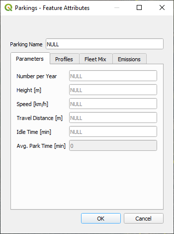
  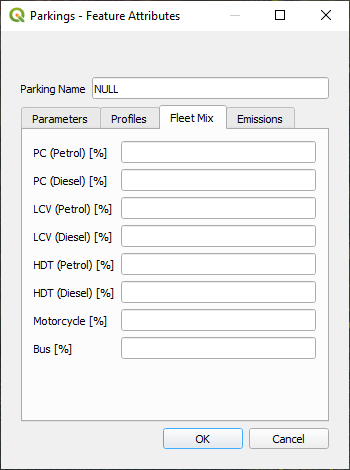
  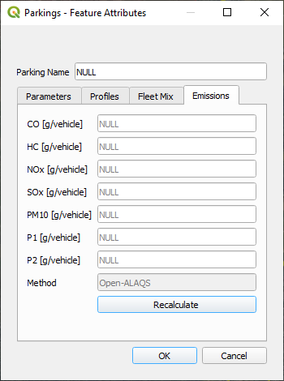
</p>

The user should ensure that the fleet mix totals 100% (see the `Fleet Mix` tab). Custom emission factors are calculated (using the `Recalculate` button in the `Emissions` tab) for each parking area using [`COPERT`](AUXILIARY_MATERIAL.md#copert) version 5.4.52, based on the parameters indicated above, as well as the average fleet year and country specified at the beginning of the study setup.

The emission factors (**CO [g/vehicle]**, **HC [g/vehicle]**, **NOx [g/vehicle]**, **SOx [g/vehicle]**, **PM10 [g/vehicle]**, **P1 [g/vehicle]**, **P2 [g/vehicle]**) and **Method** are filled in by `Recalculate` and cannot be typed in the form.

Custom activity profiles can also be defined for each parking area (see [`Activity Profiles`](#activity-profiles)).

#### [Roadways](#roadways)

Airside or landside emissions are calculated using the same methodology as described above.

When adding a roadway, the following information is required:
+ **Roadway Name**
+ **Parameters**
  + **Vehicles per Year**: Number of vehicles per year on the roadway
  + **Height [m]**: Height at which emissions are released `not yet fully implemented`
  + **Speed [km/h]**: Vehicle speed on roadway
+ **Profiles**:
  + **Hourly Profile**, **Daily Profile** and **Monthly Profile** (activity profiles)
+ **Fleet mix**
  + **PC (Petrol) [%]**: Passenger Cars (Petrol)
  + **PC (Diesel) [%]**: Passenger Cars (Diesel)
  + **LCV (Petrol) [%]**: Light Commercial Vehicles (Petrol)
  + **LCV (Diesel) [%]**: Light Commercial Vehicles (Diesel)
  + **HDT (Petrol) [%]**: Heavy Duty Trucks (Petrol)
  + **HDT (Diesel) [%]**: Heavy Duty Trucks (Diesel)
  + **Motorcycle [%]**
  + **Bus [%]**

As for parking lots, `Recalculate` fills in the emission factors (**CO [g/km]**, **HC [g/km]**, **NOx [g/km]**, **SOx [g/km]**, **PM10 [g/km]**, **P1 [g/km]**, **P2 [g/km]**).

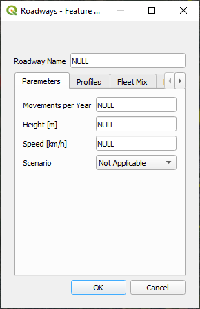

#### [Point sources](#point-sources)

Stationary or infrastructure-related emissions from airport facilities, such as power and heating plants, incinerators, training fires, fuel storage tanks, and stationary internal-combustion engines, are represented as point sources in OpenALAQS.

When adding a point source, the following information is required:
+ **Source Name**
+ **Parameters**
  + **Category**: Source category. Seven categories ship by default: *Other* (0), *Incinerator* (1), *Power/Heat Plant* (2), *Fuel Tank* (3), *Solvent Degreaser* (4), *Surface Coating* (5), *Stationary IC Engine* (6).
  + **Type**: Category-specific type. The full set is in [`default_stationary_ef`](./../open_alaqs/database/data/default_stationary_ef.csv); examples include natural gas, light/heavy fuel oil, JP-4, JP-5, JET A, automobile gasoline, aviation gasoline.
  + **Height [m]**: Height at which emissions are released. `Not yet fully implemented`.
  + **Activity per Year**: How much the source operates in one inventory year. The numeric value of throughput, fuel consumed, or hours run.
  + **Activity Unit**: Unit paired with **Activity per Year**. Filled in from the selected emission factor row (`default_stationary_ef.activity_unit`) when the **Type** changes, and can be overridden for the source (the emission factors must then be per that unit); left empty when the row has no unit (the field then shows the legacy default `1000_m3` as a hint only). Examples: `1000_m3` (natural gas throughput), `1000_L` (liquid-fuel throughput), `hr` (engine operating hours), `1000_kg` (solid waste / coating).
+ **Profiles**: Each point source carries one **Hourly Profile**, one **Daily Profile** and one **Monthly Profile**. The profiles split the **Activity per Year** total into a per-hour timeline across the inventory year. The `default_stationary_ef` table recommends profile names per source type (e.g. `business_hours` for stationary IC engines, `heating_season` for power/heat plants); these names refer to profiles you must define yourself with the OpenALAQS toolbar button **Edit profiles**, since the user profile tables in the project template ship empty. Until you create them, sources fall back to the default uniform profile.

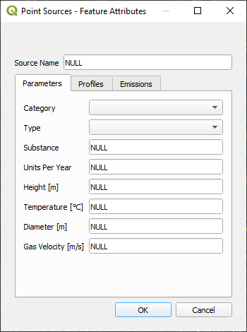

The internal OpenALAQS database contains default emission factors for each category and type (see [`default_stationary_ef`](./../open_alaqs/database/data/default_stationary_ef.csv)). Each emission factor (**CO [kg/unit]**, **HC [kg/unit]**, **NOx [kg/unit]**, **SOx [kg/unit]**, **PM10 [kg/unit]**, **P1 [kg/unit]**, **P2 [kg/unit]**) is in kilograms per **Activity Unit**. The per-hour emission is:

```
emission_kg_per_hour
    = EF_kg_per_activity_unit
    × annual_activity
    × hour_profile_factor
    × day_profile_factor
    × month_profile_factor
    / 8760
```

where the three profile factors are dimensionless and average to 1.0 across the year. For a source with all three profiles set to *constant* (1.0 everywhere), the hourly emission is simply `EF × annual_activity / 8760`, equivalent to a uniform spread across the inventory year.

**Worked examples**:

+ *Heating plant on natural gas* (Category 2): 850 000 m³ consumed per year → enter `Activity per Year = 850`. The selected type's row fills in `activity_unit = 1000_m3`. With `nox_kg_k = 1.9`, annual NOx = 850 × 1.9 = 1 615 kg.
+ *Diesel backup generator* (Category 6, Stationary IC Engine): 400 operating hours per year → enter `Activity per Year = 400`, `activity_unit = hr`. With `nox_kg_k = 0.012`, annual NOx = 400 × 0.012 = 4.8 kg.
+ *Incinerator* (Category 1): 3 200 tonnes of waste per year → enter `Activity per Year = 3200`, `activity_unit = 1000_kg`. The EF applies to the 3 200 figure directly.
+ *Fuel storage tank* (Category 3): 1 800 000 L throughput per year → enter `Activity per Year = 1800`, `activity_unit = 1000_L`. The EF here represents evaporative VOC losses per thousand litres throughput.

**Schema migration note**: studies produced by older plugin versions used a single `units_per_year` field (hours per year only) without an explicit activity unit. The `scripts/migrate_alaqs.py` tool upgrades legacy `.alaqs` files in place, renames `units_per_year` to `annual_activity`, adds the `activity_unit` column to `shapes_point_sources`, and reports any source pinned to an emission-factor row that has since been deprecated. See `documents/AUXILIARY_MATERIAL.md` for the v2 schema reference.

**Stationary IC Engine sources** are a v2 addition (category 6) and use `hr` as the activity unit (engine operating hours per year). Available types are diesel reciprocating engines at two power tiers: `>600 hp` (split further into *Prechamber* and *Open-Chamber* combustion types, per AP-42 §3.4) and `<600 hp`. Pick the type that matches the rated power and combustion chamber of the engine on site.

#### [Area sources](#area-sources)

This layer allows users to include emissions from custom, user-defined sources not covered by the standard OpenALAQS sources, as long as they have the relevant emission factor information.

When adding an area source, the following information is required:
+ **Source Name**
+ Parameters:
  + **Units per Year**: Number of operating hours per year
  + **Height [m]**: Height at which emissions are released `not yet fully implemented`
  + **Heat Flux [MW]**: read-only, 0 for new area sources `not yet fully implemented`
+ Emissions: **CO [kg/unit]**, **HC [kg/unit]**, **NOx [kg/unit]**, **SOx [kg/unit]**, **PM10 [kg/unit]**, **P1 [kg/unit]**, **P2 [kg/unit]**
+ Profiles: **Hourly Profile**, **Daily Profile** and **Monthly Profile** (default or custom)

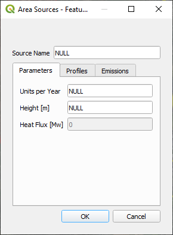

The emission calculation is: `emission (kg) = EF (kg/unit) × units_per_year × (interval_hours / 8760)`.

Beyond the standard pollutants, two additional pollutants **P1** and **P2** can be defined by the user. For aircraft movements, P1 and P2 are placeholders for PM1.0 and PM2.5 respectively, currently set equal to PM10 until dedicated emission indices become available in the EEDB (see [`PM10 output columns`](#pm10-output-columns)).

The area-source form also has an **Engine Test Site** checkbox. When enabled, the source's `*_kg_unit` emission-rate fields above are ignored at compute time; per-mode emissions come from rows in the `engine_test_events` table instead. See the next subsection for the setup workflow.

#### [Engine test sites](#engine-test-sites)

An engine test site (run-up pad) is an area source flagged for special treatment. Rather than emitting a fixed per-unit rate multiplied by an activity profile, its emissions come from discrete engine-test events — each event specifies a start and end datetime, an aircraft type and engine, per-mode durations, and a thrust-computation mode.

**Setup workflow:**

1. Draw the area source in QGIS covering the extent of the run-up pad. Fill in name and height as for a regular area source.
2. In the source's edit form, tick the **Engine Test Site** checkbox. When ticked, **Units per Year** and the Emissions and Profiles tabs gray out: they are ignored at compute time for test sites. Only **Source Name** and **Height [m]** are required.
3. Prepare a CSV of events. Each row is one engine test run. Required columns (`engine_test_import.REQUIRED_COLUMNS`): `source_id`, `start_datetime`, `end_datetime`, `aircraft_type`; when the CSV is loaded from a source's form, `source_id` is optional (filled from the current source). Optional columns: `test_id`, `engine_uid`, `engine_count`, the per-mode running times in seconds (`t_TX_s`, `t_AP_s`, `t_CL_s`, `t_TO_s`) and `instudy`. See [`scripts/README.md`](../scripts/README.md#import_engine_test_eventspy) for the full CSV specification. If your CSV includes events for multiple sources (a "master CSV"), the dialog silently skips rows for other sources when opened from a specific source's form.
4. Load the events. Two ways, functionally identical:
   * **From the source form (default):** click *"Load engine test events CSV..."* in the area-source dialog (the button is only enabled when **Engine Test Site** is ticked). Browse to the CSV, review the validation summary, pick the insert mode (`Append` or `Replace`), tick "Tolerate warnings" if needed, and click Apply. The dialog is scoped to the current source; the `source_id` column becomes optional in the CSV.
   * **From the terminal (for scripting or multi-source bulk-load):**
     ```bash
     python scripts/import_engine_test_events.py study.alaqs events.csv
     ```
     Run without `--apply` first to validate. Add `--apply` when the summary looks clean. The CLI has an extra `replace-all` mode for global operations.
5. Save the area source form (OK button). Then regenerate the emission inventory. Test-site emissions appear alongside regular sources.

**Note on pre-existing `.alaqs` files:** if your study was created by a plugin version older than the one that added engine-test-site support, running the migration is required before step 2 works: the checkbox has no place to write to otherwise. Run, from a checkout of the repository (the script is not in the plugin zip; see [Upgrading from 5.3.x](#upgrading-from-53x)):
```bash
python scripts/migrate_alaqs.py study.alaqs
```
Then close and reopen the project in QGIS.

**Thrust computation modes.** Each event has an optional `thrust_mode` column (default `snap`), not exposed in the CSV — set it via SQL if you need a non-default:

- `snap` — plain ICAO EEDB EI for each mode, no ambient corrections. This is the default.
- `meem` — nvPM correction (MEEM V1). Accepted for consistency with the wider ALAQS methodology, but numerically identical to `snap` for engine-test events because engine test modes correspond to ICAO EEDB anchor thrust settings.
- `bffm2`: gas-phase EIs (NOx, CO, HC) corrected with ambient conditions from `tbl_InvMeteo` at each event's midpoint (SAE AIR-5715 / CAEP14). PM10 and SOx pass through from the engine table per mode (SOx: 0.758 g/kg for jet fuel, the fuel selected in the CAEP14 sheet v14 inputs (FSC 0.000383, ε 0.01, its ICAO vPM parameterisation example), and 0.2 g/kg for AvGas when the table gives none). If `tbl_InvMeteo` is empty or has no data at the event's midpoint, `bffm2` falls back to ISA defaults with a one-per-run warning in the run log.

**Emission math.** For each event and each of the four ICAO modes with a non-zero running time,

```
t_effective_s = t_mode_s × engine_count × period_window_fraction
fuel_burned_kg = fuel_flow_kg_s × t_effective_s
mass_g[pollutant] = EI_g_per_kg[pollutant] × fuel_burned_kg
```

`period_window_fraction` handles events that straddle two inventory periods: the fraction of the event's duration falling inside each period. An event 09:30–10:30 with a 09:00–10:00 period contributes 50 % of its emissions to that period and 50 % to the next one.

#### [Buildings](#buildings)

Buildings are not currently considered emission sources. However, they can significantly impact dispersion modelling by affecting wind patterns and turbulence. While this functionality is `not yet fully implemented`, it is included in the layers list for future use.

When adding a building, the following detail is required:
+ **Building Name**
+ **Height [m]**: height of the building above ground `not yet fully implemented`

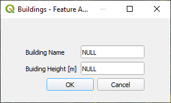

## [Activity Profiles](#activity-profiles)
[(Back to top)](#table-of-contents)

Activity Profiles are used to describe the relative hourly/daily/monthly operational mode for each airport emission source. The **Edit profiles** button in the OpenALAQS toolbar opens the activity profiles window (`Open ALAQS - Activity Profiles`), which can be used to review, edit, and create custom profiles.

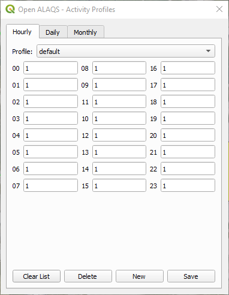

Profiles are **separable shape factors**, not absolute activity ratios. For each hour of the simulation, OpenALAQS multiplies the source's annual emission by

```
operating_factor * hour_factor * weekday_factor * month_factor / profile_mean
```

where `operating_factor = annual_total_operating_hours / hours_in_year`, the three factors are looked up from the assigned profiles, and `profile_mean` is the calendar-weighted mean of `hour_factor × weekday_factor × month_factor` over the simulated year. The internal normalisation by `profile_mean` guarantees that the source's total annual emission equals `EF × annual_total_operating_hours` regardless of the profile shape.

Each factor is a non-negative decimal number. Values are not capped at 1.0; what matters is the ratio between values within a profile. The default profile values are all 1, which produces a uniform distribution: each hour/weekday/month receives its naive share of the annual emission.

> **Note:** Because of the `profile_mean` normalisation, setting a factor to 0 for a specific period (e.g. night-time curfew) zeroes the emission in that period but **redistributes the mass to the remaining non-zero periods** — the total annual emission is preserved. To actually reduce a source's annual emission, lower its `unit_year` (or `ops_year`) field rather than zeroing profile entries.

> **Note:** Profiles whose calendar-weighted mean is exactly 0 (every entry zero) are handled specially: the multiplier evaluates to 0 for every hour, so emissions remain 0 throughout the simulation. There is no normalisation in this case.

### [Worked example — defining and using named profiles](#worked-example--defining-and-using-named-profiles)

The names `heating_season`, `cooling_season`, and `business_hours` are recommended in `default_stationary_ef` but must be defined by the user in the activity profiles window (**Edit profiles**; see [Point Sources](#point-sources)). Suggested factor values, intended as a starting point for a temperate European airport:

**`heating_season` — month profile, winter-weighted** (peaks Jan/Feb/Dec):

```
Jan=2.5, Feb=2.2, Mar=1.5, Apr=0.8, May=0.3, Jun=0.1,
Jul=0.1, Aug=0.1, Sep=0.4, Oct=1.0, Nov=1.8, Dec=2.4
```

**`cooling_season` — month profile, summer-weighted** (peaks Jun-Aug):

```
Jan=0.1, Feb=0.1, Mar=0.2, Apr=0.5, May=1.2, Jun=2.2,
Jul=2.5, Aug=2.4, Sep=1.5, Oct=0.6, Nov=0.2, Dec=0.1
```

**`business_hours` — define in BOTH `user_hour_profile` and `user_day_profile`** (one row in each table, sharing the name; the lookup uses the appropriate row at each context):

- Hour profile: zero for h01–h07 and h19–h24, ~1.0 for h08–h18 (peak ~1.2 around mid-morning).
- Day profile: 1.0 for Mon–Fri, 0 for Sat/Sun.

**Example combinations:**

| Source type | Month profile | Day profile | Hour profile | Resulting timing |
|---|---|---|---|---|
| Heating plant | `heating_season` | `default` | `default` | Concentrated in winter; uniform within each day. |
| Stationary IC engine | `default` | `business_hours` | `business_hours` | Year-round but Mon–Fri 08:00–18:00 only. |
| Cooling tower | `cooling_season` | `default` | `business_hours` | Summer daytime, every day. |

Values are relative — what matters is the ratio between entries. The `profile_mean` normalisation rescales them so the source's total annual emission is preserved across any choice of profile shape (see notes above).

## [Generate Emissions Inventory](#generate-emissions-inventory)
[(Back to top)](#table-of-contents)

This section covers all the necessary steps for preparing an emission inventory using OpenALAQS.

### [Taxi routes](#taxi-routes)

As explained in the section [`Taxiways`](#taxiways), taxi-routes describe the operational path of an aircraft between the runway and the gate (or vice versa).

Taxi-routes can be defined in the `Taxiway Routes Editor` (toolbar button **Define taxi routes**).

<p align="center">
  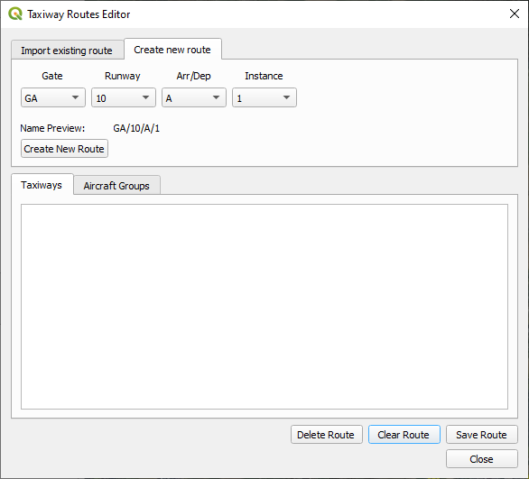
  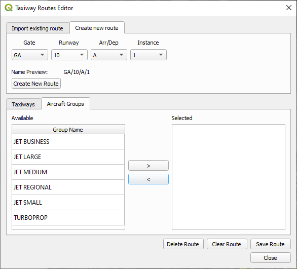
</p>

To define a taxi route in OpenALAQS, the user has to first create the taxi-route by selecting the gate, runway and operation type (arrival or departure). More than one taxi-route can be defined for the same combination of gate, runway and operation type, using a different instance number. Once defined, the corresponding taxiway segments have to be selected together with the aircraft groups that can make use of the specific taxi-route.

### [Create output file](#create-output-file)

Before calculating emissions, the user must generate an OpenALAQS file that includes all user-defined elements of the study (e.g., emission sources) and the default internal database (e.g., emission factors).

The toolbar button **Calculate Emissions Inventory** opens the window `Generate Emission Inventory`, which allows the user to set the path for saving the output file, select movements and meteorological data, optionally provide an ADS-B file, set time filters, and define the domain and its spatial resolution:
+ **Emission Inventory Output**:
  + **Directory**: The path (directory) to the output file
  + **File Name**: The name of the output file to be generated
+ **Movement Data**:
  + **Movements Table**: A placeholder to select the table containing data about aircraft movements
  + **Filter Start Date**: A date selector to filter the movement data by a specific start date
  + **Filter End Date**: A date selector to filter the movement data by a specific end date
+ **ADS-B Data (Optional)**:
  + **ADS-B Table**: A placeholder to select a CSV file with ADS-B trajectory data. When provided, the file is validated on selection and a status line below the field indicates whether the file is valid, the number of flights detected, and any warnings. ADS-B trajectories override the corresponding standard ANP profile for movements whose `profile_id` references a `course = CUSTOM` entry in `default_aircraft_profiles`. See [Movements table](#movements-table) and the [`Auxiliary Material`](AUXILIARY_MATERIAL.md#aircraft-trajectories) for the relationship between the ADS-B file and the movement records.
+ **Meteorological Data**:
  + **Meteorological Table**: A placeholder for importing meteorological data
+ **Modelled Domain**:
  + **X Resolution**: The spatial resolution in the X-axis, set by default to 250 meters and split into 50 cells.
  + **Y Resolution**: The spatial resolution in the Y-axis, also set by default to 250 meters with 50 cells.
  + **Z Resolution**: The vertical spatial resolution, set by default to 50 meters with 20 cells.

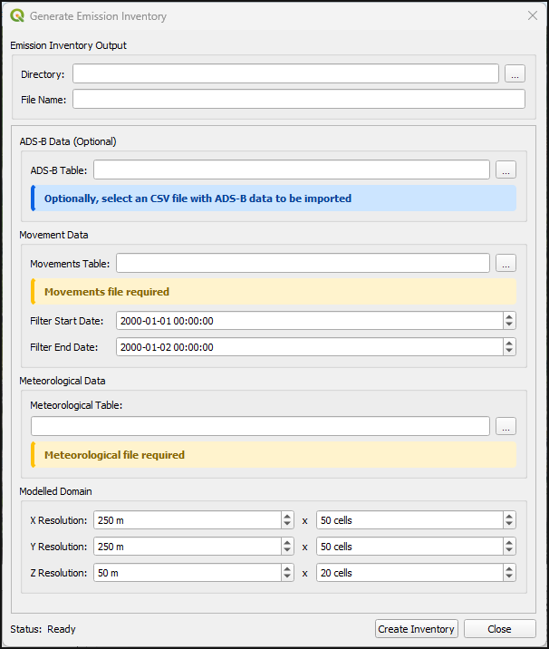

Click **Create Inventory** to write the inventory file (`<File Name>_out.alaqs` in the chosen directory); **Close** closes the window.

The user must provide a semicolon-delimited `.csv` file containing aircraft operations (as `example/training/training_movements.csv`) (see [`Movements table`](#movements-table)). An automatic check is performed to ensure that all fields in the movements and meteorology files are in the correct format (e.g., dates should follow the format YYYY-MM-DD HH:MM:SS). The meteorology file is optional; if it is missing or contains invalid data, default values based on ISA conditions will be used.

The optional ADS-B file is a `.csv` whose delimiter (comma, semicolon or tab) is detected automatically. The validator (`open_alaqs/core/tools/ads_b.py`) checks the columns below; any other columns in the CSV are passed through unchanged.

| Field | Type / Unit | Required | Notes |
|---|---|---|---|
| `flight_id` | text | yes | Groups rows belonging to one flight. |
| `latitude` | degrees, WGS84 | yes | |
| `longitude` | degrees, WGS84 | yes | |
| `altitude` | feet | yes | |
| `tas` | knots | yes | True airspeed. |
| `power_setting` | fraction 0–1 | one of `power_setting` or `fuel_flow` per row | Engine power setting fraction used by the BFFM2 twin-quadratic fit. The legacy column name `thrust` is accepted as an alias for old files; values are still treated as a fraction. |
| `fuel_flow` | kg/s, aircraft total | one of `power_setting` or `fuel_flow` per row | Total-aircraft ambient fuel flow. Divided by the engine count before BFFM2 dispatch. Values below the ICAO idle (TX) fuel flow of the flight's engine times its engine count are imported unchanged; the log names each such flight and its number of points (engine from the Movement CSV row with the same `profile_id`; flights not found there are not checked). |
| `timestamp` | YYYY-MM-DD HH:MM:SS | optional | Read for human readability only; flight time is taken from the movement table's `runway_time` / `block_time` matched by `profile_id`. |

> **Note:** Ground taxi emissions are handled separately via taxiway routes. ADS-B rows during ground taxi should not be included in this CSV — they would otherwise be imported as flight-trajectory points at zero altitude.

> **Note:** Each calculation interval uses the meteorological record nearest to its start (temperature, pressure, humidity, mixing height), so movements in different hours can see different ambient conditions.

### [Movements table](#movements-table)

This table contains all the aircraft movements occurring at the airport during a certain period. It must include the following mandatory fields:

| Field | Description |
|---|---|
| `runway_time` | Date and time on the runway (YYYY-MM-DD HH:MM:SS): for an arrival the touchdown (A-CDM ALDT), for a departure the start of the take-off roll. An A-CDM take-off time (ATOT) is wheels-off: take the take-off roll off it first. |
| `block_time` | Date and time at the gate (YYYY-MM-DD HH:MM:SS): in-block for an arrival, off-block for a departure. The taxi time is the difference; for an arrival the landing roll of its profile is taken out of it, as the profile already counts the roll. |
| `aircraft` | ICAO aircraft type designator |
| `gate` | Stand used for the aircraft operation |
| `departure_arrival` | Type of operation (A = arrival, D = departure) |
| `runway` | Name of the runway used |
| `taxi_route` | Name of the taxi route used |
| `apu_code` | APU usage control — see table below |
| `gate_emissions_code` | Gate emission control — see table below |

**`apu_code` values:**

| Code | Meaning |
|---|---|
| −1 or 0 | No APU emissions (default when field is empty) |
| 1 | APU running at gate/stand only |
| 2 | APU running during full taxi |

**`gate_emissions_code` values:**

| Code | Meaning |
|---|---|
| 0 | Suppress all gate emissions (GSE, GPU, and MES) for this movement |
| 1 | Include all gate emissions (default) |

The following optional parameters can be left empty. They will only be used if the user provides specific values; otherwise default values from the internal database will be used.

| Field | Description | Status |
|---|---|---|
| `engine_name` | Engine identifier (from the internal database) | Active |
| `profile_id` | Performance profile identifier. Standard ANP profiles use `course = ANP2.x`. ADS-B-derived profiles use `course = CUSTOM` with East/North coordinate offsets and an optional `fuel_flow_kgm` column for BFFM2. | Active |
| `track_id` | Aircraft trajectory identifier | `not yet fully implemented` |
| `tow_ratio` | Take-off gross weight divided by maximum take-off weight (≤ 1.0). Applied only when **Apply NOx Corrections** is enabled (bymode method only), to the take-off and climb-out segments. Default: 1.0. | Active (Bymode + NOx corrections only) |
| `taxi_engine_count` | Number of engines used during taxiing (single-engine taxi). Used together with the MES timing fields. | Active |
| `set_time_of_main_engine_start_after_block_off_in_s` | Duration in seconds after block-off during which single-engine taxi applies (departure). Takes priority over `_before_takeoff` if both are set. | Active |
| `set_time_of_main_engine_start_before_takeoff_in_s` | Duration in seconds before takeoff at which the remaining engines are started (departure). Used when `_after_block_off` is not set. | Active |
| `set_time_of_main_engine_off_after_runway_exit_in_s` | Duration in seconds after runway exit during which full-engine taxi applies before engines are cut (arrival). | Active |
| `engine_thrust_level_for_taxiing` | Taxi thrust level as a fraction (ICAO default: 0.07 = 7%). Used by BFFM2 only: it sets the emission index of the taxi phase, which the moving taxi, queuing and stop-and-go all use (`TaxiingEmissionCalculator.calculate_emissions`). Bymode uses the TX mode values. | Active |
| `taxi_fuel_ratio` | Ratio between actual fuel flow and idle fuel flow during taxi. Acts as a direct multiplier on the emissions of the moving taxi segments (not on queuing or stop-and-go). Default: 1.0. | Active |
| `number_of_stop_and_gos` | Number of stop-and-go events during taxiing. Each event adds `AVERAGE_DURATION_OF_STOP_AND_GOS_IN_S = 9.0` seconds per engine at the taxi emission index (`MovementEmissionCalculator.AVERAGE_DURATION_OF_STOP_AND_GOS_IN_S`, used in `TaxiingEmissionCalculator.calculate_emissions`). Added to the queuing segment only (last taxi segment). | Active |

### [Helicopters (FOCA 2015)](#helicopters-foca-2015)

Helicopter movements share the Movements table format described above; the only operational difference is that the `aircraft` field carries an ICAO type designator that resolves against the helicopter catalog (`default_helicopter`) rather than the fixed-wing catalog (`default_aircraft`). At calculation time the plugin checks both catalogs for each ICAO; rows in `default_helicopter` are routed through the FOCA 2015 emission methodology and the dedicated helicopter trajectory generator. No flag in the Movements table marks a row as a helicopter — the lookup result determines dispatch.

**FOCA 2015 method.** The reference is Rindlisbacher T., Chabbey L., "Guidance on the Determination of Helicopter Emissions", Swiss Federal Office of Civil Aviation, Edition 2, December 2015 (Ref: COO.2207.111.2.2015750). Emissions are computed live from each helicopter's engine type, maximum shaft horsepower, engine count, and category; no precomputed emission indices are stored. The implementation is independent of the **Method** selection on the Configuration tab (ByMode / BFFM2): both fixed-wing methods invoke the same FOCA path for helicopters.

**Helicopter category.** Each movement is classified at runtime into one of four FOCA categories using engine type, engine count, and MTOM. The classification is not stored in the table:

| Category | Rule |
|---|---|
| `PISTON` | `engine_type = PISTON` |
| `SINGLE_TURBOSHAFT` | `engine_type = TURBOSHAFT`, `engine_count = 1` |
| `TWIN_TURBOSHAFT_LIGHT` | `engine_type = TURBOSHAFT`, `engine_count ≥ 2`, MTOM ≤ 3400 kg |
| `TWIN_TURBOSHAFT_HEAVY` | `engine_type = TURBOSHAFT`, `engine_count ≥ 2`, MTOM > 3400 kg |

The 3400 kg threshold is defined in FOCA 2015 section 2.4. The category drives both the emission formulas and the trajectory geometry; the per-category trajectory parameters and their citations are documented in [`HELICOPTER_TRAJECTORIES.md`](HELICOPTER_TRAJECTORIES.md).

**Default catalog.** 60 helicopter rows in `default_helicopter` covering common types (R22, A109, EC135, AS332, S76, S92, etc.). 86 engine rows in `default_helicopter_engines` covering the corresponding turboshaft and piston engines. The columns are:

| Table | Field | Notes |
|---|---|---|
| `default_helicopter` | `icao` | ICAO type designator |
| | `variant_label` | Disambiguates multiple rows per ICAO (e.g. `A109E_POWER` vs `A109II`). Composite logical key is `(icao, variant_label)`. |
| | `manufacturer`, `name` | Free text |
| | `mtow_kg` | Maximum take-off weight in kilograms (used for category derivation) |
| | `engine_count` | Number of engines (used for category derivation) |
| | `engine`, `engine_name` | References a row in `default_helicopter_engines` |
| | `max_shp_per_engine` | Maximum shaft horsepower per engine |
| | `is_default` | `1` if this is the default variant for the ICAO when the Movements table does not specify a `variant_label` |
| `default_helicopter_engines` | `engine_name` | Logical key |
| | `engine_full_name` | Free text |
| | `engine_type` | `PISTON` or `TURBOSHAFT` |
| | `max_shp_per_engine` | Fallback if the helicopter row does not override |
| | `source` | Provenance citation |

To add a helicopter type that is not in the default catalog, insert a row into `default_helicopter` referencing an existing engine in `default_helicopter_engines` (or insert a new engine row first). The minimum fields are `icao`, `variant_label`, `mtow_kg`, `engine_count`, `engine`, `engine_name`, `max_shp_per_engine`, `is_default`. Once the row is in place, any movement whose `aircraft` field matches that ICAO will be routed through the FOCA path automatically.

**What is suppressed for helicopters.** No APU, GSE, GPU or MES (Main Engine Start) emissions are computed for helicopters, whatever `apu_code` and `gate_emissions_code` say. The gate calculation is not run for a helicopter movement (`MovementSourceModule.process` skips it; the gate is only the helipad, the origin of the FOCA trajectory), and the helicopter taxi branch (`TaxiingEmissionCalculator._apply_taxiing_emissions_for_helicopters`) adds ground idle only, with no APU or engine start. The FOCA 2015 LTO cycle covers ground idle, takeoff, climb-out, approach, and landing on its own, avoiding double-counting against the suppressed sub-components. Taxi emissions themselves are handled by the helicopter taxi function; helicopters typically taxi minimally (ground idle on the spot or air-taxi).

**Limitations.** The 3000 ft AGL LTO ceiling is per the ICAO LTO definition; emissions above that altitude are not modelled. Two known FOCA 2015 PDF inconsistencies were resolved during implementation (piston fuel-flow leading coefficient and twin-heavy Appendix C power settings) and are recorded in the docstring of `open_alaqs/core/tools/foca_heli.py`.

### [Meteorology](#meteorology)

OpenALAQS requires meteorological data to accurately calculate emissions using advanced methods (e.g. BFFM2, correction of NOx for ambient conditions) and for the dispersion calculation.

The required meteorological parameters are:

| Parameter | Unit | Notes |
|---|---|---|
| `Scenario` | — | Simulation name identifier |
| `DateTime` | YYYY-MM-DD HH:MM:SS | |
| `Temperature` | K | |
| `Humidity` | kg water / kg dry air | Not used by the emission calculation (see below) |
| `RelativeHumidity` | fraction (0–1) | Used to derive the humidity ratio (BFFM2, NOx correction); 0.6 when the column is missing or empty |
| `SeaLevelPressure` | Pa | |
| `WindSpeed` | m/s | |
| `WindDirection` | degrees | |
| `ObukhovLength` | m | |
| `MixingHeight` | m | Used as the LTO ceiling for aircraft movements in each interval (914.4 m when absent). |

The humidity ratio used by BFFM2 and by the NOx ambient correction is always derived from `RelativeHumidity`, `Temperature` and `SeaLevelPressure` (`bffm2.calculate_emission_index`, `nox_correction_ambient.nox_correction_for_ambient_conditions`); the `Humidity` column is not used, so a value given only in `Humidity` has no effect. When `RelativeHumidity` is missing or empty, 0.6 is used (`AmbientCondition`).

Input data may come from local or national data providers (e.g., METAR, SYNOP) or reanalysis data. If the meteorology file is missing or contains invalid data, default ISA conditions are used.

## [Calculate emissions and query results](#calculate-emissions-and-query-results)
[(Back to top)](#table-of-contents)

To calculate emissions and visualize the results, click the `Visualize Emission Calculation` button in the OpenALAQS toolbar. A new window will appear, allowing you to browse all source types and names. Emissions from aircraft-related sources (gates, taxiways and runways) are grouped together under the name `MovementSource`.

In the settings panel on the bottom left of the main window, the user can configure the calculation settings, the output formats and the settings for the dispersion model.

In the **Configuration** tab, the user can specify the general settings for the emissions calculation:
+ **Start (incl.)** / **End (incl.)**: Define the emission calculation period (_optional_)
+ **Method**: `bymode` or `BFFM2` (BFFM2 is offered for CO, HC and NOx only). See below for a description of each.
+ **Apply NOx Corrections**: Applies the ICCAIA NOx correction for ambient temperature, humidity and aircraft weight (via `tow_ratio`) to the take-off and climb-out segments of the bymode method; approach and taxi are not corrected. It has no effect with BFFM2, which applies its own ambient correction.
+ **BFFM2 Fuel-Flow Source**: `trajectory` (default: fuel flow from each segment's power setting) or `mode_anchor` (EEDB anchor fuel flow of the segment's mode, ambient corrections still applied). Only used with BFFM2.
+ **Source Dynamics**: Select source dynamics method (_set to "none" by default_)
+ **Time Interval**: Set the time interval for the calculation (_1 hour by default_)
+ **Vertical Limit**: LTO ceiling in meters, used only when no ambient condition is available; otherwise the meteorological `MixingHeight` applies (_914.40 m by default_)
+ **Receptor Points**: Specify receptor points using a `.csv` file (_optional_)

**Calculation methods:**

| Method | Description |
|---|---|
| **ByMode** | Uses ICAO EEDB emission indices for each LTO mode (TO, CL, AP, TX) directly, based on the time-in-mode from the movement profile. Simple and fast. |
| **BFFM2** | Boeing Fuel Flow Method 2. Uses the actual power setting from each profile segment to derive a fuel-flow-dependent emission index via log-log interpolation through the four EEDB breakpoints. Applies ambient corrections for temperature, pressure, humidity and flight Mach number (TAS / a, a = √(1.4 · 287.05287 · T)). On the training example it gives 29 % less NOx and 8 % more CO than ByMode on the arrivals (per movement 2 to 50 % less NOx, 1 to 18 % more CO) and 45 % less NOx on the departures. See [`BFFM2.md`](BFFM2_validation/BFFM2.md) for the full methodology. |

Changing any setting discards the previous calculation; it is recalculated when an output (View Emissions Table, Plot Time Series, Plot Vector Layer) is next requested.

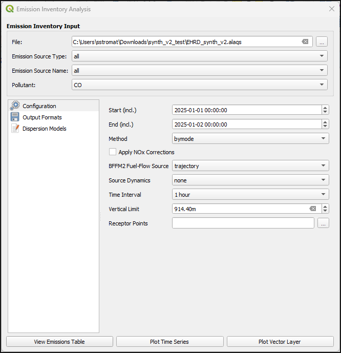

### [PM10 output columns](#pm10-output-columns)

The emission output CSV contains the following PM-related columns for aircraft movements:

| Column | Contents |
|---|---|
| `pm10_kg` | Total PM10 = combustion PM10 + brake wear (arrivals only) |
| `pm10_nonvol_kg` | Non-volatile PM (nvPM mass): the EEDB value of the mode at or below 3000 ft above the aerodrome; above, MEEM V1 (CAEP14 v14 MEEM_V1, see [`Auxiliary Material`](AUXILIARY_MATERIAL.md#meem-v1-nvpm-above-3000-ft)) |
| `pm10_sul_kg` | Sulphate vPM = ~48.96 mg/kg × fuel burned (FSC 680 ppm, the FOA3 value, ε = 0.024, SO4/S = 96/32; stored as a constant in the `pm10_sul` column; SOx uses FSC 383 ppm, ε 0.01) |
| `pm10_organic_kg` | Organic vPM = δ_k × HC_EI × fuel burned |
| `p1_kg` | PM1.0 placeholder; currently equal to `pm10_kg` |
| `p2_kg` | PM2.5 placeholder; currently equal to `pm10_kg` |

For departure movements, `pm10_kg = pm10_nonvol_kg + pm10_sul_kg + pm10_organic_kg` exactly. For arrivals, `pm10_kg` additionally includes a brake-wear contribution per the FOA3 formula (`MTOW × 0.000476 − 8.74` grams), visible as a surplus over the sub-component sum on the first taxi segment. `p1_kg` and `p2_kg` include brake wear and equal `pm10_kg` for all movements. Detailed information on the PM10 breakdown methodology is in the [`Auxiliary Material`](AUXILIARY_MATERIAL.md#pm10-breakdown).

In the **Output Formats** tab:
+ **Emissions table**: Output view type (by aggregation, by source or by grid cell)
+ **Time Series**: Define x-axis title, marker and receptor points
+ **Vector Layer**: Settings for visualisation of results on a grid

In the **Dispersion Models** tab, the user can specify general settings for the dispersion model (see [`Dispersion modeling with AUSTAL`](#dispersion-modeling-with-austal)).

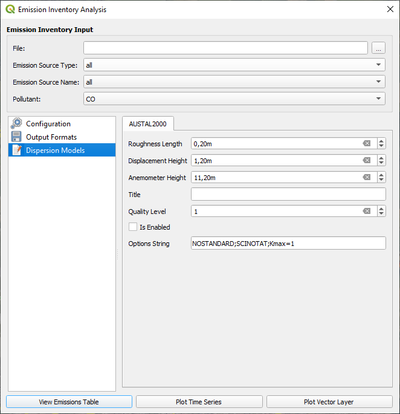

There are three ways to visualize calculated emissions:
+ View results in table format (`View Emissions Table`)
+ View results as a time series (`Plot Time Series`)
+ Visualize results on a grid (`Plot Vector Layer`)

## [Dispersion modeling with AUSTAL](#dispersion-modeling-with-austal)
[(Back to top)](#table-of-contents)

The connection of OpenALAQS with AUSTAL was realized based on the existing architecture of the OpenALAQS code. In order to retain the flexibility of OpenALAQS, two new modules were developed: one for producing the input files for the dispersion model and a second for running AUSTAL and exploring the calculated concentrations.

### [Input data](#input-data)

The dispersion module will only be activated if the `Is Enabled` checkbox is checked. By default, this checkbox is unchecked.

The following parameters need to be defined:
+ **Roughness Length**: Height above ground where wind speed theoretically becomes zero. Depends on terrain type (e.g., forests, urban areas, flat fields).
+ **Displacement Height**: Height at which the wind profile starts to be affected by obstacles on the ground, such as buildings or trees.
+ **Anemometer Height**: Height at which wind speed measurements are taken. Default: `10 + 6·z0` m, where `z0` is the roughness length (≈ 11.2 m at the typical airport value `z0 = 0.2`).
+ **Quality Level**: Determines the number of simulation particles (+1 doubles them; 1 to 10 on the Dispersion Models tab, 1 to 3 in the Calculate Dispersion dialog). Higher values increase accuracy but also computation time.
+ **NOTALUFT** (per-hour series): when enabled, AUSTAL writes per-hour grid output (`<substance>-NNNa.dmna`) and, when receptor points are configured, per-receptor time-series files (`<substance>-tmpa.dmna`). Required for **Plot Time Series** and **Compliance Report**; optional for **Plot Vector Layer** with `annual mean`.
+ **PM10 fine fraction**: how PM10 emissions are split between AUSTAL's `pm-1` and `pm-2` substances (default 0.9, suitable for an airport mix dominated by aircraft non-volatile PM and combustion exhaust).
+ **Receptor Points**: Specify receptor points using a `.csv` file. In ALAQS mode the plugin will also auto-load any receptors defined in the `shapes_receptor_points` table of the `.alaqs` file if no CSV is given. Without receptors AUSTAL still produces grid output, but Plot Time Series and Compliance Report stay disabled.
+ **Options String** (default `NOSTANDARD;SCINOTAT;Kmax=1`):
  + `NOSTANDARD`: Activates non-standard calculation configurations.
  + `SCINOTAT`: Forces output in scientific notation with four significant decimal places.
  + `Kmax=1`: Limits the simulation to near-ground (surface-level) calculations.

The necessary input files for a simulation with AUSTAL are:
+ **austal.txt**: Contains all main input parameters.
+ **series.dmna**: Time series of meteorological parameters (wind direction, wind speed, Obukhov length) as subsequent hourly means for an integer number of days.
+ **grid file** (e\*\*\*\*.dmna): Emission data on a three-dimensional grid.

The user is referred to the [`AUSTAL`](https://www.umweltbundesamt.de/en/topics/air/air-quality-control-in-europe/download) documentation for more information on the input parameters and data files.

### [Running AUSTAL](#running-austal)

Click `Calculate Dispersion` in the OpenALAQS toolbar to open the dispersion dialog. The dialog has four sections, worked through in order:

1. **AUSTAL Executable** — file-pick the path to `austal.exe` (Windows) or `austal` (Linux). One-time per machine.
2. **Input File Strategy** — pick one of three radio buttons:
   + `Use Existing AUSTAL Input Files` — run AUSTAL against a folder you already prepared.
   + `Generate AUSTAL Input Files from OpenALAQS Emission Inventory File` — drive the run from an `*_out.alaqs` file (most common path).
   + `Generate AUSTAL Input Files from CSV` — drive the run from emissions and meteo CSV files prepared outside OpenALAQS.

   In the two Generate modes, set the output folder (**Output Work Directory** for the `.alaqs` mode, **Output Directory** for the CSV mode) where the input files (`austal.txt`, `series.dmna`, etc.) and AUSTAL's outputs will be written. The same section also exposes the **Receptors CSV** picker, the **NOTALUFT** checkbox, and the **PM10 fine fraction** spinbox (described above). For Generate-from-`.alaqs`, the plugin auto-loads receptor points from the `shapes_receptor_points` table if the Receptors CSV picker is empty.

3. **Execution**: click `Run AUSTAL`. The optional `Erase Log File at Start of Calculation` checkbox deletes any existing `austal.log` before the run.
4. **Result Visualisation** — populated after a successful run. See [Visualize results](#visualize-results) below.

AUSTAL can also be run independently outside OpenALAQS. For a step-by-step operational walkthrough, see [`documents/AUSTAL/AUSTAL_OPERATION.md`](./AUSTAL/AUSTAL_OPERATION.md).


By default, a file named `austal.log` is generated at the end of the dispersion calculation. Option `Erase Log File at Start of Calculation` deletes any existing log file before the calculation.

### [Output data](#output-data)

AUSTAL calculates substance-specific annual means and, when run with NOTALUFT, also per-hour means (used by the plugin to derive daily / hourly / 8-hour aggregates and per-receptor time series).

| File pattern | When written | Read by |
|---|---|---|
| `<substance>-y00a.dmna` | Always | Plot Vector Layer (annual mean) |
| `<substance>-NNNa.dmna` | NOTALUFT enabled | Plot Vector Layer (hourly / 8-hour mean) |
| `<substance>-tmpa.dmna` | NOTALUFT + receptors | Plot Time Series, Compliance Report |
| `<substance>-y00s.dmna` | Always | Statistical uncertainty companion to `y00a` |

For example, the annual-mean concentration for HC is `hc-y00a.dmna` ('00' refers to the grid; 'a' refers to additional load). The statistical uncertainty is in `hc-y00s.dmna`. Concentrations are in micrograms per cubic metre.

By default, the concentration file only contains the ground layer (K=1). Using the `NOSTANDARD` option, more layers can be written out (e.g. `NOSTANDARD;Kmax=3` in `austal.txt`).

The plugin's substance codes follow AUSTAL convention: `pm` for PM10 (which AUSTAL internally splits into `pm-1` and `pm-2`), `pm25` for PM2.5, lowercase enum value for the rest.

### [Visualize results](#visualize-results)

After a successful AUSTAL run, three result modules are available under the **View Results** section:

+ **Plot Vector Layer** — spatial concentration map on the AUSTAL grid. The averaging combo selects which `.dmna` file is read: `annual mean` always works; `hourly` and `8-hours mean` require NOTALUFT.
+ **Plot Time Series** — concentration vs time at a chosen receptor point, with smoothing combo (raw / 1h / 8h / 24h / 7d), navigation toolbar, and CSV export. Requires NOTALUFT + receptors.
+ **Compliance Report** — per-receptor PASS/FAIL evaluation against EU Directive 2024/2881 limit values applicable from 1 January 2030 (PM10, PM2.5, NO2, NOx ecosystem, SO2). Each row reports value, threshold, allowed exceedances, and PASS/FAIL with colour coding. CSV export available. Requires NOTALUFT + receptors.

The status label below the buttons lists which substances have receptor data available, or names the missing piece (no receptors / no NOTALUFT / no AUSTAL output yet) when a button is disabled. Each button's tooltip gives the exact 3-step recipe.

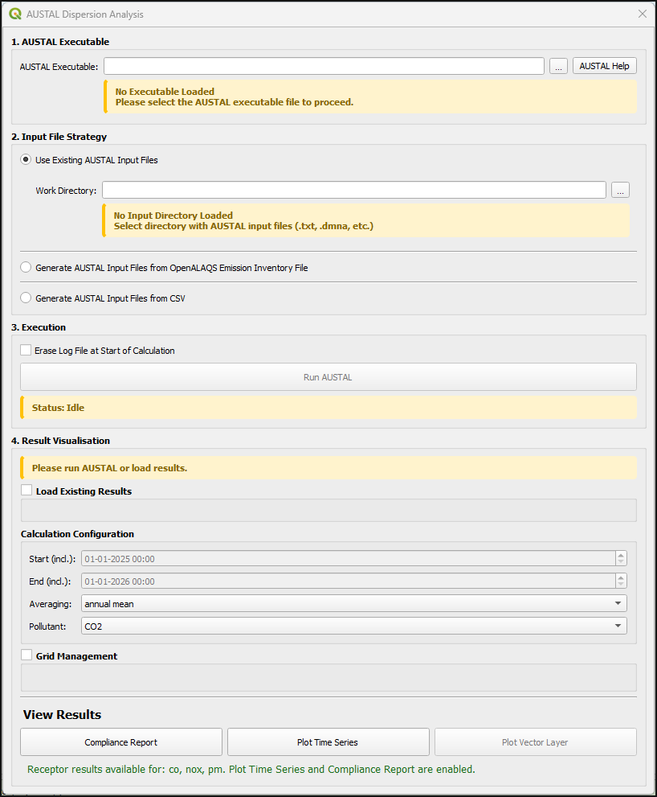
