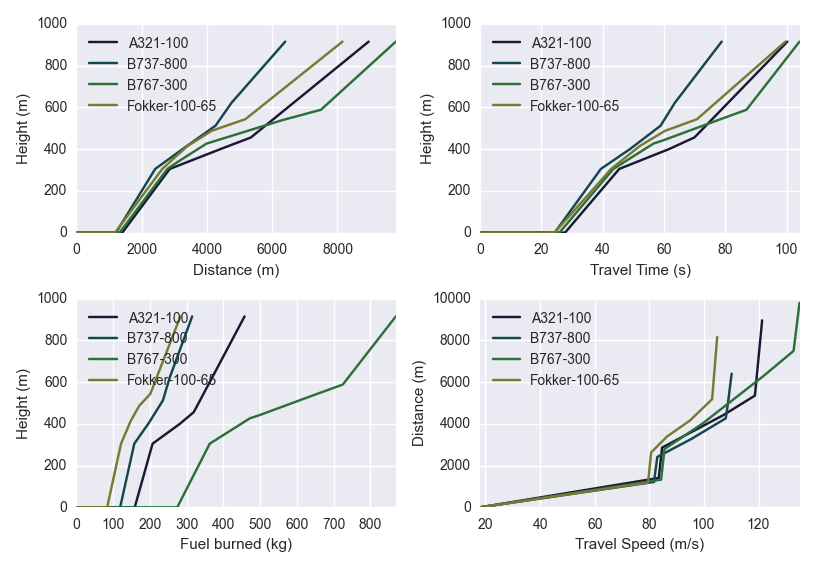
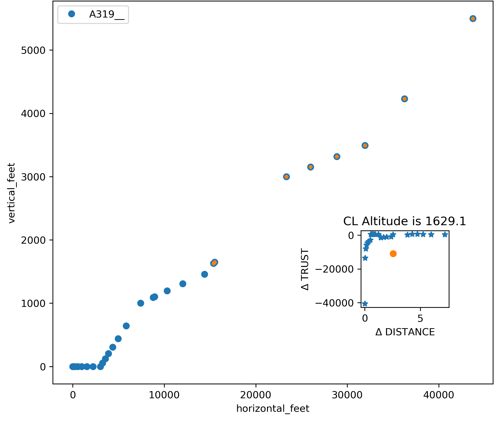

# Aircraft emissions

This page describes how OpenALAQS calculates the emissions of fixed-wing aircraft movements: the bymode and BFFM2 methods, fuel flow, the NOx ambient correction, particulate matter and SOx, taxiing, APU, GSE and engine start, and the use of ANP and ADS-B flight profiles. It is for modellers who need to know what the numbers mean. Helicopters follow their own method ([HELICOPTERS.md](HELICOPTERS.md)). Where each step is in the code is in [CODE_FLOW.md](../developer/CODE_FLOW.md).

Contents:

- [Methods](#methods)
- [Fuel flow](#fuel-flow)
- [BFFM2](#bffm2)
- [Worked example: one segment, three methods](#worked-example-one-segment-three-methods)
- [NOx ambient correction](#nox-ambient-correction)
- [Particulate matter](#particulate-matter)
- [Taxiing](#taxiing)
- [APU, GSE and engine start](#apu-gse-and-engine-start)
- [Flight profiles (ANP)](#flight-profiles-anp)
- [ADS-B](#ads-b)
- [Limitations](#limitations)
- [See also](#see-also)

## Methods

Aircraft emissions follow the ICAO LTO cycle framework of ICAO Doc 9889. For each movement OpenALAQS computes the emissions of three parts and adds them up per pollutant:

- the **gate**: GSE and GPU at the stand ([APU, GSE and engine start](#apu-gse-and-engine-start));
- **taxiing**: the taxi route, queuing, stop-and-go, APU, main engine start and brake wear ([Taxiing](#taxiing));
- the **flight profile**: one emission per profile segment up to the LTO ceiling ([Flight profiles (ANP)](#flight-profiles-anp)).

The flight and taxi phases use one of three methods. The plugin offers `bymode` and `BFFM2` in the **Method** list of the Configuration tab and the fuel-flow source in **BFFM2 Fuel-Flow Source**; the standalone pipeline names the three methods directly.

| Method | Standalone name | Fuel flow per segment | Emission index (NOx, CO, HC) |
| --- | --- | --- | --- |
| Bymode | `bymode` | EEDB fuel flow of the segment's LTO mode (TX, AP, CL, TO) | EEDB index of the mode, no ambient correction (optional NOx correction on TO and CL) |
| BFFM2, fuel-flow source `trajectory` | `bffm2_traj` | from the profile point's power setting (twin-quadratic fit), scaled to the ambient | BFFM2: read on the log-log curve at the fuel flow, corrected for the ambient |
| BFFM2, fuel-flow source `mode_anchor` | `bffm2_anchor` | flight: EEDB fuel flow of the segment's mode, unscaled; taxi: as `bffm2_traj` ([Taxiing](#taxiing)) | BFFM2, as above |

PM, SOx and the P1/P2 columns use the EEDB values of the mode in all three methods ([Particulate matter](#particulate-matter)). The methods differ in fuel burn and in the gas-phase indices. A [worked example](#worked-example-one-segment-three-methods) runs one segment through the three methods.

For each segment the emission mass is:

```text
mass [kg] = EI [g/kg] x Wf [kg/s per engine] x n_engines x t_seg [s] / 1000
```

With bymode, `EI` and `Wf` are the mode values. All approach segments use the AP values, whatever the thrust stored in the profile.

The plugin offers `BFFM2` only for some pollutant selections ([user guide](../user/USER_GUIDE.md#calculate-emissions-and-query-results)); the calculation still produces every pollutant.

## Fuel flow

### Twin-quadratic fit

With the `trajectory` source, the power setting `P` of the segment's start point (a fraction from 0 to 1, 1 = maximum take-off thrust) gives a reference fuel flow `Wf_ref` at ICAO sea-level static conditions (T = 288.15 K, p = 101 325 Pa, M = 0). The thrust range is split at the climb-out point (P = 0.85). In each part a quadratic `Wf = a P^2 + b P + c` passes exactly through three EEDB points:

- low range (0 < P <= 0.85): TX (P = 0.07), AP (P = 0.30), CL (P = 0.85);
- high range (0.85 < P <= 1.00): AP (P = 0.30), CL (P = 0.85), TO (P = 1.00).

This is the original ALAQS method. Edge cases:

- P < 0.07: `Wf_ref = max(parabola value, Wf_TX)` (idle floor). For P >= 0.07 the parabola is used as it is; it passes through `(0.07, Wf_TX)`, so it rarely falls below idle.
- 1.0 < P <= 1.05: P is set to 1.0 (warning in the log), which gives the TO fuel flow.
- P > 1.05, or P < 0: the fit is rejected and the segment uses bymode: the EEDB fuel flow and NOx, CO and HC indices of its mode, unscaled and without the BFFM2 step. One warning is logged per group of movements calculated together (same engine, profile, runway and taxi route), naming the first movement.

Piecewise-linear interpolation between the EEDB points (the CAEP14 / ICAO alternative) is not implemented.

### Scaling to the ambient

The reference fuel flow is scaled to the segment's ambient conditions with the corrected-parameter relation of gas-turbine performance. There is no option to turn it off.

```text
Wf_amb = Wf_ref x delta x sqrt(theta)      theta = T_amb / 288.15,  delta = p_amb / 101325
```

This applies to the `trajectory` source and, with either source, to every taxi segment ([Taxiing](#taxiing)). On flight segments the `mode_anchor` fuel flow and an ADS-B fuel flow are used as `Wf_amb` unchanged. T_amb and p_amb are those at the segment's start height ([ATMOSPHERE_ALOFT.md](ATMOSPHERE_ALOFT.md)).

The scaling uses the static delta and theta and leaves out the effect of flight speed; the gas-turbine similarity form of the DLR fuel-flow method in SAE AIR 5715 (section 5.3, Eq. 11) uses total (stagnation) inlet conditions, which would give about 3 % more fuel flow at Mach 0.2 and 7 % more at Mach 0.3.

### Fuel-flow sources

| Source | `Wf_amb` per engine |
| --- | --- |
| `trajectory` (default) | twin-quadratic fit at the point's power, scaled to the ambient; an ADS-B fuel flow takes priority when the point has one ([ADS-B](#ads-b)) |
| `mode_anchor` | flight segments: EEDB fuel flow of the segment's mode, unscaled; an ADS-B fuel flow is ignored. Taxi segments: as `trajectory` |

With `mode_anchor` the flight fuel flow is the ICAO mode fuel flow, as in bymode, so `bffm2_anchor` and `bymode` burn the same fuel in flight and differ only in the emission index. SAE AIR6183 (section 4.2, Eq. 1) scales a mode fuel flow to the ambient with the inverse of the BFFM2 conversion and the installation factor, `B x Wf_mode x delta / (theta^3.8 x exp(0.2 M^2))`. OpenALAQS does not; with that scaling the fuel flow would be about 2 % lower on approach at 3,000 ft (ISA, Mach 0.25), 17 % lower on take-off at sea level and 30 °C (Mach 0.2) and 43 % higher at −10 °C (Mach 0). Because the unscaled fuel flow is converted to reference conditions in step 2, the index is read close to, but not exactly at, the installation-corrected mode point (see the [example](#bffm2-fuel-flow-source-mode_anchor)).

A segment whose start point has neither a power setting nor a fuel flow (for example the RPM-based piston profiles) uses the bymode index, with a warning in the log for each such segment.

## BFFM2

The Boeing Fuel Flow Method 2 (BFFM2) was developed by Boeing and formalised in SAE AIR 5715. ICAO and CAEP use it to compute engine emissions at conditions other than the sea-level static reference of the EEDB. It maps the fuel flow to an emission index on a log-log curve through the four EEDB points (TX, AP, CL, TO), then corrects that index for ambient temperature, pressure and humidity. The Mach number enters only the conversion of the fuel flow to reference conditions (step 2).

Its advantage over bymode is that it follows the thrust stored in each profile point instead of the nominal thrust of the mode label. This matters most on approach: segments labelled `AP` are often flown near idle.

References: SAE AIR 5715, *Procedure for the Calculation of Aircraft Emissions*; ICAO Doc 9889, *Airport Air Quality Manual*, Chapter 3, Appendix 1 (which refers to SAE AIR 5715 for BFFM2).

### Step 1: fuel flow

`Wf_amb` per engine comes from the fuel-flow source ([Fuel flow](#fuel-flow)). An ADS-B fuel flow is the aircraft total divided by the engine count.

### Step 2: reference fuel flow

The ambient fuel flow is projected to BFFM2 reference conditions with the CAEP14 universal correction:

```text
theta = T_amb / 288.15
delta = p_amb / 101325
M     = TAS / SOS,   SOS = sqrt(1.4 x 287.05287 x T_amb)   (340.29 m/s at ISA sea level)

Wf_ref_BFFM2 = (Wf_amb / delta) x theta^3.8 x exp(0.2 x M^2)
```

M is the true Mach number at the segment's start point, as in the CAEP/14 BFFM2 formulation (gamma 1.4, R 287.05287 J/(kg K), ICAO Doc 7488). The form is that of SAE AIR 5715 (Eq. 2); CAEP14 prescribes it for all flight phases.

### Step 3: log-log interpolation

The EEDB gives four points `(Wf_i, EI_i)` per pollutant (NOx, CO, HC). Before interpolation the reference fuel flows are multiplied by the installation correction factors (CAEP14 defaults, from SAE AIR 5715). They account for installation losses not in the engine-only certification data. They shift the x-axis points and leave the indices unchanged.

| LTO mode | Installation factor |
| --- | --- |
| Take-off (TO) | 1.010 |
| Climb-out (CL) | 1.013 |
| Approach (AP) | 1.020 |
| Idle (TX) | 1.100 |

The factors move the reading slightly toward the low-fuel-flow end of the curve (lower NOx, higher CO and HC). The effect on total LTO NOx is typically 1 to 3 %. They cannot be changed from the plugin.

The index at `Wf_ref_BFFM2` is interpolated linearly in log10 space between the two surrounding points:

```text
log10(EI) = log10(EI_i) + [log10(EI_i+1) - log10(EI_i)] x
            [log10(Wf) - log10(Wf_i)] / [log10(Wf_i+1) - log10(Wf_i)]
```

**CO and HC.** Their curves are not monotonic: high at idle, steeply lower at approach, about flat at climb-out and take-off. OpenALAQS applies the CAEP/14 slope-to-mean-value rule for CO and HC. Above the approach point the index is `lin_av`, the linear average of the climb-out and take-off indices, which gives a step at the approach point. When the engine does not have the standard shape (the idle-to-approach line meets the `lin_av` line outside [approach, climb-out]), the index is interpolated log-linearly from the approach point to (climb-out fuel flow, `lin_av`) and held at `lin_av` above climb-out.

This rule differs from SAE AIR 5715 (section 5.2.1) and DuBois & Paynter (2006) in the standard case. There, the idle-to-approach line continues past the approach point up to its intersection with the `lin_av` line, and `lin_av` applies only beyond the intersection. Between the approach point and the intersection, AIR 5715 therefore gives higher CO and HC indices than OpenALAQS (on the LEAP-1A26 at ISA, 1.72 against 0.25 g/kg CO at 0.30 kg/s). Inventory totals differ little, because taxi at idle dominates CO: on the example and training studies, total CO is 0.9 to 1.0 % (`bffm2_traj`) and 1.8 to 2.8 % (`bffm2_anchor`) higher with the AIR 5715 rule (up to 15 % for a single movement), HC at most 0.2 %, NOx unchanged. OpenALAQS follows CAEP/14 so that its results match the CAEP/14 BFFM2 reference values. Both rules agree above the intersection, and in the non-standard case.

**Zero indices.** A zero EEDB index cannot be read on a log scale: before the interpolation a zero idle index becomes 0.001 g/kg, a zero approach index 0.001 g/kg (0.0001 g/kg when the idle index is also zero), and a zero climb-out or take-off index 0.0001 g/kg.

**No extrapolation.** Below the idle point the idle index is used. Above the take-off point NOx keeps the take-off index and CO and HC keep `lin_av`. SAE AIR 5715 recommends extrapolating the CO and HC curves below the idle point, with care (section 5.2.1); it gives no formula and notes that errors below 7 % thrust can be large (section 5.2.3). OpenALAQS does not extrapolate. This matters mostly for taxiing: at the default taxi thrust of 7 %, the reference fuel flow lies about 9 % below the installation-corrected idle point (1 / 1.1 at ISA), so the taxi CO and HC indices are the idle values.

Example curves for one engine: log-log reference curves for [NOx](bffm2_figures/NOx_interp_curve.pdf), [CO](bffm2_figures/CO_interp_curve.pdf) and [HC](bffm2_figures/HC_interp_curve.pdf); emission index against fuel flow, at ISA and with the ambient and installation corrections, for [NOx](bffm2_figures/NOx_emission_index_.pdf), [CO](bffm2_figures/CO_emission_index_.pdf) and [HC](bffm2_figures/HC_emission_index_.pdf).

### Step 4: ambient correction

NOx (SAE AIR 5715 humidity and P3T3 correction):

```text
h           = -19 x (omega - 0.00634)
EI_NOx_corr = EI_NOx x exp(h) x (delta^1.02 / theta^3.3)^0.5
```

CO and HC (temperature and pressure only, no humidity):

```text
EI_CO_corr = EI_CO x theta^3.3 / delta^1.02
EI_HC_corr = EI_HC x theta^3.3 / delta^1.02
```

The specific humidity `omega` (kg water per kg dry air) is computed from the relative humidity RH, the temperature and the pressure (Magnus formula):

```text
p_sat = 6.107 x 10^(7.5 x T_C / (237.3 + T_C))      [hPa; T_C in deg C]
omega = 0.62197058 x RH x p_sat / (p_hPa - RH x p_sat)
```

The EEDB NOx indices refer to omega0 = 0.00634 kg/kg. Drier air (omega < 0.00634) raises NOx, more humid air lowers it, and at omega0 there is no correction.

With the atmosphere model `standard_lapse` (default) or `surface_layer`, T, p and RH are the segment's local values derived from the hourly meteo row. With `ground_held` they are the row's `Temperature`, `SeaLevelPressure` (QNH) and `RelativeHumidity` as they are ([ATMOSPHERE_ALOFT.md](ATMOSPHERE_ALOFT.md)). An empty relative humidity is taken as 0.6. Without a meteo row for the period, ISA values are used at every height (288.15 K, 101 325 Pa, RH 0.6). The meteo `Humidity` column is not used.

### Step 5: PM, SOx and P1/P2

BFFM2 does not interpolate PM or SOx. After steps 3 and 4 the PM components, SOx and P1/P2 indices of the segment's mode are copied in, as in bymode, including the MEEM V1 nvPM above 3000 ft ([Particulate matter](#particulate-matter)). The PM and SOx indices are therefore the same as with bymode; the totals differ only through the fuel burn.

### Step 6: segment mass

```text
t_seg = 2 x d_geodesic / (TAS_start + TAS_end)
mass  = EI_corr [g/kg] x Wf_amb [kg/s per engine] x n_engines x t_seg [s] / 1000
```

`d_geodesic` is the ellipsoidal ground distance between the two profile points, in metres, independent of the map projection of the emission layer. When the segment is clipped (at the [LTO ceiling](#lto-ceiling-and-segment-clipping), or in plan to the calculation grid), `d_geodesic` is the length of the part kept; TAS, power, mode, Mach and the ambient conditions remain those of the original start point.

### BFFM2 against bymode

The two methods differ systematically because they treat the thrust schedule differently.

**NOx: BFFM2 is usually lower.** The EEDB NOx curve is steep (about 5 g/kg at idle to about 25 g/kg at take-off). Bymode gives every approach segment the AP index (about 9 to 14 g/kg). BFFM2 reads the profile power, which on approach is often far below the nominal 30 %, so the index is near idle. Departures climb at intermediate power below the CL nominal.

**CO and HC: BFFM2 is higher on most arrivals; on departures the sign varies.** The CO curve is high at idle (about 20 to 24 g/kg) and low near climb-out and take-off (`lin_av`, about 0.2 to 0.6 g/kg). Near-idle approach segments get about the idle index with BFFM2, against the lower AP index (about 2 to 4 g/kg) with bymode. Departure segments are mostly at climb-out or take-off power, where both methods give about `lin_av`, so departure CO comes mostly from the taxi at idle, where the methods differ only through the ambient correction and the fuel-flow scaling.

**Fuel, SOx and PM: BFFM2 is lower.** These follow the fuel burn. Arrival PM10 also carries the brake wear, which is the same for both methods.

In the training example (`example/training/training_validation_reference.xlsx`, plugin columns, `bffm2_traj` against `bymode`, study meteo, 13 movements), BFFM2 gives per movement −19 % to −45 % NOx on the 7 arrivals (together −35 %) and −41 % to −60 % on the 6 departures (together −52 %). CO is +1 % to +16 % on the arrivals (together +8 %) and −12 % to +8 % on the departures (together −6 %). Fuel (CO2) is lower on every movement: −6 % to −28 % on arrivals, −8 % to −33 % on departures.

These figures come from one small study (one airport, two aircraft types, one ADS-B profile: movement 11, the −60 % NOx departure). They depend on the profiles, the engines and the meteo, and are no acceptance band. A large NOx difference alone is expected. Investigate when the sign is unexpected (BFFM2 NOx above bymode on an LTO movement, or arrival CO clearly below it), or when one movement differs strongly from others of the same type and profile.

## Worked example: one segment, three methods

This example runs one approach segment of the training study through the three methods. The numbers can be reproduced with the shared code (`open_alaqs/core/tools/twin_quadratic_fit_method.py`, `open_alaqs/core/tools/bffm2.py`); `tests/test_worked_example_methods.py` checks them.

**The segment.** An A20N arrival (two LEAP-1A26 engines, EEDB `01P20CM128`) on the ANP profile `JET-SMALL-A-1`, from point 8 to point 9: the final descent from 554 m to 15 m above the runway, labelled `AP`.

| | Value |
| --- | --- |
| power setting `P` at the start point | 0.186 |
| TAS at start and end | 70.32 m/s, 68.52 m/s |
| ground distance | 10 288 m |
| duration `t_seg = 2 x 10288 / (70.32 + 68.52)` | 148.2 s |
| Mach at the start point, `70.32 / 340.29` | 0.207 |

**The engine** (EEDB, per engine):

| Mode | Thrust | Fuel flow [kg/s] | NOx [g/kg] | CO [g/kg] | HC [g/kg] |
| --- | --- | --- | --- | --- | --- |
| TX | 0.07 | 0.091 | 4.61 | 21.63 | 0.29 |
| AP | 0.30 | 0.244 | 8.75 | 2.65 | 0.04 |
| CL | 0.85 | 0.710 | 13.38 | 0.26 | 0.02 |
| TO | 1.00 | 0.861 | 30.80 | 0.24 | 0.02 |

**The ambient.** To keep the arithmetic short the example uses ISA sea-level values (288.15 K, 101 325 Pa) and the reference humidity (omega = 0.00634 kg/kg, RH 0.60) for the whole segment. Then theta = delta = 1, the ambient scaling of the fuel flow is 1 and the BFFM2 ambient correction (step 4) is 1. A study run takes T, p and RH at the segment's start height (554 m) from the study meteo and the atmosphere model, so its numbers differ. With the three training meteo rows at 06:00 and `standard_lapse`, the `trajectory` fuel of this segment is 6 to 12 % lower, its NOx 13 to 21 % lower and its CO between 6 % lower and 28 % higher than in this example; the lower pressure at 554 m accounts for much of it. The segment is also assumed to lie entirely inside the calculation grid.

The masses below are computed from unrounded values, so they can differ in the last digit from the product of the rounded numbers shown.

### Bymode

The segment is labelled `AP`, so it gets the AP fuel flow and indices, whatever its power setting:

```text
fuel = 0.244 kg/s x 2 engines x 148.2 s = 72.3 kg
NOx  = 72.3 x 8.75 = 633 g      CO = 72.3 x 2.65 = 192 g      HC = 72.3 x 0.04 = 2.9 g
```

### BFFM2, fuel-flow source `trajectory`

1. Fuel flow from the power setting: P = 0.186 lies in the low range, so the parabola through TX, AP and CL gives `Wf_ref = 0.165 kg/s`. At ISA, `Wf_amb = Wf_ref x delta x sqrt(theta) = 0.165 kg/s`.
2. Reference fuel flow for the index: `0.165 / 1 x 1^3.8 x exp(0.2 x 0.207^2) = 0.165 x 1.0086 = 0.1666 kg/s`.
3. Index on the log-log curve. With the installation factors the idle point moves to 0.091 x 1.100 = 0.1001 kg/s and the approach point to 0.244 x 1.020 = 0.2489 kg/s; 0.1666 lies between them. For NOx:

   ```text
   log10(EI) = log10(4.61) + [log10(8.75) - log10(4.61)] x [log10(0.1666) - log10(0.1001)] / [log10(0.2489) - log10(0.1001)]
   EI_NOx    = 6.60 g/kg
   ```

   CO and HC the same way: 6.69 and 0.096 g/kg.
4. Ambient correction: 1 at ISA.

```text
fuel = 0.165 kg/s x 2 x 148.2 s = 49.0 kg
NOx  = 49.0 x 6.60 = 323 g      CO = 49.0 x 6.69 = 327 g      HC = 49.0 x 0.096 = 4.7 g
```

### BFFM2, fuel-flow source `mode_anchor`

1. Fuel flow: the AP fuel flow, 0.244 kg/s, used as it is.
2. Reference fuel flow for the index: `0.244 x 1.0086 = 0.2461 kg/s`.
3. Index: 0.2461 lies just below the installation-corrected approach point (0.2489), so the index is slightly toward idle: NOx 8.68, CO 2.72, HC 0.041 g/kg.

```text
fuel = 0.244 kg/s x 2 x 148.2 s = 72.3 kg
NOx  = 72.3 x 8.68 = 628 g      CO = 72.3 x 2.72 = 197 g      HC = 72.3 x 0.041 = 3.0 g
```

### Comparison

| Method | Fuel [kg] | NOx [g] | CO [g] | HC [g] |
| --- | --- | --- | --- | --- |
| bymode | 72.3 | 633 | 192 | 2.9 |
| BFFM2 `trajectory` | 49.0 | 323 | 327 | 4.7 |
| BFFM2 `mode_anchor` | 72.3 | 628 | 197 | 3.0 |

The profile flies this segment at 19 % thrust, well below the nominal 30 % of the AP mode. Only `trajectory` follows that: about a third less fuel and half the NOx, but more CO and HC, because the index is read closer to idle. `mode_anchor` keeps the mode's fuel flow and differs from bymode only through the BFFM2 index (here the Mach and installation factors; in a real run also the ambient correction). PM10 and SOx use the AP indices in all three methods, so they scale with the fuel. Whole movements are compared in [BFFM2 against bymode](#bffm2-against-bymode).

## NOx ambient correction

The **Apply NOx Corrections** option applies the ICCAIA correction to the NOx index of bymode take-off and climb-out segments. Approach and taxi segments are not corrected. It is off by default, for comparison with ICAO-standard LTO inventories. It has no effect with BFFM2, which always applies its own correction ([BFFM2, step 4](#step-4-ambient-correction)).

```text
NOx_corr = NOx_EI x (1 + 1.55 x (TOW_ratio - 1) + 0.012 x (T - T_ISA)) x exp(19 x (0.00634 - h))

T_ISA = 288.15 - 0.0065 x elevation [m]                         [K]
h     = 0.62197058 x RH x p_sat / (p_hPa - RH x p_sat)          [kg water / kg dry air]
p_sat = 6.1078 x 10^(7.5 x T_C / (237.3 + T_C))                 [hPa]
```

- `TOW_ratio` is the movement's `tow_ratio` (take-off gross weight over maximum take-off weight; default 1). A value of 0, a negative value or an unreadable one is replaced by 1, with a warning in the log; a value above 1 is used as given.
- T, RH and p are those of the period's meteo row at the airport, whatever the atmosphere model; p is the row's sea-level pressure. Without a meteo row, ISA values are used (288.15 K, 101 325 Pa, RH 0.6).
- The correction covers weight, temperature and humidity. It does not model thrust reduction.

## Particulate matter

All methods take the PM and SOx indices from the engine's mode row (`default_aircraft_engine_ei`; columns and data sources in [REFERENCE_DATA.md](REFERENCE_DATA.md)).

### PM10 components

PM10 is split into three combustion components, stored separately so they can be reported and updated independently:

- **Non-volatile PM (`pm10_nonvol`)**: soot, measured at ICAO sea-level static conditions (EEDB). Above 3000 ft above the aerodrome it is replaced by MEEM V1 (below).
- **Sulphate vPM (`pm10_sul`)**: volatile sulphate particles from the fuel sulphur, ICAO Doc 9889 Appendix D:

  ```text
  pm10_sul [mg/kg] = FSC [kg/kg] x epsilon x 3062500
  ```

  The table holds a constant 48.96 mg/kg for the jet-fuel engines with PM data (0 for the AvGas rows). It equals FSC 0.068 % (680 ppm, the FOA3 value) x epsilon 0.024 x 3 000 000 (SO4/S = 96/32). With the factor 98/32 above it would correspond to FSC of about 666 ppm.
- **Organic vPM (`pm10_organic`)**: volatile organic particles from unburned hydrocarbons, ICAO Doc 9889 Appendix D parameterised vPM method:

  ```text
  pm10_organic [mg/kg] = delta_k [mg/g HC] x EI_HC [g/kg]
  ```

  | Mode | delta_k |
  | --- | --- |
  | TO | 115 |
  | CL | 76 |
  | AP | 56.25 |
  | TX | 6.17 |

Total combustion PM10 = `pm10_nonvol` + `pm10_sul` + `pm10_organic`, stored in `pm10_ei`. The FOCA pistons and turboprops are an exception: their `pm10_ei` is the FOCA total PM and they have no sulphate and organic parts ([REFERENCE_DATA.md](REFERENCE_DATA.md)).

### MEEM V1: nvPM above 3000 ft

The EEDB nvPM indices are certification values at ground level. Above 3000 ft the nvPM index depends on the combustor inlet conditions. OpenALAQS implements the MEEM V1 method (ICAO CAEP/13-MDG) and applies it to every flight segment, for bymode and BFFM2 alike. The cut is on the start point's height above the aerodrome.

**At or below 3000 ft (914.4 m) above the aerodrome (LTO):** the certification nvPM value of the mode (EEDB at 7, 30, 85 or 100 % thrust), unchanged. No interpolation, no ambient correction.

**Above 3000 ft (non-LTO):** phase "CLIMB TO CRUISE" for departures, "DESCENT TO APPROACH" for arrivals, at the segment altitude above MSL (start height plus airport elevation), with the Mach number from the start point's TAS and the local speed of sound:

```text
TT    = T (1 + 0.2 M^2),   PT = P (1 + 0.2 M^2)^3.5
P3    = PT (1 + Pi (OPR - 1)),   T3 = TT (1 + ((P3/PT)^(0.4/1.4) - 1) / eta)
P3_GR = 101325 (1 + eta (T3/288.15 - 1))^3.5
F_GR  = (P3_GR / 101325 - 1) / (OPR - 1)
EI_GR = linear interpolation of the EEDB nvPM points at F_GR
        (7 % value below 0.07, 100 % value above 1)
EI_mass   = EI_GR,mass x (P3 / P3_GR)^1.35 x 1.1^2.5
EI_number = EI_mass x EI_GR,number / EI_GR,mass
```

- **Coefficients.** Climb: eta = 0.88, Pi = 0.85 at 3000 ft rising linearly to 1.15 at the cruise altitude. Descent: eta = 0.7, Pi = 0.12. Pi is taken at the segment altitude above MSL, as in the method; at an airport below sea level a segment just above the LTO cut gives Pi slightly below 0.85 (0.8499 at the training airport, −5 m).
- **Cruise altitude.** OpenALAQS has no cruise altitude per aircraft (the ANP profiles end at about 10 000 ft), so a default cruise altitude of 38 000 ft is used for every aircraft.
- **Fuel composition.** The factors are 1 (fossil fuel).
- **Ambient T and P.** With `standard_lapse` (default) or `surface_layer`, the segment's local temperature and pressure ([ATMOSPHERE_ALOFT.md](ATMOSPHERE_ALOFT.md)). With `ground_held`, or when the period has no meteo row, the method's atmosphere: ISA + ΔT at the segment altitude above MSL. ΔT (the temperature offset at 0 ft MSL) is the temperature of the movement's meteo period minus the ISA temperature at the airport elevation (288.15 K − 0.0065 K/m x elevation), constant aloft. Without meteo the ISA sea-level 288.15 K is used, so ΔT = 0.0065 K/m x elevation.
- **OPR** is `press_ratio` (ICAO EEDB v31; ACT_PRF for engines not in it; 890 jet engines). Where it is empty (pistons, turboprops and 14 jets) the EEDB has no value, so 30 is used, with one warning in the log.
- **5th point.** The fifth nvPM point (`meem_nvpm_m_i_f00_avg` with `nvpm_m_max_mgkg`; `meem_nvpm_n_i_f00_avg` with `nvpm_n_max_nkg`) is used when its thrust is above 0, as in the method (77 engines for mass, 75 for number).

The non-LTO mass index replaces `pm10_nonvol`. `pm10`, `p1` and `p2` move by the same amount, so `pm10 = pm10_nonvol + pm10_sul + pm10_organic` still holds. The number index is computed but no output column holds it. Fuel flow and the gas-phase indices are not changed.

Segments more than 3000 ft above the aerodrome are calculated only in hours whose mixing height (the LTO ceiling) is above 3000 ft. MEEM V2 is implemented but not used; its adoption is to be decided. Any other `meem_version` runs MEEM V1, with a warning.

The implementation reproduces ten MEEM V1 reference cases to 1e-15.

### SOx

The fuel sulphur not converted to sulphate leaves as SO2:

```text
SOx EI [g/kg] = 1000 x FSC x (1 - epsilon) x 64/32
Jet fuel: FSC 0.000383, epsilon 0.01  ->  0.758   (the ICAO vPM parameterisation example)
AvGas:    FSC 0.0001,   epsilon 0     ->  0.2     (measured AvGas sulphur at most 100 ppm, CRC AV-30-22 2025)
```

- The row's `fuel_type` decides: jet-fuel rows and turboshaft helicopters take the jet-fuel value, AvGas rows and piston helicopters the AvGas value. A `sox_ei` of 0 or empty is replaced by the fuel's value.
- The CAEP/14 method has no SOx calculation; it uses FSC and epsilon for the sulphate vPM only. Its default is FSC 0.0005 with epsilon 0.024; the ICAO vPM parameterisation example uses FSC 0.000383 with epsilon 0.01, the values used here. The stored `pm10_sul` keeps the FOA3 FSC (680 ppm).
- APU and GSE SOx come from their own tables.
- For comparison, the EUROCONTROL fuel burn and emissions tools (EMEP/EEA 2023 Annex 5) use 0.84 g/kg for all engines (about 420 ppm).

### Brake and tyre wear

Arrivals of aircraft with MTOW above 18 632 kg get a PM10 contribution from tyre and brake wear (FOA3) on their first taxi segment:

```text
PM10_brake_wear [g] = MTOW [kg] x 0.000476 - 8.74
```

It is added to `pm10_kg`, `p1_kg` and `p2_kg`, not to the combustion components.

### Output columns

| Column | Contents |
| --- | --- |
| `pm10_kg` | combustion PM10 + brake wear (arrivals only) |
| `pm10_nonvol_kg` | nvPM mass: EEDB value of the mode at or below 3000 ft above the aerodrome, MEEM V1 above |
| `pm10_sul_kg` | sulphate vPM: about 48.96 mg/kg x fuel burned |
| `pm10_organic_kg` | organic vPM: delta_k x EI_HC x fuel burned |
| `p1_kg`, `p2_kg` | PM1.0 and PM2.5 placeholders, equal to `pm10_kg` |
| `sox_kg` | SOx (as SO2) |

For departures `pm10_kg = pm10_nonvol_kg + pm10_sul_kg + pm10_organic_kg` exactly. For arrivals `pm10_kg` also holds the brake wear, visible as a surplus on the first taxi segment. P1 and P2 equal PM10 (brake wear included) because the EEDB has no sub-micron indices yet. They will be updated when the data exist.

## Taxiing

Taxi emissions are computed per taxi-route segment at the taxi emission index:

- **Bymode:** the TX mode index and fuel flow.
- **BFFM2 (both fuel-flow sources):** the fuel flow is the twin-quadratic value at the movement's `engine_thrust_level_for_taxiing` (default 0.07, the TX fuel flow), scaled to the ground ambient with δ√θ ([Scaling to the ambient](#scaling-to-the-ambient)); `mode_anchor` does not change this. The BFFM2 index is read at that fuel flow, at Mach 0 and the ground ambient (2 m temperature, station pressure; with `ground_held`, the row with QNH), and the same fuel flow gives the taxi fuel burn. PM, SOx and P1/P2 are the TX mode values. When the taxi thrust is outside the range of the twin-quadratic fit (below 0 or above 1.05, for example 7 given for 7 %), the taxi uses the TX mode values as in bymode, and the log gives an error. When the engine has no BFFM2 index at the taxi thrust, the movement gets no taxi emissions and the log gives an error.

The taxi time is the movement's block-to-runway time. For an arrival the profile's landing roll is subtracted, because the profile already counts it. The time is shared between the route segments (length over the taxiway speed), for an arrival the runway stretch from the rollout end to the exit, and queuing (the rest). When route and stretch do not fit in the taxi time, both are compressed to it and there is no queuing. Without block and runway times, the route's own segment times are used.

| Part | Time | Engines | Placed on |
| --- | --- | --- | --- |
| Moving taxi | segment time | all, or `taxi_engine_count` during single-engine taxi | each route segment |
| Arrival runway stretch | stretch time | all | runway centreline, rollout end to exit |
| Queuing | rest of the taxi time | departures: `taxi_engine_count` before the main engine start, all after it; arrivals: as on the last segment | last route segment |
| Stop-and-go | 9 s x `number_of_stop_and_gos` | as on the last segment | last route segment |

**Single-engine taxi.** It applies when `taxi_engine_count` (default 2) and a main-engine time are set; the engine count used is the smaller of `taxi_engine_count` and the aircraft's engine count.

- Departures, with `set_time_of_main_engine_start_after_block_off_in_s`: on the segments reached within that time after block-off. This field takes priority over `set_time_of_main_engine_start_before_takeoff_in_s`.
- Departures, with `set_time_of_main_engine_start_before_takeoff_in_s` only: the main engines start that time before take-off, so single-engine taxi applies to the segments that end before that point (cumulative moving time plus that time at most the block-to-runway time).
- Arrivals, with `set_time_of_main_engine_off_after_runway_exit_in_s`: on the segments reached after that time.

**Queuing of a departure.** The queue follows the route in time. With a main engine start time, the part of the queue before the main engine start is on single-engine taxi and the rest on all engines. Without one, the whole queue is on all engines.

**Taxi fuel ratio.** `taxi_fuel_ratio` (default 1) multiplies the emissions of the segments in single-engine taxi and of the single-engine part of a departure's queue only. It does not apply to other segments, other queuing or stop-and-go.

**Taxi fuel flow.** On all engines, the taxi fuel flow is the idle fuel flow at the taxi thrust (the EEDB TX value at the default 7 %), as in the ICAO LTO cycle. SAE AIR8035 (2023) found from airline flight data recorder data that this overestimates the baseline taxi fuel flow of most of the aircraft types it analysed, and recommends 0.80 times the 7 % fuel flow (0.75 to 1.02 by type); OpenALAQS does not apply that factor.

A taxi time of 0 s gives no route or queuing time; APU, engine start, stop-and-go and brake wear are still counted. A route with no segments places them at the gate. Both cases are logged.

Helicopters taxi at ground idle under their own method ([HELICOPTERS.md](HELICOPTERS.md)).

## APU, GSE and engine start

### APU

APU emissions depend on the APU model (`apu_id`) of the aircraft in `default_aircraft`. The emission factors (kg/h) are in `default_aircraft_apu_ef`, the operating times (minutes, by aircraft category, stand type and arrival or departure) in `default_apu_times`. The APU is added to the taxi segments, for arrivals and departures, according to the movement's `apu_code`:

| `apu_code` | Meaning |
| --- | --- |
| −1 or 0 (default when empty) | no APU emissions |
| 1 | APU at the stand only: the full APU time on the first taxi segment |
| 2 | APU during the whole taxi. Each segment after the first gets its own taxi time. The first segment gets the APU time when that is shorter than the total taxi time, otherwise the excess over the total taxi time plus its own taxi time |

`gate_emissions_code` does not suppress the APU.

### GSE and GPU

GSE and GPU emission factors (g/h) and occupancy times are in `default_gate_profiles`, by gate type (PIER, REMOTE, CARGO), aircraft group (the shipped table has JET BUSINESS, JET REGIONAL, JET SMALL, JET MEDIUM, JET LARGE and TURBOPROP) and operation (arrival, departure). The emission is the factor times the occupancy time, placed on the gate polygon, for CO, HC, NOx, SOx and PM10. An aircraft group without its own profile takes the closest group name, with a warning. When no group name is close, the aircraft gets no GSE and no GPU emissions; this is not logged as a warning. This is intended for the group PROPELLER (1163 of the 1919 types in `default_aircraft`): these aircraft get no GSE and no GPU emissions.

### Main engine start

Main engine start (MES) emissions are given per aircraft group in `default_aircraft_start_ef` (unit `gram/aircraft` in the file) and applied once per engine started, for departures only, on the first taxi segment. All engines are started by default, on the first taxi segment. With a main-engine-start time set, the engines are split, and each part adds its share once: the engines started at the gate on the first taxi segment, the single-engine-taxi engines on the first segment inside the main-engine-start window. Each engine starts once per departure: when no taxi segment ends inside that window, the aircraft taxis on all engines and all of them start on the first taxi segment.

### `gate_emissions_code`

| `gate_emissions_code` | Meaning |
| --- | --- |
| 0 | no GSE, GPU or MES emissions (also none for the single-engine-taxi engines) |
| 1 (default) | GSE, GPU and MES included |

Helicopters have no APU, GSE, GPU or MES emissions.

## Flight profiles (ANP)

The flight phase uses fixed-point profiles from the Aircraft Noise and Performance (ANP) database (`default_aircraft_profiles`; data provenance in [AIRCRAFT_PROFILES_PROVENANCE.md](../developer/AIRCRAFT_PROFILES_PROVENANCE.md)). Each profile point gives the horizontal position (`x_m`, `y_m`), height above the runway (`z_m`), true airspeed (`tas_metres`), power setting (`power`, 0 to 1), LTO mode (`mode`) and, for ADS-B profiles, fuel flow (`fuel_flow_kgm`). The points are placed on the study's runway to build the trajectory.



### Placement on the runway

- **Standard ANP profiles** (`course` `ANP2.2`): `x_m` is the distance along the runway axis from touchdown (arrivals) or brake release (departures), `y_m` the lateral offset.
  - Arrivals touch down at the landing threshold plus the runway's Touchdown Offset, else at the profile's 50 ft crossing distance. The rollout ends at the taxi route's exit.
  - Departures brake-release where the taxi route last meets the runway (the line-up point).
  - Without a track the profile is straight along the runway axis; with a track assigned to the movement it follows the track.
- **ADS-B profiles** (`course` `CUSTOM`): `x_m` and `y_m` are East and North offsets from the runway intersection and follow the flown path ([ADS-B](#ads-b)).

How the user sets the touchdown offset and taxi routes is in the [user guide](../user/USER_GUIDE.md#define-emission-sources).

### LTO modes

Each point carries its mode (TX, AP, CL, TO), which selects the bymode values and the MEEM phase. In the shipped departure profiles TO covers the take-off roll and the initial climb at full thrust; the mode changes to CL during the climb. The first CL point lies 310 to 914 m above the runway (median about 490 m). For more on the performance model see ECAC Doc 29, 5th edition, Volume 2, Appendix B.



### LTO ceiling and segment clipping

Only segments below the LTO ceiling count. This section is the one description of the ceiling; other pages link here.

The ceiling is the `MixingHeight` of the period's meteo row, in metres above the runway. When the meteo table has no rows, or the row's `MixingHeight` is empty, it is 914.4 m (3000 ft). The **Vertical Limit** of the study setup and the **Vertical Limit** of the Configuration tab have no effect; both fields are shown greyed out. The study value stays in the database for compatibility.

The period's meteo row is the row nearest in time to the start of the period that contains the movement's runway time (ties go to the earlier row). The standalone works in hourly periods and uses the same rule, with the period start at the hour. With complete hourly meteo this is the row at the hour; the rule matters when hours are missing, rows are not on the hour, or a movement is before the first row.

Segments are also clipped in plan to the calculation grid (the **Modelled Domain** of the inventory): a segment outside the grid gets no emission and a segment that crosses its edge keeps only the part inside, with distance and emission scaled.

Segments entirely above the ceiling are dropped. A segment that crosses it is clipped: its upper end is replaced by the linearly interpolated point at the ceiling, and distance and emission are scaled accordingly.

### Meteo per period

Each time period uses the meteo row nearest in time to its start ([LTO ceiling and segment clipping](#lto-ceiling-and-segment-clipping)). The row is constant within the period. With `standard_lapse` (default) or `surface_layer` its temperature, pressure and humidity are carried to each segment's height ([ATMOSPHERE_ALOFT.md](ATMOSPHERE_ALOFT.md)).

## ADS-B

Profiles from ADS-B recordings can replace the ANP profiles for single flights. The ADS-B file is given in the **ADS-B Table** field when the inventory is generated (file format: [INPUT_FORMATS.md](../user/INPUT_FORMATS.md#ads-b-tracks)). Each flight becomes a `CUSTOM` profile in `default_aircraft_profiles`, with the flight id as `profile_id`; a movement uses it through its `profile_id`. In the training example, movement 11 flies a CUSTOM profile imported from `example/training/training_ads_b_data.csv` ([details](../../openalaqs_standalone/validation/tools/CAEP14_VALIDATION.md#movement-11-phbba-custom-track)).

**Geometry.** Each point is placed at the runway intersection plus `x_m` East and `y_m` North, by geodesic projection on the WGS84 ellipsoid. The path can be curved (SID and STAR turns). Segment distances are geodesic, so the Mercator scale of EPSG:3857 does not affect them.

**Modes.** At import every arrival point gets mode AP. Departure points on the ground (height 0) get TO and airborne points CL. Bymode, and BFFM2 when a point has no power and no fuel flow, use these modes.

**Fuel flow.** `fuel_flow_kgm` is the estimated total-aircraft ambient fuel flow (kg/s). ANP profiles have none. With the `trajectory` source and a value above 0:

1. The value is divided by the engine count.
2. If the result is at most 1.5 x the EEDB take-off fuel flow, it is used as `Wf_amb` in BFFM2 (no twin-quadratic fit, no ambient scaling).
3. Above that ceiling the segment uses the EEDB fuel flow of its mode, and one warning per movement gives the number of segments.

With `mode_anchor` the ADS-B fuel flow is ignored. Without a fuel flow, a point's power setting goes through the twin-quadratic fit as for ANP profiles.

A fuel flow below the EEDB idle fuel flow is imported unchanged, with one warning per flight; BFFM2 then gives such a segment the idle index.

The ADS-B fuel flow is an estimate from aircraft performance models applied to position and speed data, not a measurement. Its accuracy varies with the aircraft type. After a BFFM2 run with ADS-B profiles, check the log for the message `ADS-B ff/engine exceeded the plausibility ceiling`.

## Limitations

- **Installation corrections** are always the SAE AIR 5715 defaults; changing them requires a Python call with an `installation_corrections` dict.
- **MEEM V1 inputs** that are not in the data: engines without `press_ratio` use OPR 30 above 3000 ft, and every aircraft uses a 38 000 ft cruise altitude. There is no nvPM number output.
- **P1 and P2** equal PM10.
- **ADS-B fuel flow** is an estimate; above 1.5 x the take-off fuel flow it is replaced by the mode fuel flow.
- **ANP profiles without a track** are straight along the runway axis.
- **Meteo** is one row per period, carried aloft by the atmosphere model.
- **Taxi with Mach 0** is by design: the EEDB idle mode is measured at M = 0.
- **NOx P3T3 exponent** is 0.5 for every engine and height. The CAEP/14 formulation uses 0.3 for lean-burn engines above 3000 ft; OpenALAQS does not distinguish lean-burn engines. The effect on the NOx of the affected engines is small within the modelled height: segments above 3000 ft occur only when the mixing height is higher, and there the factor `(delta^1.02 / theta^3.3)^(0.3 - 0.5)` is 1.009 at 3000 ft, 1.015 at 5000 ft and 1.018 at 6000 ft (ISA), so below 2 % up to 6000 ft.
- **Single-engine taxi in the standalone.** The standalone does not model single-engine taxi: it uses all engines for every taxi segment. Plugin and standalone differ for movements with `taxi_engine_count` and a main-engine time set.
- **Single-engine taxi and queuing.** Stop-and-go, and the queuing of an arrival, use the engine count of the last route segment, even when the main engines stop during the queue.

## See also

- [ATMOSPHERE_ALOFT.md](ATMOSPHERE_ALOFT.md): temperature, pressure and humidity at each segment's height
- [REFERENCE_DATA.md](REFERENCE_DATA.md): engine, APU, GSE and profile tables and their sources
- [HELICOPTERS.md](HELICOPTERS.md): the FOCA 2015 helicopter method
- [CODE_FLOW.md](../developer/CODE_FLOW.md): code structure and calculation flow
