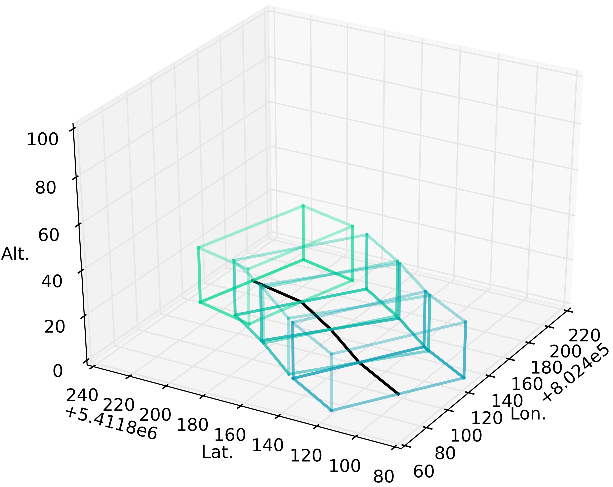
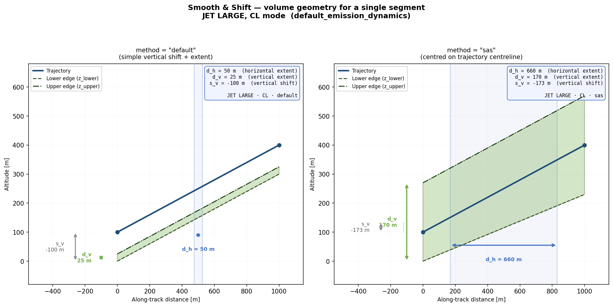
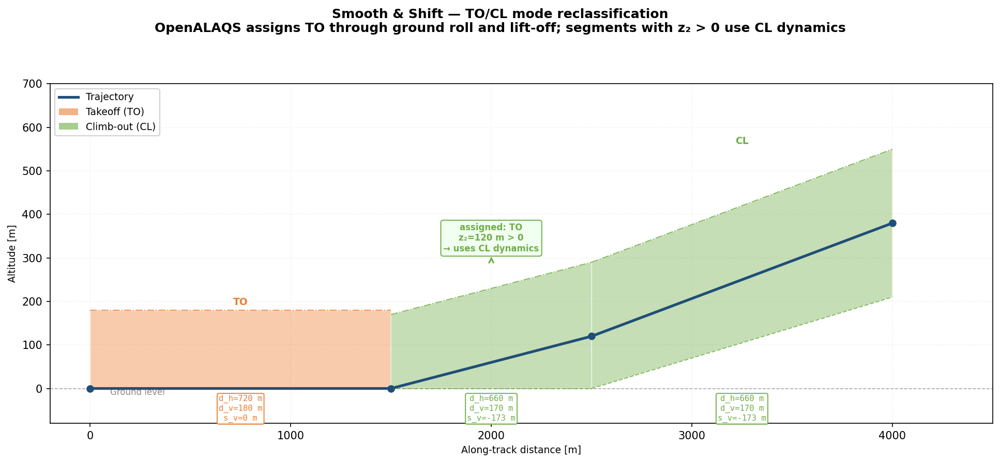
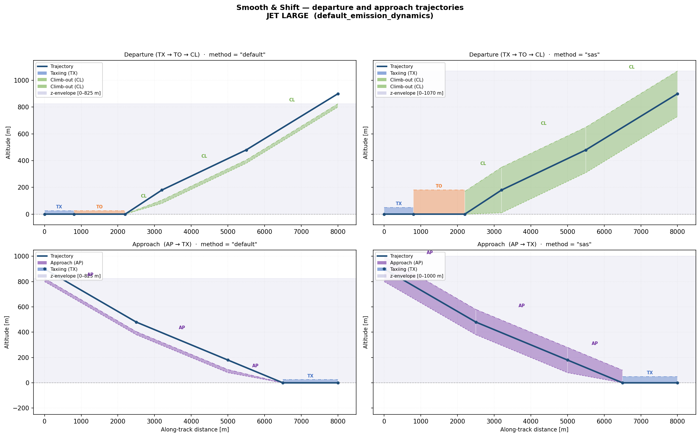
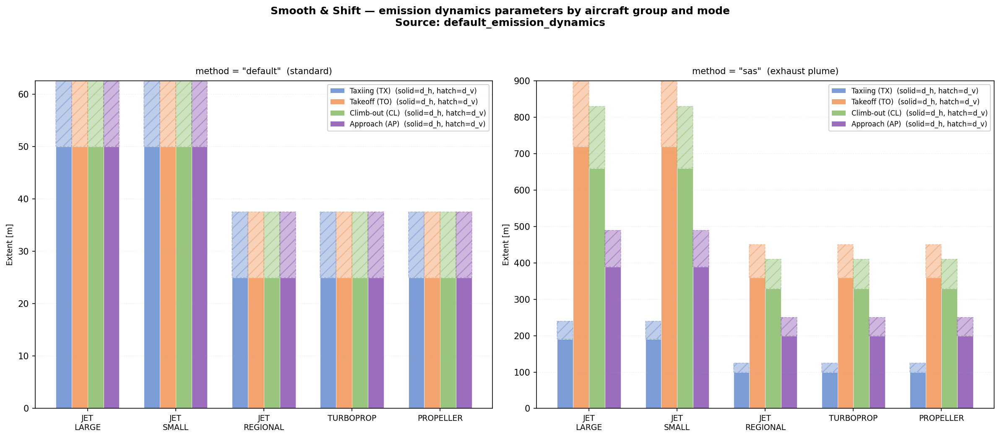

# Stationary and road sources: emission methods

This page explains how OpenALAQS computes the emissions of road traffic, parkings, point sources, area sources and engine test sites, and how source dynamics (Smooth & Shift) give aircraft emissions a volume. It is for modellers who want to know what the numbers mean; how to enter these sources in QGIS is in the [User Guide](../user/USER_GUIDE.md#define-emission-sources).

- [Road traffic and parkings (COPERT)](#road-traffic-and-parkings-copert)
- [Point and area sources](#point-and-area-sources)
- [Engine test sites](#engine-test-sites)
- [Source dynamics (Smooth and Shift)](#source-dynamics-smooth-and-shift)
- [References](#references)

## Road traffic and parkings (COPERT)

Roadway emissions (landside and airside) and parking emissions are based on the COPERT 5 emission factors and the road transport chapters of the EMEP/EEA Air Emissions Inventory Guidebook. The emission factor data and its provenance are described in [Reference data: COPERT](REFERENCE_DATA.md#copert-road-vehicle-emission-factors).

The implementation preserves the core information of COPERT, with some simplification tailored to the scope of OpenALAQS. It generates typical emission factors for roadway segments or parking areas based on fleet year (as a proxy for Euro standard), country, fleet mix, number of vehicles, temperature, average speed, and roadway segment length.

The calculation has two stages: the fleet-averaged emission factors are computed when the user saves a roadway or parking (the **Recalculate** button), and the emission masses are computed for each hour when emissions are calculated.

### Stage 1: fleet-averaged emission factors

This is the Tier 3 method of the Guidebook. The module and its tables (3-39 to 3-46) follow the EMEP/EEA Guidebook 2019, Update Oct. 2020; later additions cite the Guidebook 2023, Update 2025.

1. **Emission factor lookup.** The row of `default_vehicle_ef_copert5` is selected for the country of the study and the tabulated speed closest to the feature's speed (rounded to the nearest 10 km/h between 10 and 130 km/h). Separate rows exist for `Hot`, `Cold` and `Evaporation` conditions.

2. **Hot emissions.** For each technology (vehicle category × fuel × Euro standard), the hot emission factor `e_hot [g/km]` is read from the table:
   ```
   E_hot [g] = N_vehicles × M [km] × e_hot [g/km]
   ```
   where `M` is fixed at 1 000 km per vehicle. It is a normalisation that cancels in step 4; the actual distance is applied in Stage 2.

3. **Cold-start emissions.** The cold mileage fraction β follows EMEP/EEA Table 3-39:
   ```
   β = 0.6474 − 0.02545 × L − (0.00974 − 0.000385 × L) × T
   ```
   where L is the average trip length, always 12.4 km (a default, not country-specific), and T is the ambient temperature [°C] of the study setup. For diesel HDTs and buses a separate formula applies: `β = min(8.25 / L, 1)` (EMEP/EEA Guidebook 2023 Update 2025, chapter 1.A.3.b.i-iv §3.4, p.77). Motorcycles and petrol HDTs use β = 0 (hot emissions only).

   A pollutant-specific reduction factor `bc` (EMEP/EEA Tables 3-41, 3-43, 3-46) modifies β for Euro 2 to Euro 6 petrol passenger cars and LCVs and for Euro 6 diesel passenger cars:
   ```
   E_cold [g] = N_vehicles × M [km] × β × bc × e_cold [g/km]
   ```

4. **Total and fleet average.** `E_total = E_hot + E_cold`, summed across all technologies of the fleet mix:
   ```
   e_avg [g/km] = Σ E_total [g] / Σ (N_vehicles × M [km])
   ```
   For a roadway, `e_avg` is the stored emission factor (`co_gm_km`, `nox_gm_km`, and so on, in g/km per vehicle).

5. **Parkings.** A parking stores emission factors per vehicle (g/vehicle). Each pollutant is `e_avg` times the parking's **Travel Distance** (converted from m to km). VOC also receives the evaporative emission: the `Evaporation` rows (Diurnal and Hot soak; Running losses are excluded, see below) are summed into `eVOC [g/day]` per vehicle and scaled by the idle time:
   ```
   VOC_evap [g/vehicle] = eVOC [g/day] × idle_time [min] / (24 × 60)
   HC [g/vehicle]       = e_avg_VOC [g/km] × travel_distance [km] + VOC_evap [g/vehicle]
   ```

The temperature is the airport temperature of the study setup. The country and fleet year are also study settings.

In the code: `open_alaqs/core/tools/copert5.py` (`roadway_emission_factors`) and `copert5_utils.py` (`ef_query`, `cold_mileage_fractions`, `calculate_evaporation`).

### Stage 2: emissions per hour

For each hour, the activity of a roadway or parking is the number of vehicles in that hour: the **Vehicles per Year** spread over the year with the hourly, daily and monthly profiles, as for point sources (see [Point and area sources](#point-and-area-sources)).

Roadway:
```
emission [kg] = EF [g/km] × L [km] × vehicles_in_hour × length_fraction / 1000
```
where `L` is the length of the roadway line, and `length_fraction` is 1 unless the roadway extends outside the calculation grid, in which case it is the share of its length inside the grid (the emission then gets the clipped geometry).

Parking:
```
emission [kg] = EF [g/vehicle] × vehicles_in_hour / 1000
```

In the code: `RoadwaySourceModule.process` and `ParkingSourceModule.process` in `open_alaqs/core/modules/`.

### Pollutant mapping

| OpenALAQS output column | COPERT 5 source | Notes |
|---|---|---|
| `co_kg` | `eCO[g/km]` | Hot + cold |
| `hc_kg` | `eVOC[g/km]` + evaporation | VOC used as HC proxy; evaporative VOC for parkings only |
| `nox_kg` | `eNOx[g/km]` | Hot + cold |
| `sox_kg` | `eSO2[g/km]` | Hot only |
| `pm10_kg` | `ePM2.5[g/km]` | COPERT 5 reports PM2.5; used as PM10 |
| `p1_kg` | `ePM0.1[g/km]` | PM0.1 from COPERT 5 |
| `p2_kg` | `ePM2.5[g/km]` | Same as `pm10_kg` |

PM10 equals PM2.5 for road transport exhaust (EMEP/EEA Guidebook 2023 Update 2025, §1.1, p.4). CO2 is not computed by the COPERT module: the `co2_kg` column stays zero for roadway and parking sources.

### Known limitations and future work

These are documented simplifications of the COPERT 5 implementation; comments in the code refer to them by number. They do not block correct use of the module.

**1. Parking cold-start option.** By default the cold-start part of a parking is the fleet-averaged factor (computed for a 12.4 km trip) times the short parking distance. An option, off by default and not set from the plugin forms, makes the parking carry the full cold-start emission of departing vehicles. It evaluates the cold factor at a single speed (30 km/h) over a single trip length (12.4 km). Per the Guidebook 2023 Update 2025 chapter 1.A.3.b.i-iv §3.4, cold-start factors depend on speed (Tables 3-40, 3-44, 3-47) and the trip length should reflect the actual trip-length distribution. Both values can be overridden per study (`parking_cold_speed_kmh`, `parking_cold_trip_length_km`).

**2. Evaporation: Hot soak scaling and Running losses.** Running losses are excluded from parking evaporation per Guidebook chapter 1.A.3.b.v §4.7 (p.28-29). Two approximations remain:

- *Hot soak per event*: Diurnal and Hot soak are both scaled by `idle_time / (24 × 60)`. Per Guidebook §2.1.3 and the Tier 2 equations, Hot soak is a fixed amount per parking event (one per engine turn-off). The approximation understates Hot soak for short parkings and overstates it for long ones.
- *Running losses on roadways*: per Guidebook §4.7, Running losses depend on mileage and belong to driving sources. OpenALAQS does not add an evaporation contribution to roadways, so this VOC is not in the inventory (small on modern fleets).

**3. Data items.** The EU27 / EU28 labelling mismatch and the low NH3 values of the data file are described in [Reference data: COPERT](REFERENCE_DATA.md#copert-road-vehicle-emission-factors).

How the Guidebook is cited in the code, and what to re-check at the next Guidebook update, is in [DATASET_PROVENANCE.md](../developer/DATASET_PROVENANCE.md#6-guidebook-citations-in-the-code).

## Point and area sources

Point sources represent stationary facilities such as power and heating plants, incinerators, training fires, fuel storage tanks and stationary internal-combustion engines. Area sources hold user-defined emissions not covered by the other source types. Both use the same method: an emission factor times an annual activity, spread over the year with activity profiles.

- **Point source.** The emission factors (kg per activity unit) come from the selected category and type in [`default_stationary_ef`](REFERENCE_DATA.md#stationary-source-emission-factors). The activity is **Activity per Year** in the source's **Activity Unit** (for example `1000_m3` of natural gas, `1000_L` of fuel throughput, `hr` of engine operation, `1000_kg` of waste).
- **Area source.** The user enters the emission factors (kg per unit) and **Units per Year**.

For each hour h of the inventory year:

```
emission_kg(h) = EF_kg_per_unit × annual_activity / H
                 × hour_factor(h) × day_factor(h) × month_factor(h) / profile_mean
```

where H is the number of hours in the year (8760, or 8784 in a leap year) and `profile_mean` is the mean of the product of the three profile factors over the calendar year. Dividing by it makes the annual total exactly `EF × annual_activity`, whether or not the profiles average to 1. With all three profiles constant, each hour gets `EF × annual_activity / H`. For an interval of several hours, the hourly values are summed.

The profiles are therefore relative shapes, not absolute activity ratios. Their values are non-negative and not capped at 1; only the ratios within a profile matter. Two consequences:

- A factor of 0 for some period (for example a night curfew) zeroes the emission in that period and moves its mass to the other periods: the annual total is kept. To lower the annual emission, lower the annual activity instead.
- If every factor is 0 (`profile_mean` = 0), the emission is 0 in every hour; no normalisation is applied.

The same profile normalisation gives the hourly number of vehicles of roadways and parkings.

Worked examples (from the default factors):

- Heating plant on natural gas (category 2): 850 000 m³ per year is `Activity per Year = 850` with unit `1000_m3`. With the type *Natural Gas, EMEP Tier 1 commercial/institutional* (`nox_kg_k = 1.84`), annual NOx = 850 × 1.84 = 1 564 kg.
- Diesel backup generator (category 6, Stationary IC Engine): 400 operating hours per year with unit `hr`. With the type `Diesel <600 hp, Uncontrolled` (`nox_kg_k = 4.41` kg/hr), annual NOx = 400 × 4.41 = 1 764 kg.

The fuel tank factors (category 3, unit `1000_L` of throughput) give HC only: they are evaporative VOC losses.

Stationary IC engine types are diesel reciprocating engines at two power tiers, `>600 hp` (split into *Prechamber* and *Open-Chamber* combustion, per AP-42 §3.4) and `<600 hp`.

An area source flagged as an engine test site does not use this method; see [Engine test sites](#engine-test-sites).

In the code: `SourceModule.getRelativeActivityPerHour` (`open_alaqs/core/interfaces/SourceModule.py`), `PointSourceModule.process`, `AreaSourceModule.process`.

## Engine test sites

An engine test site (run-up pad) is an area source whose emissions come from discrete engine test events instead of an emission rate times a profile. Each event gives a start and end time, an aircraft type and engine, the running time in each of the four ICAO modes, and a thrust computation mode. The events file format is in [Input formats](../user/INPUT_FORMATS.md#engine-test-events).

For each event and each mode with a non-zero running time:

```
t_effective_s  = t_mode_s × engine_count × period_window_fraction
fuel_burned_kg = fuel_flow_kg_s × t_effective_s
mass_g         = EI_g_per_kg × fuel_burned_kg
```

`period_window_fraction` splits events that straddle two inventory periods: it is the share of the event's duration inside the period. An event from 09:30 to 10:30 with a 09:00 to 10:00 period gives 50 % of its emissions to that period and 50 % to the next. The mode times are treated as uniform over the event window.

Thrust computation modes (per event, default `snap`):

- `snap`: the ICAO EEDB emission index of each mode, no ambient correction.
- `meem`: the nvPM correction (MEEM V1). It gives the same result as `snap` for engine tests, because the test modes are the ICAO certification thrust settings at ground level.
- `bffm2`: the gas-phase emission indices (NOx, CO, HC) are corrected with the ambient conditions of the meteo row nearest in time to the event's midpoint, ties to the earlier row; plugin and standalone use the same row (SAE AIR 5715, see [Aircraft emissions: BFFM2](AIRCRAFT_EMISSIONS.md#bffm2)). PM10 and SOx are taken from the engine table per mode (SOx 0.758 g/kg for jet fuel and 0.2 g/kg for AvGas when the table gives none). Without any meteo row, ISA conditions are used and a warning is written once per run.

Engine test sites are not processed as ordinary area sources, so they are not counted twice.

In the code: `open_alaqs/core/modules/EngineTestSourceModule.py`.

## Source dynamics (Smooth and Shift)

OpenALAQS calculates three-dimensional emission distributions. To feed them into dispersion models, the near-field exhaust dynamics must be accounted for: engine momentum, buoyant plume rise and atmospheric diffusion. Source dynamics approximate these effects by expanding each aircraft trajectory segment into a three-dimensional volume before it enters the emission grid.

The approach comes from the EUROCONTROL report [`EEC/SEE/2005/016`](../pdf/038_Derivation_of_Smooth_and_Shift_Parameters_for_ALAQS-AV.pdf) (Smooth & Shift) and was used to connect ALAQS-AV output to dispersion models. The parameters were originally derived from [`LASPORT`](https://www.janicke.de/en/lasport.html) v1.6 and later updated to LASPORT v2.2. They are stored in [`default_emission_dynamics`](REFERENCE_DATA.md#emission-dynamics) per aircraft group and LTO mode and can be modified.

Source dynamics apply to aircraft movements: flight segments and taxiing get a volume. When source dynamics are on, gate emissions get a fixed vertical extent from 0 to 5 m. Roadways, parkings, point and area sources are not affected.

The figure below shows a taxiway example: each line segment (black) is expanded into a lateral and vertical polygon volume.



### Volume geometry

For each segment between two consecutive trajectory points, a cross-section is built from three parameters per aircraft group and LTO mode:

| Parameter | Column (`default`) | Column (`smooth & shift`) | Description |
|---|---|---|---|
| `d_h` | `horizontal_extent_m` | `horizontal_extent_m_sas` | Full lateral width of the volume [m], centred on the trajectory |
| `d_v` | `vertical_extent_m` | `vertical_extent_m_sas` | Vertical extent of the volume [m] |
| `s_v` | `vertical_shift_m` | `vertical_shift_m_sas` | Vertical shift of the volume [m] (used by `default` only) |

The **Source Dynamics** option of the Configuration tab selects the method: `none`, `default` or `smooth & shift`.

**`none`**: no volume is built; the emissions stay on the trajectory.

**`default`**: the lower edge of the volume is the trajectory point shifted vertically by `s_v`, and the volume extends upward by `d_v`:

```
z_lower = z_trajectory + s_v
z_upper = z_lower + d_v
```

**`smooth & shift`**: the volume is centred on the trajectory point and spans `d_v` below and above it. The vertical shift column `vertical_shift_m_sas` is not used:

```
z_lower = z_trajectory − d_v
z_upper = z_trajectory + d_v
```

In both methods the polygon vertices are clamped to zero (ground level), but the vertical extent given to the emission record (`z_min`) is not: with a negative `s_v` or with `smooth & shift` near the ground, `z_min` can be below 0. Taxiing segments are at ground level (z = 0), and there is no horizontal shift: the volume is always centred laterally on the trajectory (the `horizontal_shift_m` column of the table is not read).

The figure below illustrates the two methods for a representative climb segment (JET LARGE, CL mode, training example dynamics):



In the code: `GeoTransformation._compute_z_envelope` and `GeoTransformation.create_polygon_3d` in `open_alaqs/core/GeoTransformation.py`; the parameters are read in `open_alaqs/core/interfaces/EmissionDynamics.py`.

### LTO mode and TO/CL reclassification

The LTO mode selects the row of `default_emission_dynamics` used for each segment. OpenALAQS follows a different convention from LASPORT:

- LASPORT defines TO as the ground roll only; once the aircraft is airborne it is in CL.
- OpenALAQS assigns TO through the entire take-off phase. A TO segment whose end point is above the ground (`z₂ > 0`) uses the CL dynamics for its volume. The LTO mode of the emission record is not changed; only the dynamics lookup is.

The volume therefore widens and deepens as soon as the aircraft leaves the ground, reflecting the change from ground roll to free-jet exhaust. The figure below shows this on a departure trajectory:



### Departure and approach trajectories

The figure below shows the volumes of a departure and an approach for a JET LARGE aircraft, with the dynamics of the training example, for both methods. The coloured bands are the vertical extent at each segment; the navy shading is the overall vertical envelope given to the emission record (`z_min` to `z_max`).



Observations:

- With `default`, approach (AP) volumes are shifted down (`s_v = −100 m` for JET LARGE), representing the exhaust plume below the glide slope.
- With `smooth & shift`, AP volumes are centred on the trajectory and extend `d_v = 100 m` above and below it.
- With `smooth & shift`, the envelope of the full departure spans from the ground to well above 900 m.

### Parameter values

The figure below summarises `d_h` and `d_v` for the main aircraft groups and the four LTO modes under both methods. JET LARGE aircraft have the largest volumes; helicopters and GSE the smallest.



The complete table is [`default_emission_dynamics`](../../open_alaqs/database/data/default_emission_dynamics.csv). Values for JET LARGE (the `s_v` of `smooth & shift` is stored but not used):

| Mode | `d_h` (default) | `d_v` (default) | `s_v` (default) | `d_h` (sas) | `d_v` (sas) | `s_v` (sas, not used) |
|---|---|---|---|---|---|---|
| TX | 50 m | 25 m | 0 m | 190 m | 50 m | 0 m |
| TO | 50 m | 25 m | 0 m | 720 m | 180 m | 0 m |
| CL | 50 m | 25 m | −100 m | 660 m | 170 m | −173 m |
| AP | 50 m | 25 m | −100 m | 390 m | 100 m | −138 m |

## References

- EMEP/EEA air pollutant emission inventory guidebook 2019 (Update Oct. 2020) and [2023 (Update 2025)](https://www.eea.europa.eu/publications/emep-eea-guidebook-2023), chapters 1.A.3.b.i-iv (road transport exhaust) and 1.A.3.b.v (gasoline evaporation).
- COPERT 5.4.52, [EMISIA](https://copert.emisia.com/) for the European Environment Agency.
- US EPA AP-42, sections 1.4 (natural gas combustion), 3.3 (gasoline and diesel industrial engines) and 3.4 (large stationary diesel engines).
- EUROCONTROL, [Derivation of Smooth and Shift parameters for ALAQS-AV](../pdf/038_Derivation_of_Smooth_and_Shift_Parameters_for_ALAQS-AV.pdf), EEC/SEE/2005/016.

See also: [Reference data](REFERENCE_DATA.md), [Aircraft emissions](AIRCRAFT_EMISSIONS.md), [User Guide: define emission sources](../user/USER_GUIDE.md#define-emission-sources), [Dispersion with AUSTAL](../user/DISPERSION_AUSTAL.md).
