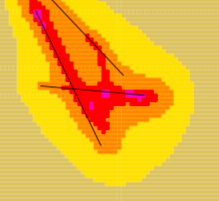
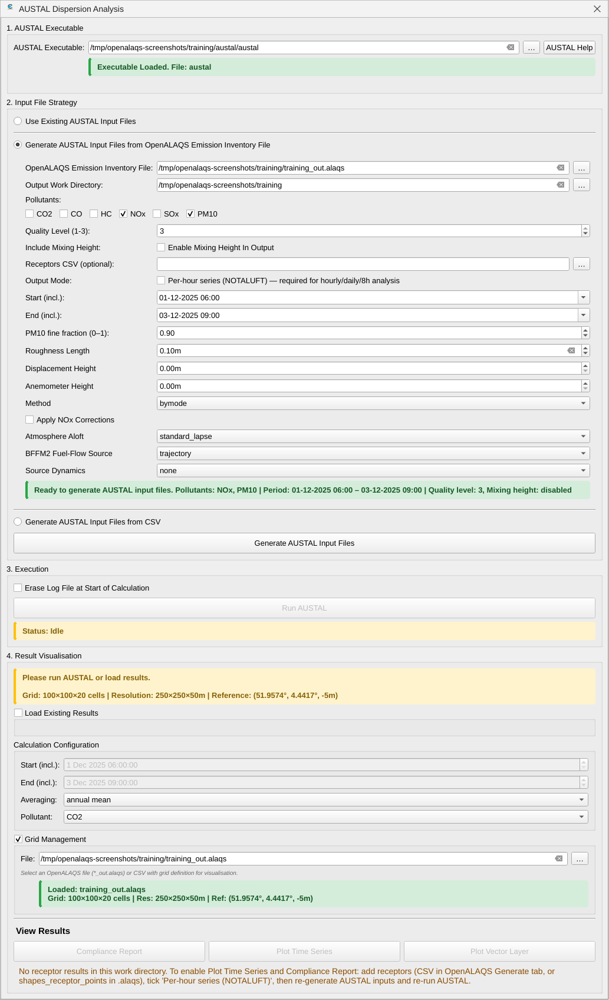
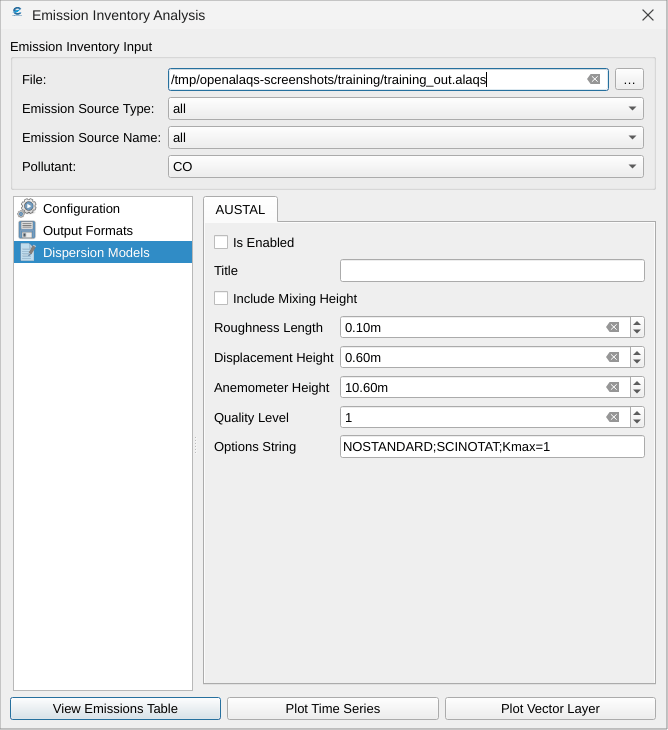
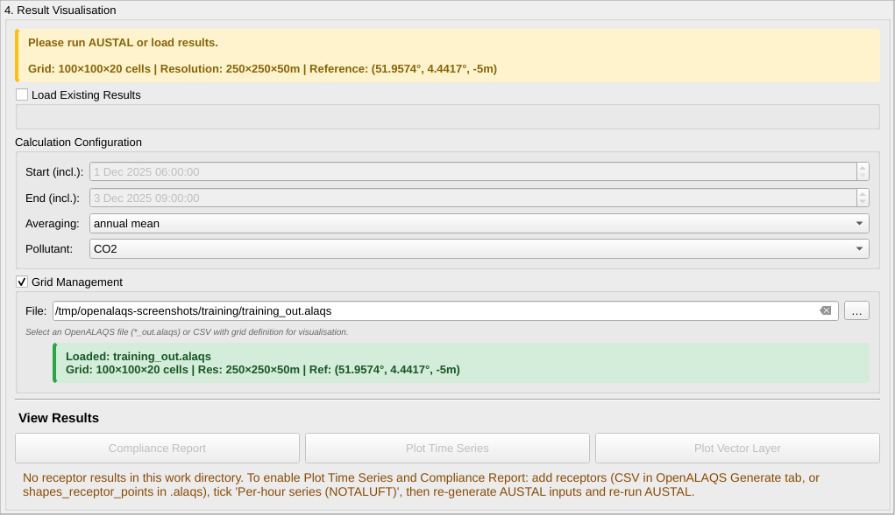

# Dispersion modelling with AUSTAL

This page explains how to turn an OpenALAQS emission inventory into concentrations with the AUSTAL dispersion model, and how to view the results in QGIS. It is for users of the QGIS plugin who have already built an inventory (see the [User Guide](USER_GUIDE.md#generate-emissions-inventory)).

Contents:
- [Two ways to prepare an AUSTAL run](#two-ways-to-prepare-an-austal-run)
- [Before you start](#before-you-start)
- [Calculate Dispersion dialog](#calculate-dispersion-dialog)
- [Dispersion Models tab](#dispersion-models-tab)
- [Site parameters](#site-parameters)
- [AUSTAL input files](#austal-input-files)
- [AUSTAL output files](#austal-output-files)
- [Results](#results)
- [Typical session](#typical-session)
- [Common failure modes](#common-failure-modes)

## Two ways to prepare an AUSTAL run

AUSTAL is the reference dispersion model of the German TA Luft. OpenALAQS writes its input files, starts it, and reads its output. You can prepare the input files in two places:

- **Calculate Dispersion dialog** (toolbar button **Calculate Dispersion**). The usual path. It writes the input files from an inventory file (`*_out.alaqs`) or from CSV files, runs AUSTAL and shows the results. See [Calculate Dispersion dialog](#calculate-dispersion-dialog).
- **Dispersion Models tab** of the *Emission Inventory Analysis* window (toolbar button **Visualize Emission Calculation**). It writes the input files while you calculate emissions, with the same method and settings as that calculation. You then run AUSTAL from the Calculate Dispersion dialog. See [Dispersion Models tab](#dispersion-models-tab).

The two paths differ in what they let you set:

| | Calculate Dispersion dialog | Dispersion Models tab |
|---|---|---|
| Emission method | set in the inventory option, with the same choices as the *Configuration* tab; default `bymode`, no NOx correction, no source dynamics | the method and settings of the *Configuration* tab (for example BFFM2) |
| Pollutants | any of CO2, CO, HC, NOx, SOx, PM10 in one run | the one pollutant selected in the window |
| Site parameters z0, d0, ha | set in the dialog; default 0.1 / 0.6 / 10.6 m | set on the tab |
| Receptor points | **Receptors CSV** | **Receptor Points** of the *Configuration* tab |
| Per-hour output (NOTALUFT) | a check box | type it into **Options String** |
| Runs AUSTAL | yes | no: run it from the dialog with **Use Existing AUSTAL Input Files** |

## Before you start

- **AUSTAL is installed** and its `austal.settings` is replaced with the OpenALAQS copy. Without that copy, AUSTAL does not know the CO2, CO, HC and SOx substances that OpenALAQS writes. See [AUSTAL installation](../AUSTAL/AUSTAL.md#installation).
- **You have an inventory file** (`*_out.alaqs`) made with **Calculate Emissions Inventory**. It holds the sources, movements, meteorology and the calculation grid. See [Calculate Emissions Inventory window](USER_GUIDE.md#calculate-emissions-inventory-window).
- **Optional: receptor points.** Without them AUSTAL produces only concentration maps; with them it also produces hourly time series at each point, which the time series plot and the compliance report need.

## Calculate Dispersion dialog

Click **Calculate Dispersion** on the OpenALAQS toolbar:



The *AUSTAL Dispersion Analysis* dialog has four numbered sections. Work through them in order. Each section has a status line that turns green when its inputs are complete.



### 1. AUSTAL Executable

Use the file picker to select `austal.exe` (Windows) or `austal` (Linux). The picker shows only files with these names. The status line then reads *Executable Loaded*. The path is remembered, so you do this once per computer.

The **AUSTAL Help** button opens a short reminder of where to download AUSTAL, which `austal.settings` to use and where to find the English language files, with links to the [AUSTAL installation page](../AUSTAL/AUSTAL.md).

### 2. Input File Strategy

Choose where AUSTAL's input files come from. Pick one of three options; each shows its own fields.

| Option | Use it when |
|---|---|
| **Use Existing AUSTAL Input Files** | You already have a folder with `austal.txt`, `series.dmna` and the emission grid files, for example from the [Dispersion Models tab](#dispersion-models-tab). Set **Work Directory** to that folder. Nothing is generated; AUSTAL runs in that folder. |
| **Generate AUSTAL Input Files from OpenALAQS Emission Inventory File** | The usual case. Set **OpenALAQS Emission Inventory File** to your `*_out.alaqs` and **Output Work Directory** to a folder for the run. |
| **Generate AUSTAL Input Files from CSV** | You have an emissions CSV and a meteorology CSV prepared outside the inventory. Set **Output Directory**, **Emissions CSV File** and **Meteorology CSV File**. The CSV formats are described in the [`austal_from_csv` README](../../scripts/austal_from_csv/README.md#input-csv-formats). |

The two Generate options share these fields:

- **Pollutants**: CO2, CO, HC, NOx, SOx, PM10. Tick at least one. Only the ticked pollutants are written.
- **Quality Level (1-3)**: default 3. Each step up doubles the number of simulation particles in AUSTAL: less statistical noise, longer run.
- **Include Mixing Height**: when ticked, AUSTAL uses the mixing height of each hour of the meteorology. When not ticked, AUSTAL applies its own mixing height.
- **Receptors CSV (optional)**: points where AUSTAL writes hourly time series. The format, the limit of 20 points and which points are used when the picker is empty or the file cannot be read are in [Receptor points](INPUT_FORMATS.md#receptor-points).
- **Output Mode: Per-hour series (NOTALUFT)**: when ticked, AUSTAL writes one concentration file per hour and, with receptors, a time series per receptor. Without it, AUSTAL writes only the mean over the run. See [AUSTAL output files](#austal-output-files) for which result needs what.
- **Start (incl.)** / **End (incl.)**: the part of the data to disperse. They fill in with the full time range when you select the inventory or emissions file. A period outside the data stops the generation with a message giving the available range.
- **PM10 fine fraction (0-1)**: default 0.9. AUSTAL treats PM10 as two size classes: fine (below 2.5 µm) and coarse (2.5 to 10 µm). This value is the fine share. 0.9 suits a typical airport mix (aircraft, ground support equipment, vehicle exhaust); the tooltip suggests 0.95 for pure aircraft exhaust, 0.70 for road traffic with tyre and brake wear, 0.40 to 0.50 for wear or dust dominated sources.
- **Roughness Length**, **Displacement Height**, **Anemometer Height**: the [site parameters](#site-parameters) z0, d0 and ha written to `austal.txt`. Defaults 0.1 m, 0 and 0. A value of 0 in Displacement Height or Anemometer Height derives it from z0 (6 × z0 and 10 m + d0), so the defaults give 0.1 / 0.6 / 10.6 m and changing z0 alone keeps the three consistent. Anemometer Height must be above Displacement Height, or the generation stops with a message.

Only the inventory option has the emission settings, since it recalculates the emissions. They are the settings of the *Configuration* tab of **Visualize Emission Calculation**, see [Calculate emissions and query results](USER_GUIDE.md#calculate-emissions-and-query-results). The defaults are the settings used before these fields existed:

- **Method**: `bymode` (default) or `BFFM2`. BFFM2 changes the fuel flow and the emission indices of CO, HC and NOx. The other pollutants keep their per-mode emission indices, applied to the BFFM2 fuel flow, as in any BFFM2 calculation. So with BFFM2 the CO2, SOx and PM10 inputs change too.
- **Apply NOx Corrections**: not ticked by default.
- **Atmosphere Aloft**: `standard_lapse` by default. With `surface_layer` the profile uses the site parameters of this dialog.
- **BFFM2 Fuel-Flow Source**: `trajectory` by default. Used only with BFFM2.
- **Source Dynamics**: `none` by default.

Only the CSV option has the **Grid Configuration** box, since there is no inventory to take the grid from:

- **Grid File**: an `*_out.alaqs` or a grid CSV; its grid fills **Grid Details**.
- **Grid Details**: X/Y/Z Cells, X/Y/Z Resolution (m), Reference Latitude/Longitude (°) and Reference Altitude (m). You can type the grid here instead of loading a file. Cell sizes are true ground metres: the grid is built in the local UTM zone.
- **Save Grid as CSV** writes the grid to a new CSV. **Update File** writes the edited grid back into the selected grid file.

With the inventory option the grid is always the inventory's calculation grid.

AUSTAL needs square cells. If the X and Y resolutions differ, the smaller one is used for both. AUSTAL's calculation grid is the emission grid plus two cells on every side.

#### Generate AUSTAL Input Files

When the status line of your option is green, click **Generate AUSTAL Input Files**. The plugin:

1. creates a folder `AUSTAL` inside the output folder you chose. If that folder is not empty, it asks before deleting its contents;
2. with the inventory option, recalculates the emissions of all sources from the inventory with the emission settings above for the selected period;
3. writes the [AUSTAL input files](#austal-input-files) into `AUSTAL`, with the [site parameters](#site-parameters) of the dialog.

The status line then shows the path of the `AUSTAL` folder. **Run AUSTAL** becomes available. If you switch to another option, generate again before running.

### 3. Execution

- **Erase Log File at Start of Calculation**: AUSTAL starts a new `austal.log` instead of appending to the old one.
- **Run AUSTAL**: with a Generate option it is available only after a successful generation; with **Use Existing AUSTAL Input Files**, as soon as the work directory is valid.

When you click **Run AUSTAL**, the plugin checks sections 1 and 2. If something is missing, a message names it and nothing runs. Otherwise AUSTAL runs in the `AUSTAL` folder (or in your work directory) and opens its own console window, where you can follow its progress. QGIS waits until AUSTAL ends. A run can take from minutes to hours, depending on the grid, the period and the quality level.

When AUSTAL ends without error, the status line turns green and a message confirms the run. When it fails, a message gives AUSTAL's exit code and the last 40 lines of `austal.log` (or points to the console window if there is no log).

### 4. Result Visualisation

This section shows the results of the run. See [Results](#results).

## Dispersion Models tab

The *Emission Inventory Analysis* window (toolbar button **Visualize Emission Calculation**) has a **Dispersion Models** tab with an **AUSTAL** page. Use it when the AUSTAL inputs must come from the emission calculation of that window, for one pollutant at a time.



| Setting | Default | Meaning |
|---|---|---|
| **Is Enabled** | not ticked | Tick to write AUSTAL input files during the next calculation. |
| **Title** | empty | Title written into `austal.txt`. |
| **Include Mixing Height** | not ticked | As in the dialog: AUSTAL uses the hourly mixing height of the meteorology. Needs `NOSTANDARD` in the options string. |
| **Roughness Length** | see [Site parameters](#site-parameters) | z0. |
| **Displacement Height** | see [Site parameters](#site-parameters) | d0. `0` means "derive from z0". |
| **Anemometer Height** | see [Site parameters](#site-parameters) | ha. `0` means "derive from z0". |
| **Quality Level** | 1 | 1 to 10; each step up doubles the number of particles. |
| **Options String** | `NOSTANDARD;SCINOTAT;Kmax=1` | AUSTAL options, separated by semicolons. `NOSTANDARD` allows non-standard settings (needed for the mixing height and for `Kmax`); `SCINOTAT` writes the results in scientific notation; `Kmax=1` writes only the ground layer of concentrations (`Kmax=3` writes three layers). Add `NOTALUFT` for per-hour output. |

To write the input files:

1. Set the *Configuration* tab as for any emission calculation (method, period, **Receptor Points** if you want receptor time series). See [Calculate emissions and query results](USER_GUIDE.md#calculate-emissions-and-query-results).
2. On the **Dispersion Models** tab, tick **Is Enabled** and set the values above.
3. Select the pollutant in the window and click an output button (**View Emissions Table** is fastest).
4. The plugin asks for an output folder (*AUSTAL: Select Output directory*). If the folder is not empty, it asks whether to delete the files in it.
5. Open **Calculate Dispersion**, select **Use Existing AUSTAL Input Files** with that folder as **Work Directory**, and click **Run AUSTAL**.

The site parameters of this tab are also used for the `surface_layer` atmosphere aloft of the emission calculation, whether **Is Enabled** is ticked or not.

## Site parameters

The AUSTAL input file holds three site parameters. AUSTAL derives its wind and turbulence profiles, and so the dilution of every source, from them and the hourly wind. OpenALAQS also uses them for the `surface_layer` atmosphere aloft, where their effect on emissions is small: under 0.2 % in NOx on a test day.

| Parameter | Meaning | How to set it |
| --- | --- | --- |
| `z0`, Roughness Length (m) | aerodynamic roughness of the area around the sources | from the land cover around the sources (step 1) |
| `d0`, Displacement Height (m) | height by which the profiles are shifted up over vegetation or buildings | 6 × z0 (AUSTAL default) unless there is a reason to deviate |
| `ha`, Anemometer Height (m) | the height at which the meteo file's wind applies, **for the roughness z0** | from the anemometer's real height and its own surroundings (step 2); 10 m + d0 only if the anemometer stands on ground as rough as z0 |

### Step 1: z0 from the land cover

AUSTAL implements TA Luft (2021, Anhang 2). Its rule for z0:
1. For each source, take the area-weighted mean of the TA Luft z0 values of the land cover within a circle around the source. The radius is 15 × the source height, at least 150 m.
2. Average over the sources; for sources of different height, weight by the square of the height.
3. Round to the nearest TA Luft class: 0.01, 0.02, 0.05, 0.10, 0.20, 0.50, 1.0, 1.5 or 2.0 m.

Outside Germany AUSTAL has no roughness register, so z0 must be entered. CORINE Land Cover (EEA, 100 m) gives the land-cover class. TA Luft values for common classes:

| CORINE class | z0 (m) |
| --- | --- |
| water bodies (512) | 0.01 |
| sport and leisure (142) | 0.05 |
| airports (124), meadows and pastures (231), arable land (211) | 0.10 |
| roads and rail (122), urban green (141) | 0.20 |
| port areas (123) | 0.50 |
| discontinuous urban (112), industrial and commercial (121) | 1.0 |
| continuous urban (111) | 2.0 |

AUSTAL takes **one z0 for the whole domain**. When the sources sit on very different ground, choose for the question asked and say so in the report:
- an airport-only study takes the airport's value;
- a study that adds city road traffic takes the value over all sources, or runs both as a sensitivity.

*Example (Rotterdam The Hague, 2025 sources, CORINE 2018):*
- airport ground sources, emission-weighted: 0.105 m, class 0.10;
- roads: 0.65 to 0.69 m, class 0.50.

### Step 2: ha for that z0

The meteo file's wind was measured at a real height h over the anemometer site's own roughness z0s, normally 10 m over grass at an airfield. AUSTAL instead reads the wind as if measured at height `ha` over ground of roughness z0.
- **Same roughness (z0s = z0):** ha = 10 m + d0, which is AUSTAL's default.
- **Different roughness:** ha is the equivalent height at which the profile over z0 gives the measured speed. German DWD time series (AKTerm) carry one such height per roughness class for this reason (AUSTAL manual, section 3.5.1).

Using 10 m + d0 when the site is smoother than z0 makes AUSTAL overestimate u* and the dilution, so concentrations come out low.

*Order of magnitude* (neutral log profiles, equal wind at 100 to 200 m; an approximation, not the DWD procedure) for a 10 m anemometer over z0s = 0.03 to 0.10 m:

| z0 of the study | d0 = 6 z0 | ha |
| --- | --- | --- |
| 0.10 | 0.6 | 10 to 15 m |
| 0.20 | 1.2 | 13 to 20 m |
| 0.50 | 3.0 | 19 to 28 m |
| 1.0 | 6.0 | 25 to 37 m |

Where the met service supplies equivalent anemometer heights, use those. In the Netherlands, KNMI also publishes "potential wind": hourly wind at 10 m, reduced to a standard roughness of 0.03 m. With that series z0s = 0.03 m by construction.

### Step 3: keep the meteo file consistent

The Obukhov length L in the meteorology describes stability for a roughness too. AUSTAL's own conversion from stability class to L (TA Luft, Klug/Manier classes) depends on z0. A meteo file whose L was made for another roughness, or without one, gives profiles that are inconsistent with z0. The [METAR converter](../../scripts/README_metar_to_alaqs_meteo.md) assigns L independently of z0, a known limitation.

### Where to set them

| Tool | Setting | Default |
| --- | --- | --- |
| Plugin, [Dispersion Models tab](#dispersion-models-tab) of **Visualize Emission Calculation** | Roughness Length, Displacement Height, Anemometer Height | 0.1 / 0.6 / 10.6 m; `0` in Displacement Height or Anemometer Height derives it from z0 |
| Plugin, [Calculate Dispersion dialog](#calculate-dispersion-dialog) (Generate AUSTAL Input Files) | Roughness Length, Displacement Height, Anemometer Height, in each Generate option | 0.1 m, 0, 0, which give 0.1 / 0.6 / 10.6 m; `0` in Displacement Height or Anemometer Height derives it from z0 |
| [Standalone](../../openalaqs_standalone/USAGE.md) `austal` subcommand, `austal_prep`, Dataiku recipe | `--z0`, `--d0`, `--ha`; `z0`, `d0`, `ha` in `config.json` and `recipe_config.json` | 0.1 m / 6 z0 / 10 m + d0; an empty or `null` value is derived from z0 |
| `surface_layer` without an AUSTAL module (plugin, standalone `aircraft`, headless runner) | `--z0`, `--d0`, `--ha`; `atmosphere_z0_m`, `atmosphere_d0_m`, `atmosphere_ha_m` | as the AUSTAL module |

**Current behaviour in the plugin.** The values on the Dispersion Models tab are used for the `surface_layer` atmosphere aloft and for the AUSTAL input files that the tab writes when **Is Enabled** is ticked. The Calculate Dispersion dialog has its own fields: **Generate AUSTAL Input Files** writes them into `austal.txt` and, with the inventory option, uses them for the `surface_layer` atmosphere aloft.

**Defaults.** The plugin, the standalone and `austal_prep` share one default: z0 = 0.1 m, the TA Luft value for airports (class 124), the land use around most airport sources; d0 = 6 z0 and ha = 10 m + d0, AUSTAL's own defaults, consistent with each other when the anemometer stands on the airfield. d0 and ha are derived from z0 whenever they are left empty, so changing z0 alone keeps the three consistent. These defaults changed in 5.4.1, and so do the results of studies that keep them; see [Upgrading from 5.4.0](UPGRADING.md#upgrading-from-540).

**Report the three values and how they were chosen** with every AUSTAL result.

## AUSTAL input files

Both paths write the same set of files. For the dialog's Generate options they go into `AUSTAL` inside the folder you chose.

| File | Content |
|---|---|
| `austal.txt` | Main input: title, quality level, site parameters (z0, d0, ha), `hm ?` when the mixing height is included, calculation grid (mesh width, origin, number of meshes), receptor points if any (positions and heights), options string, and one column per AUSTAL source whose values are marked `?` (read from `series.dmna`). |
| `series.dmna` | Hourly time series: wind direction, wind speed, Obukhov length (and mixing height when included), and for each source the emission grid file index and the emission rate of each pollutant. |
| `NN/eNNNN.dmna` | 3D emission grids, one subfolder `NN` per AUSTAL source. The non-stationary sources (movements, gates, taxiways) start at `01/` with one file per hour; each stationary source group has its own folder with a single `e0001.dmna` for the whole run. |

The options string in `austal.txt`, as written by the dialog, is `NOSTANDARD;NOTALUFT;SCINOTAT;Kmax=1` with **NOTALUFT** ticked and `NOSTANDARD;SCINOTAT;Kmax=1` without it. `SCINOTAT` writes the results in scientific notation, so small concentrations keep their digits. `NOSTANDARD` is always set because AUSTAL needs it to read the mixing height from `series.dmna`.

PM10 is written as two AUSTAL emission lines, `pm-1` (fine) and `pm-2` (coarse), split by the **PM10 fine fraction**. AUSTAL sums them in its `pm` result.

See the [AUSTAL documentation](https://www.umweltbundesamt.de/en/topics/air/air-quality-control-in-europe/download) for the meaning of every input parameter.

## AUSTAL output files

AUSTAL writes its results and `austal.log` into the folder of `austal.txt`:

```
<output folder>/AUSTAL/
├── austal.txt                 # input (generated, or yours with "Use Existing")
├── series.dmna                # input time series
├── 01/, 02/, ...              # input emission grids (eNNNN.dmna)
├── austal.log                 # run log
├── <substance>-y00a.dmna      # mean concentration grid over the run (always)
├── <substance>-y00s.dmna      # its statistical uncertainty (always)
├── <substance>-NNNa.dmna      # one grid per hour, NNN = hour index (NOTALUFT only)
└── <substance>-tmpa.dmna      # hourly time series at the receptors (receptors + NOTALUFT only)
```

`<substance>` is the AUSTAL code: `co2`, `co`, `hc`, `nox`, `sox` (defined in the OpenALAQS `austal.settings`) and `pm` for PM10. In `y00a`, `00` is the grid number and `a` means additional load. Concentrations are in µg/m³ (CO2 in mg/m³). By default only the ground layer is written; `Kmax` in the options string writes more layers.

| File | Written when | Used by |
|---|---|---|
| `<substance>-y00a.dmna` | always | **Plot Vector Layer**, averaging `annual mean` |
| `<substance>-y00s.dmna` | always | not read by the plugin; statistical uncertainty of `y00a` |
| `<substance>-NNNa.dmna` | NOTALUFT | **Plot Vector Layer**, averaging `hourly` or `8-hours mean` |
| `<substance>-tmpa.dmna` | NOTALUFT and receptor points | **Plot Time Series**, **Compliance Report** |

"Annual mean" is the mean over the simulated period. For a run shorter than a year it is not an annual mean in the regulatory sense.

## Results

Section 4 of the Calculate Dispersion dialog, *Result Visualisation*, reads the AUSTAL output files and shows them in three ways.



**Which folder is read.** After a run, the buttons read the folder where AUSTAL ran. To view an earlier run, select **Use Existing AUSTAL Input Files**, tick **Load Existing Results** and set its **Work Directory** to the folder with the `.dmna` result files. The pollutant and averaging lists then offer what was found in that folder.

**Grid Management.** Tick it and set **File** to the inventory (`*_out.alaqs`) of the run. All three buttons need it: the plugin takes the period and, for the map, the grid from that file. Use the same inventory that the input files were generated from, otherwise the cells are drawn in the wrong place. The last file chosen is remembered.

**Calculation Configuration.** **Start (incl.)** and **End (incl.)** show the period of the inventory (read only). **Averaging** (`hourly`, `8-hours mean`, `daily mean`, `annual mean`; default `annual mean`) and **Pollutant** select what **Plot Vector Layer** shows.

| Button | What you get | Needs |
|---|---|---|
| **Plot Vector Layer** | A polygon layer on the QGIS canvas, one square per grid cell, with the concentration as attribute and a graduated colour ramp. `annual mean` reads `y00a`; `hourly` and `8-hours mean` combine the per-hour files. `daily mean` is not available for the map; use the receptor results for daily values. | The Grid Management file and the result file of the chosen averaging. |
| **Plot Time Series** | A plot of concentration against time at each receptor, with a smoothing list (Raw (hourly), 8-hour rolling mean, 24-hour rolling mean, Monthly mean), a zoom toolbar and **Export CSV**. | `*-tmpa.dmna` files: a run with receptor points and NOTALUFT. |
| **Compliance Report** | A table per receptor and limit: value, limit, allowed exceedances and PASS/FAIL in colour, with CSV export. | As for Plot Time Series. |

The line below the buttons lists the substances with receptor results, or says what is missing. The tooltip of a disabled button gives the steps to enable it: add receptor points, tick NOTALUFT, generate the input files again and run AUSTAL again.

### The concentration map

The layer is drawn in the UTM zone of the study, so each cell is a true square of the mesh width. It is a normal QGIS vector layer: you can change its symbology, click cells to read values, open its attribute table or save it as a GeoPackage. A new plot of the same name replaces the old layer.

### The compliance report

The report compares each receptor with the limit values of Directive (EU) 2024/2881 ([Annex I, Section 1](http://data.europa.eu/eli/dir/2024/2881/oj)) that apply from 1 January 2030, and NOx with the critical level for the protection of vegetation. The header line states the directive and how many receptors and substances were evaluated.

| Substance | Annual mean (µg/m³) | Daily mean (µg/m³, exceedances allowed per year) | Hourly mean (µg/m³, exceedances allowed per year) |
|---|---|---|---|
| PM10 | 20 | 45 (18) | |
| PM2.5 | 10 | 25 (18) | |
| NO2 | 20 | | 200 (3) |
| NOx: critical level for the protection of vegetation, not a limit value (the report labels the row "NOx") | 30 | | |
| SO2 | 20 | 50 (treated as no exceedance allowed, pending verification of the count) | |

Notes:
- The annual mean is the mean of the hours of the run, and the exceedances are counted over the run. For a run shorter than a year, read the result as an indication only.
- CO, HC and CO2 have no comparable EU ambient limit and are not reported.
- A run from the dialog produces only the pollutants of its check boxes, so the report shows rows for PM10 and NOx only. No check box writes PM2.5, NO2 or SO2.

## Typical session

1. Open **Calculate Dispersion**.
2. Section 1: select the AUSTAL executable (once per computer).
3. Section 2: select **Generate AUSTAL Input Files from OpenALAQS Emission Inventory File**. Set the inventory file, the **Output Work Directory**, the pollutants, the quality level and the period.
4. For receptor results: give a **Receptors CSV** and tick **NOTALUFT**.
5. Click **Generate AUSTAL Input Files** and wait for the status line to show the `AUSTAL` folder.
6. Section 3: click **Run AUSTAL** and wait for the green status line.
7. Section 4: tick **Grid Management** and set **File** to the same inventory.
8. Click **Plot Vector Layer** for the concentration map, or, with receptors and NOTALUFT, **Plot Time Series** or **Compliance Report**.

## Common failure modes

- **"No Executable Loaded" after picking a file.** The picker accepts only files named `austal.exe` or `austal`. Rename a file such as `austal_3.exe`.
- **The run fails, or the results of some substances are missing.** Check that the AUSTAL folder has the OpenALAQS `austal.settings`. It defines the CO2, CO, HC and SOx substances that are not among AUSTAL's standard ones. See [Configuration files](../AUSTAL/AUSTAL.md#configuration-files).
- **"AUSTAL input files could not be created: the selected time period".** Start or End is outside the inventory or emissions file. The message gives the available range.
- **A result button says "No emission calculation loaded".** Set **Grid Management** > **File** to the inventory.
- **Plot Vector Layer stays disabled.** No run has finished in this session and no results folder is loaded under **Load Existing Results**.
- **Plot Time Series and Compliance Report stay disabled.** There are no `*-tmpa.dmna` files: the run had no receptor points or no NOTALUFT. Set both, generate again and run again.
- **Plot Vector Layer says it "can't aggregate" to the period.** The averaging needs files that the run did not write (`hourly` or `8-hours mean` without NOTALUFT), or it is `daily mean`. Use `annual mean` for the map and the receptor results for hourly and daily values.
- **Cells appear in the wrong place.** The Grid Management file is not the inventory the inputs were generated from. Select the same inventory.
- **A long run seems stuck.** Watch AUSTAL's console window, or check that `austal.log` in the run folder is still growing.

## See also

- [AUSTAL installation](../AUSTAL/AUSTAL.md)
- [User Guide: calculate emissions](USER_GUIDE.md#calculate-emissions-and-query-results)
- [Input formats: receptor points](INPUT_FORMATS.md#receptor-points)
- [Tutorial with the Rotterdam training data](TUTORIAL_ROTTERDAM.md)

## In the code

For maintainers: the dialog is `open_alaqs/gui/DispersionAnalysis.py` with `open_alaqs/ui/ui_run_austal.ui`; the input files are written by `open_alaqs/core/modules/AUSTALOutputModule.py` (CSV option: `open_alaqs/core/tools/austal_csv_generation.py`); the results by `ConcentrationsQGISVectorLayerOutputModule.py`, `TimeSeriesDispersionOutputModule.py` and `ComplianceReportOutputModule.py` in `open_alaqs/core/modules/`. The site-parameter default is `site_parameters()` in `open_alaqs/core/tools/surface_layer_atmosphere.py`.
