# OpenALAQS User Guide

This guide walks through the OpenALAQS plugin in QGIS: setting up a study, drawing the emission sources, generating the emission inventory and looking at the results. It is for airport air quality modellers who use the plugin. The input file formats are in [Input file formats](INPUT_FORMATS.md), the calculation methods in the [methods pages](../methods/AIRCRAFT_EMISSIONS.md), and dispersion in [Dispersion with AUSTAL](DISPERSION_AUSTAL.md).

- [Introduction](#introduction)
- [Workflow at a glance](#workflow-at-a-glance)
- [The OpenALAQS Toolbar](#the-openalaqs-toolbar)
- [Starting a Study](#starting-a-study)
  - [Setup a new study](#setup-a-new-study)
  - [Open an existing study](#open-an-existing-study)
  - [Import OpenStreetMap data](#import-openstreetmap-data)
- [Define emission sources](#define-emission-sources)
  - [Add, edit and delete features](#add-edit-and-delete-features)
  - [Visualize and Edit Attribute Values](#visualize-and-edit-attribute-values)
  - [Aircraft related Sources](#aircraft-related-sources): [Gates](#gates), [Runways](#runways), [Taxiways](#taxiways), [Tracks](#tracks), [Helicopters](#helicopters-foca-2015)
  - [Stationary Sources](#stationary-sources): [Parking Lots](#parking-lots), [Roadways](#roadways), [Point sources](#point-sources), [Area sources](#area-sources), [Engine test sites](#engine-test-sites), [Buildings](#buildings)
- [Activity Profiles](#activity-profiles)
- [Generate Emissions Inventory](#generate-emissions-inventory)
  - [Taxi routes](#taxi-routes)
  - [Calculate Emissions Inventory window](#calculate-emissions-inventory-window)
- [Calculate emissions and query results](#calculate-emissions-and-query-results)
  - [PM10 output columns](#pm10-output-columns)
- [Dispersion](#dispersion)
- [See also](#see-also)

## Introduction

OpenALAQS is a [EUROCONTROL](https://www.eurocontrol.int/) open-source tool that models emissions from aircraft operations and other airport sources. It calculates emission inventories, shows them on the map, and prepares and runs dispersion calculations with [AUSTAL](https://www.umweltbundesamt.de/en/topics/air/air-quality-control-in-europe/overview).

It is a plugin for the open-source geographic information system [QGIS](https://qgis.org/). You draw the airport elements (runways, taxiways, gates, buildings, ...) as QGIS layers and see the spatial distribution of emissions and concentrations on the map.

To install the plugin, see [Installation](../../README.md#installation). To open a study made with an earlier version, see [Upgrading](UPGRADING.md).

## Workflow at a glance

A study goes through these steps, in the order of the toolbar buttons:

1. [Create the study](#starting-a-study): airport, road traffic settings.
2. [Draw the emission sources](#define-emission-sources): gates, runways, taxiways, stationary sources, and their [activity profiles](#activity-profiles).
3. [Define the taxi routes and generate the emission inventory](#generate-emissions-inventory) from the movements, meteo and (optionally) ADS-B files.
4. [Calculate the emissions and look at the results](#calculate-emissions-and-query-results): tables, time series, maps.
5. Optionally, [run AUSTAL](#dispersion) for concentrations.

The [tutorial](TUTORIAL_ROTTERDAM.md) goes through all steps with the training data.

## The OpenALAQS Toolbar


The toolbar has these buttons (the names are the button tooltips):

+ **About Open ALAQS**: the plugin version and general information.
+ **Create an Open ALAQS project**: create a new study.
+ **Load an Open ALAQS project**: open an existing study.
+ **Close all Open ALAQS projects**: close the current study.
+ **Airport Study Setup**: general information about the study (window `ALAQS Project Properties`).
+ **Import OSM data**: download and import data from OpenStreetMap (OSM).
+ **Edit profiles**: create activity profiles (hourly, daily, monthly; window `Open ALAQS - Activity Profiles`).
+ **Define taxi routes**: build taxi routes from the gates, runways and taxiways (window `Taxiway Routes Editor`).
+ **Calculate Emissions Inventory**: write the inventory file with all study data (window `Generate Emission Inventory`).
+ **Visualize Emission Calculation**: calculate the emissions, show and export the results (window `Emission Inventory Analysis`).
+ **Calculate Dispersion**: prepare and run AUSTAL (window `AUSTAL Dispersion Analysis`).
+ **Review Open ALAQS logs**: open the log file. Besides errors, it lists warnings about the input, for example an ADS-B fuel flow far above the take-off fuel flow or below idle, an arrival that leaves the runway above 50 kt, or duplicate gate names after an OSM import.
+ **Open ALAQS documentation**: open this documentation, for the installed plugin version, in the web browser.

The order of the buttons follows the steps of a study.

## Starting a Study

### Setup a new study

Click **Create an Open ALAQS project**. In the window `Create an Open ALAQS project file`, choose a **File name** for the new study (`.alaqs`).

The `ALAQS Project Properties` window then opens. On the `Airport` tab, enter a project name and at least the ICAO code of the airport. The other fields (airport name, country, latitude, longitude, ...) are filled from the plugin's airport list; you can edit them.

<p align="center">
  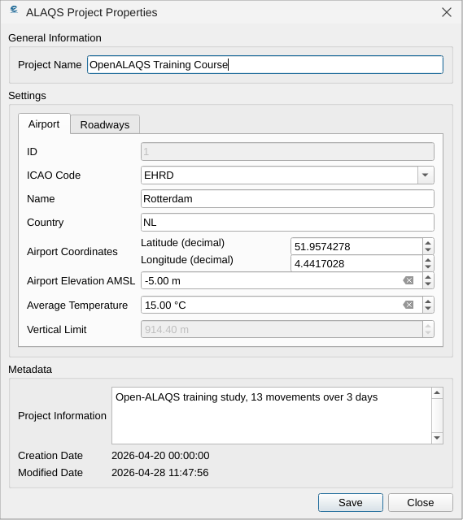
  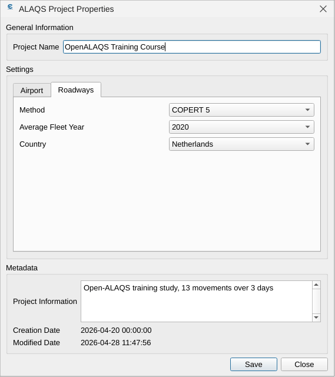
</p>

The **Vertical Limit** field of the `Airport` tab is greyed out because it is not used: the LTO ceiling of each hour is the mixing height of the meteo file, or 914.4 m when there is none (see [LTO ceiling](../methods/AIRCRAFT_EMISSIONS.md#lto-ceiling-and-segment-clipping)).

The `Roadways` tab holds the settings for road traffic emissions with [COPERT](https://copert.emisia.com/): the average fleet year (1990 to 2030 in steps of 5) and the country for country-specific emission factors (or EU27). The fleet year stands for the average age of the fleet, and so for its mix of Euro 1 to Euro 6 vehicle standards.

**Airport Study Setup** opens the same window later.

### Open an existing study

Click **Load an Open ALAQS project** and select the study file (`.alaqs`) in the window `Open an ALAQS database file`.

### Import OpenStreetMap data

**Import OSM data** creates sources from OpenStreetMap data (runways, taxiways, gates, buildings, roads, ...).

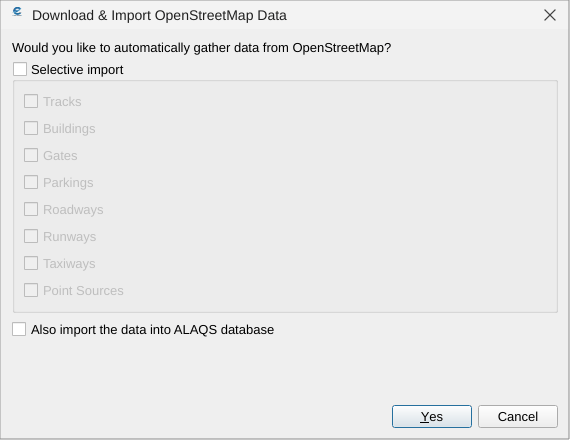

There is no search box: the plugin finds the aerodrome on Nominatim from the study's ICAO code, then downloads its data from OpenStreetMap. In the dialog:

+ **Selective import**: tick it, then tick the layer types to download. When it is not ticked, every layer type is downloaded.
+ **Also import the data into ALAQS database**: tick it to create the features in the study's layers (Runways, Taxiways, Gates, ...). Without it, the data only appear as the layers *OSM Points*, *OSM Lines* and *OSM Polygons* in a group *OpenStreetMap Layers*, for reference.

The study setup must have the airport latitude and longitude. Without them the import does nothing, with no message. The import needs the QuickOSM QGIS plugin; without it, the dialog says so and the import is disabled. The image below shows what can be collected.

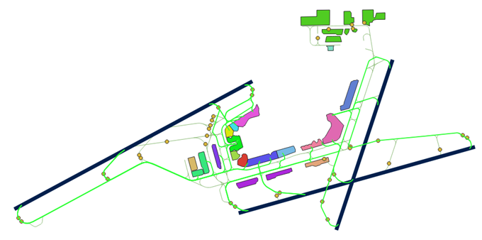

The log reports the number of buildings imported and where their heights come from: the OSM `height` value when the feature has one, else 0 m. With the bundled OSM reader configuration the height is not available, so imported buildings get 0 m; enter the heights by hand.

Gate names come from the OSM `ref` tag of the aprons. When an imported name is already in the Gates layer, or occurs twice in the import, the log warns with the names, for example `OSM import: gate name(s) already in layer "Gates": G7; check and rename before calculating.` The features are imported as they are. Rename or delete the duplicates before calculating (see [Gates](#gates)).

## Define emission sources

### Add, edit and delete features

Draw new features with the QGIS `Digitizing` toolbar.


The [QGIS User Manual](https://docs.qgis.org/3.34/en/docs/user_manual/working_with_vector/editing_geometry_attributes.html#digitizing-an-existing-layer) explains this toolbar.

To create a source, select its layer (for example Taxiways or Runways), click `Toggle Editing`, then `Add Feature`, and draw. Right-click to finish and fill in the form.

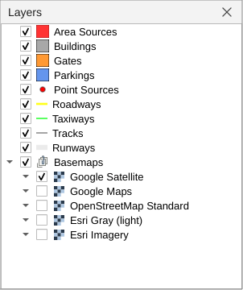

To change a geometry, use the `Vertex Tool` in editing mode. To delete features, select them (`Select Features by area or single click`, or in the attribute table) and click `Delete Selected`.

### Visualize and Edit Attribute Values

You can change the attributes of a feature after it is created, with the `Attributes` toolbar.


`Open Attribute Table` is on the `Attributes` toolbar and in the right-click menu of the layer in the `Layers` panel.

The attribute table uses the field names of the forms and of this guide (for example **Touchdown Offset, Runway 1 [m]** or **Vehicles per Year**). **In Study** is the last column, shown as true / false. On parkings, roadways, point sources and area sources it is also a check box in the form, right under the name: unticked sources are left out of the emission calculation. It is hidden on the other layers, which do not use it. New features start with the form defaults: heights and offsets 0, profiles `default`, **Gate Type** PIER and **In Study** ticked.

### Aircraft related Sources

Aircraft emissions need three layers: runways, taxiways and gates, each with its required attributes. Tracks (custom aircraft trajectories) can be drawn too, but this function is not yet fully implemented.

#### Gates

A gate is where aircraft park for boarding, loading and services (refuelling, catering, maintenance).

In OpenALAQS a gate is a polygon and can hold several aircraft stands. The more stands one gate holds, the less preparation is needed (for example fewer taxi routes). A gate that is too large no longer places the emissions well.

Gate emissions are the sum of four sources: ground support equipment (GSE), ground power unit (GPU), auxiliary power unit (APU) and main engine start (MES).

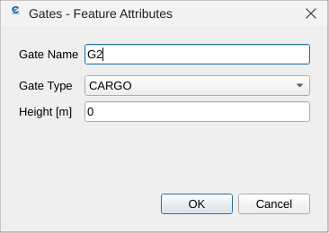

A gate needs:
+ **Gate Name**
+ **Gate Type** (PIER, REMOTE or CARGO). The type selects the GSE and GPU emission factors, together with the aircraft category and the operation (arrival or departure).
+ **Height [m]** (not yet fully implemented)

Gate names should be unique: movements refer to gates by name, and with two gates of the same name the calculation uses only one of them. When another gate already has the name, the form colours the **Gate Name** box yellow and its tooltip says so; the gate can still be saved.

How the gate, APU and engine start emissions are calculated is described in [APU, GSE and engine start](../methods/AIRCRAFT_EMISSIONS.md#apu-gse-and-engine-start).

#### Runways

A runway is a line. It defines the vertical plane of approach, landing, take-off and climb-out. Each end of the runway is a runway direction.

A runway has:
+ **Runway Name**: built from the runway ends chosen in the form (Runway 1 and the opposite Runway 2, for example 06/24).
+ **Touchdown Offset, Runway 1 [m]**: distance from the Runway 1 end (its landing threshold) to the touchdown of arrivals landing on Runway 1. Empty or 0: each arrival profile's own distance, where the profile descends through 50 ft (15.24 m, the ILS reference datum height), about 290 m past the threshold on a 3° approach.
+ **Touchdown Offset, Runway 2 [m]**: the same for Runway 2, independently of Runway 1. Empty or 0: each arrival profile's own distance.

Both offsets are whole metres.

Draw the runway along the full pavement, from one end to the other (the drawing direction does not matter). The touchdown offset is measured from the drawn end: where the landing threshold is displaced, enter the displacement plus about 290 m; otherwise leave it empty (the profile's own 50 ft crossing, about 290 m). A profile that never descends through 50 ft touches down at the drawn end. Departures line up where their taxi route last meets the runway (see below), not at the drawn end.

Each offset is measured from its own landing threshold, along the landing direction, and applies to that direction only: for the same touchdown on both ends, enter the value in both fields.

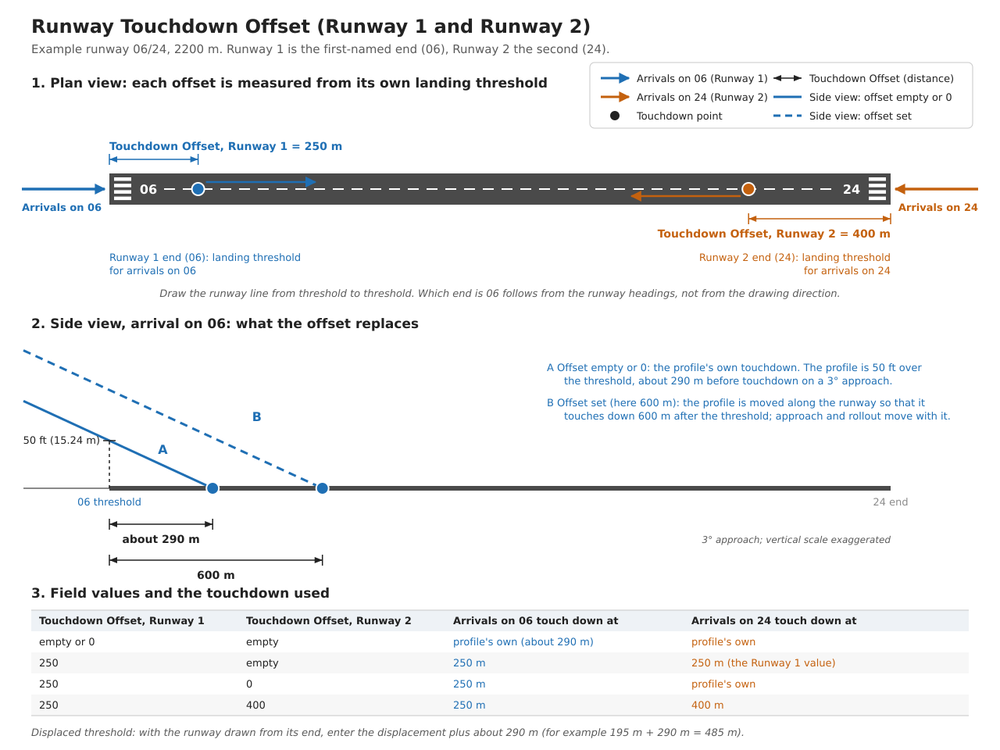

**Placement of the flight profiles on the runway.** The taxi route does not move the flight profile; it is checked against it.
+ Arrivals (ANP profiles) touch down at the landing threshold plus the Touchdown Offset. The aircraft leaves the runway at the first point past the touchdown where its taxi route meets the runway at 50 kt or less (ICAO Doc 9157 Part 2: rapid-exit reference speed); if no crossing is that slow, at the first one past the touchdown. When that exit comes before the end of the profile's rollout, the rollout ends there. When it comes after, the aircraft rolls on along the runway to the exit; that stretch is taxiing (from the rollout-end speed down to at most 18 kt).
+ Departures (ANP profiles) start their take-off roll where the taxi route last meets the runway (the line-up point); a route that runs along the runway (backtracking) lines up where it leaves it.
+ ADS-B profiles keep their own positions.
+ Taxi routes are read in the direction of travel, whichever way round their taxiways are listed (stand to runway or runway to stand); the taxiways must still be listed in sequence: from the stand for a departure, to the stand for an arrival.

Nothing blocks the calculation. An exit above 50 kt, or a route that meets the runway only before the touchdown, is reported in the log. The QGIS-free tool also writes a check report (`runway_checks.csv`), one line per route and profile, with what to change.

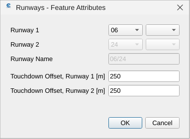

Runways are named after their compass heading, rounded to the nearest 10 degrees. Since a runway can be used in both directions, its two ends have numbers that differ by 18 (180 degrees). Parallel runways add L (Left), C (Center) or R (Right).

Runway emissions follow the flight profiles of the [Aircraft Noise and Performance](https://www.easa.europa.eu/en/domains/environment/policy-support-and-research/aircraft-noise-and-performance-anp-data) (ANP) database, see [Flight profiles](../methods/AIRCRAFT_EMISSIONS.md#flight-profiles-anp).

#### Taxiways

A taxiway connects the runways with the gates and other parts of the airport. A taxiway needs:
+ **Taxiway Name**
+ **Speed [km/h]**

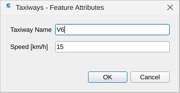

The length comes from the drawn geometry, and the time on the taxiway from its length and speed. Taxi speeds depend on the conditions, the traffic and the position on the route; typical values lie between 10 and 40 km/h (about 5 to 25 kt).

Taxiways are not taxi routes. A taxi route is the path an aircraft follows for one gate, runway and operation (arrival or departure); it is a series of taxiways. See [Taxi routes](#taxi-routes).

#### Tracks

A track is a custom aircraft trajectory. A track needs:
+ **Track Name**
+ **Runway Direction** (from the runways of the study)
+ **Operation Type** (Arrival or Departure)

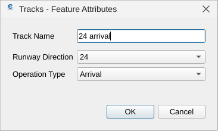

Tracks are not yet used by the calculation. Departure and approach trajectories come from the ANP profiles (column `profile_id` of the [movements file](INPUT_FORMATS.md#movements)). To use observed trajectories instead, give an ADS-B file when you generate the inventory and set the movement's `profile_id` to the ADS-B `flight_id`, see [ADS-B tracks](INPUT_FORMATS.md#ads-b-tracks) and [ADS-B in the emission calculation](../methods/AIRCRAFT_EMISSIONS.md#ads-b).

#### Helicopters (FOCA 2015)

Helicopter movements are in the same movements file as aircraft. Nothing marks a row as a helicopter: when the `aircraft` code is in the helicopter catalog, the movement is calculated as a helicopter, with the FOCA 2015 method and helicopter trajectories, whatever the **Method** chosen. The `aircraft` column takes an ICAO code (the catalog's default variant is used) or a variant label of the catalog.

No APU, GSE, GPU or main engine start emissions are calculated for helicopters, whatever `apu_code` and `gate_emissions_code` say; the gate is only the helipad. The method, the helicopter categories, the catalog and how to add a type are described in [Helicopters](../methods/HELICOPTERS.md).

### Stationary Sources

Besides aircraft, a study can hold point sources, roadways, parking lots, area sources and buildings, each with its required attributes.

#### Parking Lots

Parking emissions are calculated with the COPERT method, see [Road traffic and parkings](../methods/STATIONARY_AND_ROAD.md#road-traffic-and-parkings-copert).

A parking lot needs:
+ **Parking Name**
+ **Parameters**
  + **Vehicles per Year**: total number of vehicles per year
  + **Height [m]**: height at which emissions are released (not yet fully implemented)
  + **Speed [km/h]**: average speed in the parking
  + **Travel Distance [m]**: average distance driven in the parking
  + **Idle Time [min]**: average idling time between entry and exit
+ **Profiles**: **Hourly Profile**, **Daily Profile** and **Monthly Profile** (see [Activity Profiles](#activity-profiles))
+ **Fleet mix**
  + **PC (Petrol) [%]**, **PC (Diesel) [%]**: passenger cars
  + **LCV (Petrol) [%]**, **LCV (Diesel) [%]**: light commercial vehicles
  + **HDT (Petrol) [%]**, **HDT (Diesel) [%]**: heavy duty trucks
  + **Motorcycle [%]**
  + **Bus [%]**

<p align="center">
  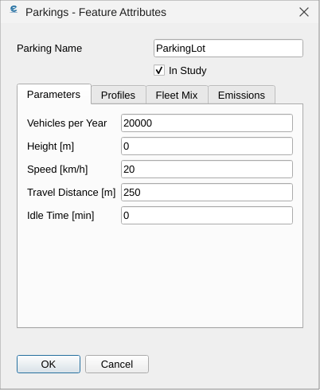
  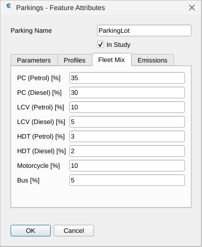
  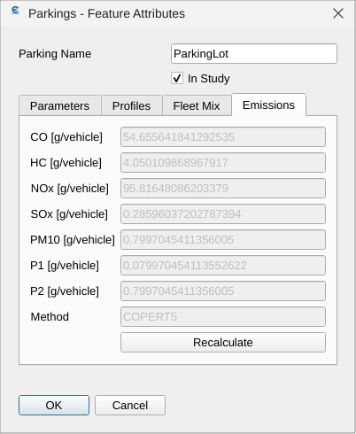
</p>

Make sure the fleet mix adds up to 100 % (`Fleet Mix` tab). Then click `Recalculate` on the `Emissions` tab: it fills in the emission factors (**CO [g/vehicle]**, **HC [g/vehicle]**, **NOx [g/vehicle]**, **SOx [g/vehicle]**, **PM10 [g/vehicle]**, **P1 [g/vehicle]**, **P2 [g/vehicle]**) and **Method** from COPERT, using the parameters above and the fleet year and country of the study setup. These fields cannot be typed.

#### Roadways

Roadway emissions (airside or landside) use the same method as parking lots.

A roadway needs:
+ **Roadway Name**
+ **Parameters**
  + **Vehicles per Year**: number of vehicles per year on the roadway
  + **Height [m]**: height at which emissions are released (not yet fully implemented)
  + **Speed [km/h]**: vehicle speed on the roadway
  + **Scenario**: greyed out (*Not Applicable*); it has no effect.
+ **Profiles**: **Hourly Profile**, **Daily Profile** and **Monthly Profile**
+ **Fleet mix**: as for parking lots

As for parking lots, `Recalculate` fills in the emission factors (**CO [g/km]**, **HC [g/km]**, **NOx [g/km]**, **SOx [g/km]**, **PM10 [g/km]**, **P1 [g/km]**, **P2 [g/km]**).

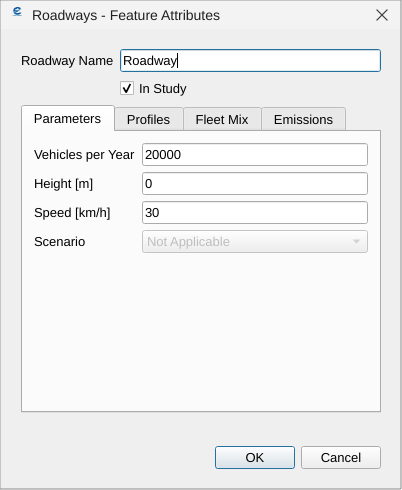

#### Point sources

Point sources are stationary emitters at the airport: power and heating plants, incinerators, training fires, fuel tanks, stationary combustion engines.

A point source needs:
+ **Source Name**
+ **Parameters**
  + **Category**: *Other*, *Incinerator*, *Power/Heat Plant*, *Fuel Tank*, *Solvent Degreaser*, *Surface Coating* or *Stationary IC Engine*.
  + **Type**: the type within the category, for example natural gas, light or heavy fuel oil, JP-4, JP-5, JET A, automobile gasoline, aviation gasoline. The full list is in [`default_stationary_ef`](../../open_alaqs/database/data/default_stationary_ef.csv). For a *Stationary IC Engine*, pick the type that matches the engine's rated power and combustion chamber.
  + **Height [m]**: height at which emissions are released (not yet fully implemented).
  + **Activity per Year**: how much the source runs in one year: throughput, fuel used or hours run.
  + **Activity Unit**: the unit of **Activity per Year**. It is filled in from the selected type when the **Type** changes, and you can change it (the emission factors must then be per that unit). Examples: `1000_m3` (natural gas), `1000_L` (liquid fuel), `hr` (engine hours), `1000_kg` (waste, coating).
  + **Substance**, **Temperature [°C]**, **Diameter [m]**, **Gas Velocity [m/s]**: the state of the release and the stack, filled in from the type. They are stored with the source; neither the emission calculation nor the AUSTAL input uses them.
+ **Profiles**: one **Hourly Profile**, one **Daily Profile** and one **Monthly Profile**, which spread the **Activity per Year** over the year. The type list suggests profile names (for example `business_hours` for stationary engines, `heating_season` for heating plants); see the [example profiles](#activity-profiles) for whether your study has them. Until a suggested profile exists, the source uses the uniform default profile.

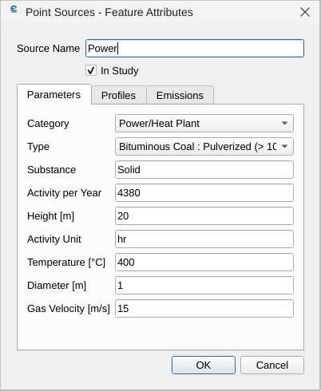

The emission factors (**CO [kg/unit]**, **HC [kg/unit]**, **NOx [kg/unit]**, **SOx [kg/unit]**, **PM10 [kg/unit]**, **P1 [kg/unit]**, **P2 [kg/unit]**) come from the selected type and are in kilograms per **Activity Unit**. What to enter, for example:

| Source | Activity | Activity per Year | Activity Unit |
|---|---|---|---|
| Heating plant on natural gas | 850 000 m³ gas per year | 850 | `1000_m3` |
| Diesel backup generator | 400 operating hours per year | 400 | `hr` |
| Incinerator | 3 200 tonnes of waste per year | 3200 | `1000_kg` |
| Fuel storage tank | 1 800 000 L throughput per year | 1800 | `1000_L` |

The calculation is described in [Point and area sources](../methods/STATIONARY_AND_ROAD.md#point-and-area-sources).

#### Area sources

The area source layer holds sources that the other layers do not cover, when you have their emission factors.

An area source needs:
+ **Source Name**
+ Parameters:
  + **Units per Year**: number of operating hours (units) per year
  + **Height [m]**: height at which emissions are released (not yet fully implemented)
  + **Heat Flux [MW]**: read-only, 0 for new area sources (not yet fully implemented)
+ Emissions: **CO [kg/unit]**, **HC [kg/unit]**, **NOx [kg/unit]**, **SOx [kg/unit]**, **PM10 [kg/unit]**, **P1 [kg/unit]**, **P2 [kg/unit]**
+ Profiles: **Hourly Profile**, **Daily Profile** and **Monthly Profile** (default or your own)

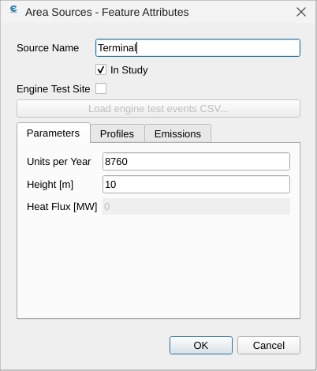

The yearly emission is the emission factor times **Units per Year**, spread over the year by the profiles (see [Point and area sources](../methods/STATIONARY_AND_ROAD.md#point-and-area-sources)).

**P1** and **P2** are two extra pollutants you can define. For aircraft, P1 and P2 stand for PM1.0 and PM2.5 and are currently equal to PM10 (see [PM10 output columns](#pm10-output-columns)).

The form also has an **Engine Test Site** check box, see the next section.

#### Engine test sites

An engine test site (run-up pad) is an area source whose emissions come from a list of engine test events, not from emission factors and profiles. Each event gives a start and end time, the aircraft type and engine, and the running time in each engine mode.

**Setup:**

1. Draw an area source covering the run-up pad. Fill in the name and height as for an area source.
2. In the source's form, tick **Engine Test Site**. **Units per Year** and the Emissions and Profiles tabs gray out: they are not used for test sites. Only **Source Name** and **Height [m]** are required.
3. Prepare a CSV of events, one row per engine run, see [Engine test events](INPUT_FORMATS.md#engine-test-events). One file can hold the events of several test sites.
4. Load the events, in one of two ways:
   * **From the source form:** click **Load engine test events CSV...** (enabled only when **Engine Test Site** is ticked). Select the file, review the summary, pick the insert mode (`Append` or `Replace`), tick "Tolerate warnings" if needed, and click Apply. Only the rows for this source are loaded; the summary counts the others ("Rows for other sources: n (skipped; not for this source)").
   * **From a terminal**, for scripting or several sites at once: run `python scripts/import_engine_test_events.py study.alaqs events.csv` without `--apply` first to check the file, then with `--apply`. See [`scripts/README.md`](../../scripts/README.md#import_engine_test_eventspy).
5. Save the form (OK). Then generate the emission inventory again. Test site emissions appear with the other sources (as `EngineTestSource`).

A study made before engine test sites existed needs the migration script first, otherwise the check box has nowhere to save; see [Upgrading from 5.3.x](UPGRADING.md#upgrading-from-53x). Close and reopen the study after the migration.

By default each event uses the ICAO emission indices of each engine mode, with no ambient correction; other thrust modes cannot be set from the CSV. The calculation is described in [Engine test sites](../methods/STATIONARY_AND_ROAD.md#engine-test-sites).

#### Buildings

Buildings are not emission sources, but they affect the wind and turbulence and so the dispersion. They are in the layer list for future use (not yet fully implemented).

A building needs:
+ **Building Name**
+ **Height [m]**: height of the building above ground (not yet fully implemented)

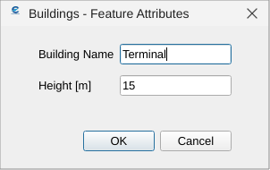

## Activity Profiles

Activity profiles describe how a source's activity varies by hour of the day, day of the week and month. **Edit profiles** opens the window `Open ALAQS - Activity Profiles`, where you review, edit and create profiles.

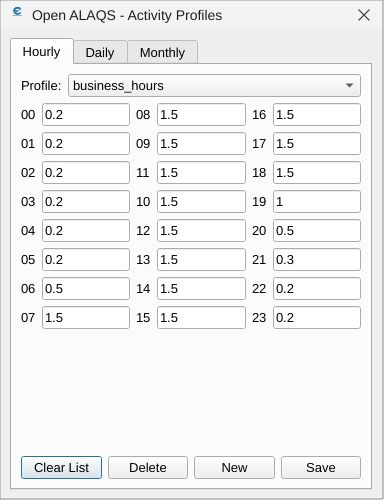

Profiles are relative shapes. Each value is a non-negative number; only the ratios between the values of a profile matter, and values above 1 are allowed. The default profiles are all 1 (uniform). Whatever the shapes, the source's annual total stays the same: the profiles only spread it over the year.

So a 0 in a profile (for example a night curfew) moves that period's emissions to the other periods; it does not lower the annual total. To lower the total, lower **Activity per Year** or **Units per Year**. A profile that is 0 everywhere gives no emissions at all. The calculation is described in [Point and area sources](../methods/STATIONARY_AND_ROAD.md#point-and-area-sources).

**Example profiles.** The type list of point sources suggests the names `heating_season`, `cooling_season` and `business_hours`. A new study does not have them: create them with **Edit profiles**. A study updated with the migration script ([Upgrading from 5.3.x](UPGRADING.md#upgrading-from-53x)) already has them, with the values below (1.0 where nothing is listed). They are a starting point for a temperate European airport, not reference data; adapt them to the site.

**`heating_season`**: month profile, winter-weighted (peaks in January, February and December):

```
Jan=2.0, Feb=1.8, Mar=1.4, Apr=0.7, May=0.3, Jun=0.1,
Jul=0.05, Aug=0.05, Sep=0.3, Oct=0.8, Nov=1.5, Dec=1.9
```

**`cooling_season`**: month profile, summer-weighted (peaks in July and August), with a daytime hour profile:

```
Jan=0.2, Feb=0.2, Mar=0.3, Apr=0.5, May=0.9, Jun=1.4,
Jul=1.8, Aug=1.8, Sep=1.2, Oct=0.6, Nov=0.3, Dec=0.2

h01=0.4, h02-h05=0.3, h06=0.4, h07=0.6, h08=0.8, h09=1.0, h10=1.2, h11=1.4, h12=1.6,
h13=1.8, h14-h16=2.0, h17=1.8, h18=1.5, h19=1.2, h20=1.0, h21=0.8, h22=0.6, h23=0.5, h24=0.4
```

**`business_hours`**: one hour profile and one day profile with the same name:

- Hour profile: h01 to h06 = 0.2, h07 = 0.5, h08 to h19 = 1.5, h20 = 1.0, h21 = 0.5, h22 = 0.3, h23 to h24 = 0.2.
- Day profile: 1.2 for Monday to Friday, 0.4 for Saturday and Sunday.

**Example combinations:**

| Source type | Month profile | Day profile | Hour profile | Resulting timing |
|---|---|---|---|---|
| Heating plant | `heating_season` | `default` | `default` | Mostly in winter; uniform within each day. |
| Stationary IC engine | `default` | `business_hours` | `business_hours` | Year-round, mostly on weekdays from h08 to h19 (nights and weekends keep a small share). |
| Cooling tower | `cooling_season` | `default` | `business_hours` | Summer daytime, every day. |

## Generate Emissions Inventory

This section covers the steps that prepare the emission inventory.

### Taxi routes

A taxi route is the path of an aircraft between the runway and the gate (see [Taxiways](#taxiways)). Define the routes in the `Taxiway Routes Editor` (button **Define taxi routes**).

<p align="center">
  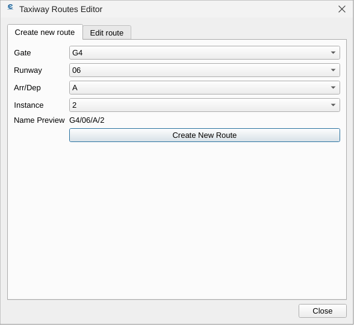
  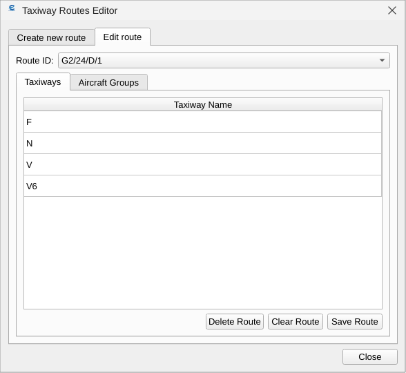
</p>

The editor has two tabs. In **Create new route**, select the gate, the runway and the operation (arrival or departure) to create the route. Several routes can exist for the same gate, runway and operation, with different instance numbers. In **Edit route**, pick the route in **Route ID**, then list its taxiways, in order, in the **Taxiways** tab and the aircraft groups that may use it in the **Aircraft Groups** tab, and click **Save Route**. The route name (for example `G4/24/A/1`) is what the movements file refers to. The [tutorial](TUTORIAL_ROTTERDAM.md#taxi-routes) shows an example.

### Calculate Emissions Inventory window

Before calculating emissions, generate the inventory file. It holds all elements of the study (sources, routes, profiles) and the reference data (emission factors, profiles).

**Calculate Emissions Inventory** opens the window `Generate Emission Inventory`:
+ **Emission Inventory Output**:
  + **Directory**: the folder of the output file
  + **File Name**: the name of the output file, without extension: the plugin adds `_out.alaqs` (`training` gives `training_out.alaqs`)
+ **ADS-B Data (Optional)**:
  + **ADS-B Table**: a file of observed flight tracks (see [ADS-B tracks](INPUT_FORMATS.md#ads-b-tracks)). It is checked when you select it; the line below the field says whether it is valid, how many flights it holds, and any warnings. A movement uses an ADS-B track when its `profile_id` is the track's `flight_id`.
+ **Movement Data**:
  + **Movements Table**: the movements file, semicolon-separated (see [Movements](INPUT_FORMATS.md#movements)). The file is checked when you select it; the summary shows the number of movements and their period.
  + **Filter Start Date**, **Filter End Date**: limit the movements to a period. They are filled from the movements file.
+ **Meteorological Data**:
  + **Meteorological Table**: the hourly meteo file: temperature, pressure, humidity, wind, stability and mixing height, from local or national providers (METAR, SYNOP) or reanalysis data. They are used by BFFM2, by the NOx correction, for the mixing height (the LTO ceiling of each hour) and for dispersion. The file is optional; columns and what happens without it: [Meteorology](INPUT_FORMATS.md#meteorology). To convert METAR reports, use [`scripts/metar_to_alaqs_meteo.py`](../../scripts/README_metar_to_alaqs_meteo.md).
+ **Modelled Domain**:
  + **X Resolution**: cell size and number of cells along X; default 250 m and 50 cells.
  + **Y Resolution**: the same along Y; default 250 m and 50 cells.
  + **Z Resolution**: the same in height; default 50 m and 20 cells.

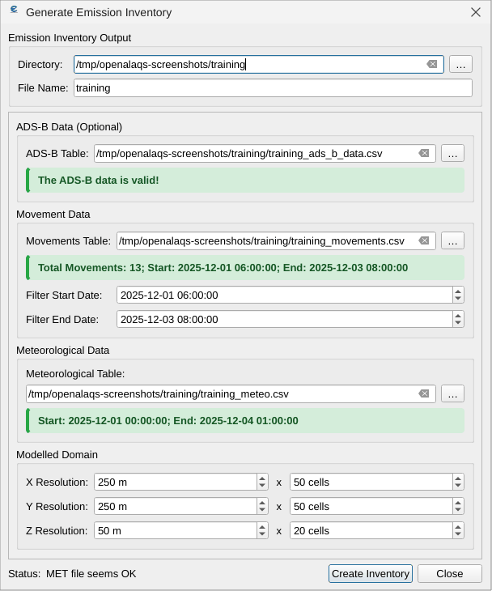

Click **Create Inventory** to write the inventory file (`<File Name>_out.alaqs` in the chosen folder); **Close** closes the window.

## Calculate emissions and query results

**Visualize Emission Calculation** opens the window where the emissions are calculated and shown. You can browse all source types and names. Aircraft emissions (gates, taxiways and runways) are grouped under `MovementSource`.

The settings panel at the bottom left holds the calculation settings, the output formats and the dispersion settings.

On the **Configuration** tab:
+ **Start (incl.)** / **End (incl.)**: the calculation period (optional).
+ **Method**: `bymode` or `BFFM2`.
  + `bymode` uses the ICAO emission indices of each engine mode (take-off, climb-out, approach, taxi) with the time in each mode. Simple and fast.
  + `BFFM2` (Boeing Fuel Flow Method 2) derives the emission indices from the fuel flow of each profile segment and corrects them for the ambient conditions. It applies to CO, HC and NOx only. It usually gives less NOx than `bymode`. See [Methods](../methods/AIRCRAFT_EMISSIONS.md#methods) and [BFFM2](../methods/AIRCRAFT_EMISSIONS.md#bffm2).

  `BFFM2` is offered only while the selected pollutant is CO, HC or NOx. Selecting another pollutant shows **Method** as `bymode`; selecting CO, HC or NOx again brings back `BFFM2` if you had chosen it.
+ **Apply NOx Corrections**: corrects the `bymode` NOx of take-off and climb-out for ambient temperature, humidity and aircraft weight (`tow_ratio` of the movements). No effect with BFFM2, which corrects for the ambient conditions itself. See [NOx ambient correction](../methods/AIRCRAFT_EMISSIONS.md#nox-ambient-correction).
+ **BFFM2 Fuel-Flow Source** (BFFM2 only): `trajectory` (default) takes the fuel flow from each segment's power setting, or from the ADS-B track when it has one; `mode_anchor` takes the ICAO fuel flow of the segment's engine mode and ignores ADS-B fuel flows. The emission indices are corrected for the ambient conditions with both. Taxi uses the fuel flow at the taxi thrust with both. See [Fuel-flow sources](../methods/AIRCRAFT_EMISSIONS.md#fuel-flow-sources).
+ **Atmosphere Aloft**: the temperature, pressure and humidity used at each flight segment's height, from the hourly meteo.
  + `standard_lapse` (default): the ground values carried up with the ISA lapse rate.
  + `surface_layer`: the AUSTAL boundary-layer temperature profile, from the hour's wind and stability and the site parameters of the Dispersion Models tab. It is not more accurate than `standard_lapse`.
  + `ground_held`: the hourly ground values at every height.

  See [Ambient conditions aloft](../methods/ATMOSPHERE_ALOFT.md).
+ **Source Dynamics**: `none` (default), `default` or `smooth & shift`. The last two spread each trajectory segment into a volume before it enters the emission grid, to account for engine exhaust momentum, plume rise and near-field mixing. See [Source dynamics](../methods/STATIONARY_AND_ROAD.md#source-dynamics-smooth-and-shift).
+ **Time Interval**: the time step of the calculation (default 1 hour).
+ **Vertical Limit**: greyed out, because it does not change the result. The LTO ceiling of each hour is the mixing height of the meteo file, or 914.4 m when there is none (see [LTO ceiling](../methods/AIRCRAFT_EMISSIONS.md#lto-ceiling-and-segment-clipping)).
+ **Receptor Points**: a file of receptor points for the AUSTAL module of the Dispersion Models tab (optional, see [Receptor points](INPUT_FORMATS.md#receptor-points)).

Changing any setting discards the previous calculation. It is calculated again when you next ask for an output (**View Emissions Table**, **Plot Time Series**, **Plot Vector Layer**).

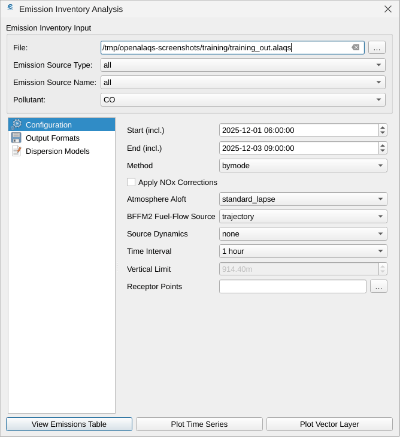

On the **Output Formats** tab:
+ **Emissions table**: how the table is aggregated (by aggregation, by source or by grid cell)
+ **Time Series**: x-axis title, marker and receptor points
+ **Vector Layer**: settings for the map of results on the grid

The **Dispersion Models** tab holds the AUSTAL settings, see [Dispersion](#dispersion).

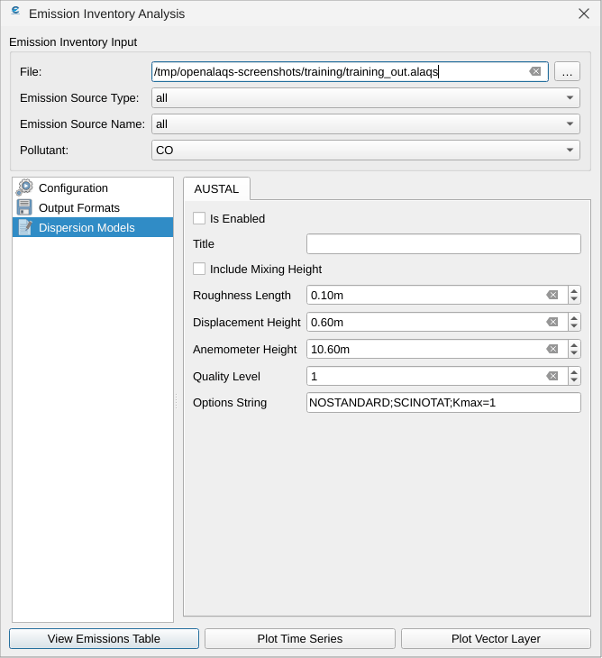

There are three ways to see the emissions:
+ as a table (**View Emissions Table**)
+ as a time series (**Plot Time Series**)
+ on the grid (**Plot Vector Layer**)

### PM10 output columns

For aircraft movements, the emission output has these particulate matter columns:

| Column | Contents |
|---|---|
| `pm10_kg` | Total PM10: combustion PM10, plus brake wear for arrivals |
| `pm10_nonvol_kg` | Non-volatile PM (nvPM mass) |
| `pm10_sul_kg` | Sulphate volatile PM |
| `pm10_organic_kg` | Organic volatile PM |
| `p1_kg` | PM1.0 placeholder; currently equal to `pm10_kg` |
| `p2_kg` | PM2.5 placeholder; currently equal to `pm10_kg` |

For departures, `pm10_kg` is the sum of the three sub-components. For arrivals it also holds the brake wear, which shows as a surplus over that sum on the first taxi segment. How each column is calculated is described in [Particulate matter](../methods/AIRCRAFT_EMISSIONS.md#particulate-matter).

## Dispersion

OpenALAQS prepares the input files of the AUSTAL dispersion model from the emission inventory, runs AUSTAL and shows the concentrations. The AUSTAL settings of the **Visualize Emission Calculation** window are on the [Dispersion Models tab](DISPERSION_AUSTAL.md#dispersion-models-tab), including the site parameters roughness length, displacement height and anemometer height ([how to choose them](DISPERSION_AUSTAL.md#site-parameters)). The **Calculate Dispersion** button opens the [Calculate Dispersion dialog](DISPERSION_AUSTAL.md#calculate-dispersion-dialog), which generates the AUSTAL input files and runs AUSTAL. The concentration maps, time series at receptors and the compliance report are described in [Results](DISPERSION_AUSTAL.md#results). AUSTAL itself is installed separately, see [AUSTAL installation](../AUSTAL/AUSTAL.md#installation).

## See also

- [Input file formats](INPUT_FORMATS.md): movements, meteo, ADS-B, engine test events and receptor files.
- [Tutorial with the Rotterdam training data](TUTORIAL_ROTTERDAM.md): a full study, step by step.
- [Dispersion with AUSTAL](DISPERSION_AUSTAL.md): concentrations from the inventory.
- [Upgrading](UPGRADING.md): opening a study made with an earlier version.
